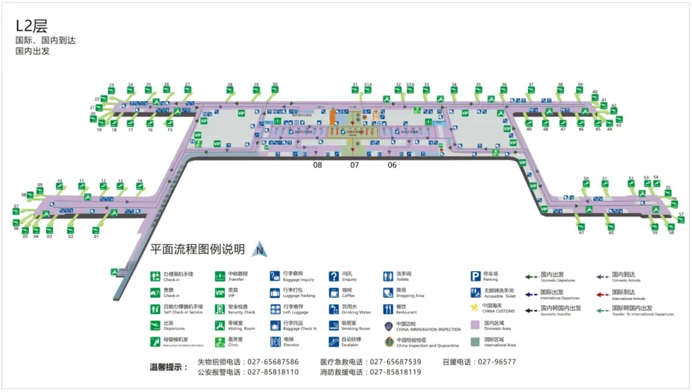
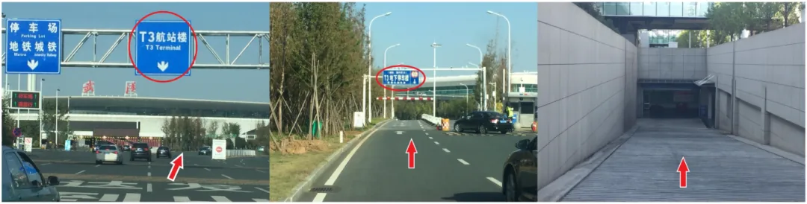
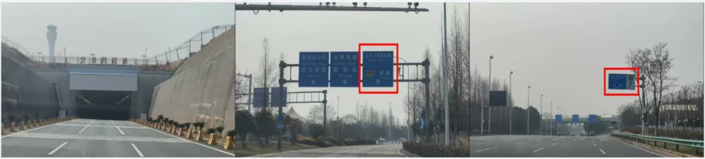
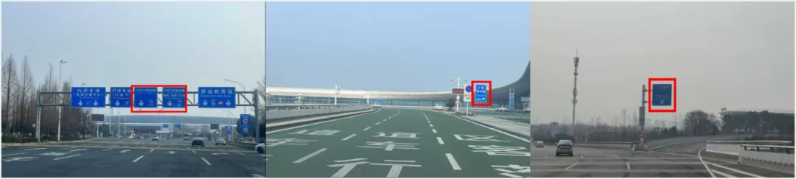

Dengan berakhirnya liburan musim panas yang bersamaan dengan arus balik, Bandara Internasional Wuhan Tianhe sedang berada di puncak kesibukannya. Panduan ini membahas detail praktis Terminal 2 dan 3 dalam empat bagian — **keberangkatan domestik**, **kedatangan domestik**, **cara menuju dan meninggalkan bandara**, dan **parkir**.

Tianhe memiliki dua terminal yang beroperasi: **Terminal 3** (keberangkatan di lantai 4, kedatangan di lantai 2) dan **Terminal 2** (keberangkatan di lantai 2, kedatangan di lantai 1). Periksa terminal yang digunakan penerbangan Anda sebelum berangkat; **Rute Bandara 3** melayani antar-jemput antara keduanya. Denah terminal dan diagram rute parkir di sini berasal dari situs resmi bandara.

## 1. Keberangkatan domestik

### Terminal 3

1. **Tiba di terminal.** Datang 2 jam lebih awal dan konfirmasikan terminal Anda dengan maskapai. Lantai 4 adalah lantai keberangkatan di Terminal 3.
2. **Check-in dan serahkan bagasi.** Pulau check-in E, F, J, dan K melayani check-in dan bagasi. Check-in ditutup **30 menit** sebelum keberangkatan, jadi sediakan waktu yang cukup. Check-in mandiri dan penyerahan bagasi mandiri tersedia, tetapi check-in online sebelumnya adalah ide yang baik.
3. **Keamanan.** Siapkan boarding pass dan KTP atau paspor Anda untuk petugas keamanan.
4. **Tunggu dan naik pesawat.** Ikuti layar informasi penerbangan dan tanda petunjuk, dan sudah berada di gerbang Anda **30–40 menit** sebelum keberangkatan.

### Terminal 2

1. **Tiba di terminal.** Datang 2 jam lebih awal dan konfirmasikan terminal Anda dengan maskapai. Lantai 2 adalah lantai keberangkatan di Terminal 2.
2. **Check-in dan serahkan bagasi.** Pulau check-in A dan B melayani check-in dan bagasi. Check-in ditutup **30 menit** sebelum keberangkatan, jadi sediakan waktu yang cukup. Check-in mandiri dan penyerahan bagasi mandiri tersedia, tetapi check-in online sebelumnya adalah ide yang baik.
3. **Keamanan.** Siapkan boarding pass dan KTP atau paspor Anda untuk petugas keamanan.
4. **Tunggu dan naik pesawat.** Ikuti layar informasi penerbangan dan tanda petunjuk, dan sudah berada di gerbang Anda **30–40 menit** sebelum keberangkatan.

## 2. Kedatangan domestik

### Terminal 3

1. **Kedatangan.** Jika seseorang menjemput Anda, beri tahu mereka sebelumnya terminal kedatangan penerbangan Anda. Lantai 2 adalah lantai kedatangan di Terminal 3.
2. **Ambil bagasi Anda.** Temukan carousel untuk penerbangan Anda di layar informasi. Untuk mencegah bagasi tertukar, petugas mungkin memeriksa tag bagasi terhadap barcode di tiket Anda, jadi simpan bukti bagasi Anda dan bekerja samalah.
3. **Meninggalkan bandara.** Demi keselamatan dan keamanan Anda, jangan menerima layanan dari siapa pun tanpa ID bandara resmi di luar area terbatas, dan jangan menggunakan tumpangan dari pengemudi tidak resmi yang menawarkan jasa.

### Terminal 2

1. **Kedatangan.** Jika seseorang menjemput Anda, beri tahu mereka sebelumnya terminal kedatangan penerbangan Anda. Lantai 1 adalah lantai kedatangan di Terminal 2.
2. **Ambil bagasi Anda.** Temukan carousel untuk penerbangan Anda di layar informasi, dan bekerja samalah dengan pemeriksaan acak dengan cara yang sama.
3. **Meninggalkan bandara.** Jangan menerima layanan dari siapa pun tanpa ID bandara resmi di luar area terbatas, dan jangan menggunakan tumpangan tidak resmi.

## 3. Cara menuju dan meninggalkan bandara

Transportasi darat di Tianhe dibangun di sekitar **bus bandara**, **Metro Jalur 2**, **Rute Bandara 3**, dan **stasiun kereta**. Setiap penghubung antara kedua terminal, dan antara terminal dengan Transport Centre, diberi tanda petunjuk.

### Bus bandara

- **Jam operasional:** 08.30 setiap hari hingga penerbangan terakhir; pesan online melalui mini-program “天河畅行” (Tianhe Changxing).
- **Frekuensi:** setiap 30 menit, hingga penerbangan terakhir.
- **Pembelian tiket di loket:** Terminal 2, lantai 1, gerbang 9 sampai 10; Terminal 3, di dalam gerbang 12.
- **Layanan pelanggan:** 13387631827

| Rute | Halte (tarif) |
| --- | --- |
| Jalur 1 | T3 / T2 → Yuanboyuan North (metro, ¥10) → kawasan hunian Minhang (¥10) → Stasiun Kereta Hankou (¥12) → CBD Wealth Centre, Fanhu (¥12) → Qingnian Road (¥12) → Guqintai (¥15) → Shouyi Square (¥18) → Stasiun Kereta Wuchang (¥20) → Wushang Dream Plaza (¥20; tiket untuk halte ini mulai dijual pukul 21.30) |
| Jalur 2 | T3 / T2 → Yangchahu (¥10) → Jinqiao Aeon (¥10) → Jalan Huangpu / Jalan Gongnongbing (¥12) → Pusat Perbelanjaan Xudong (¥15) → Yuejiazui (¥15) → Dongting (¥18) → Jalan Chuhe Han (¥20) → Alun-alun Hongshan (¥20) → Stasiun Kereta Wuhan (¥45) |
| Penghubung udara-rel | Bandara Internasional Wuhan Tianhe ⇄ Stasiun Kereta Wuhan, tanpa henti dan gratis (sementara, 09.25–17.55); titik pembelian tiket dan naik yang sama dengan bus bandara |

### Bus jarak jauh

Hubungi saluran layanan pelanggan untuk waktu keberangkatan dan rute; penjualan di loket adalah jadwal yang definitif. Tiket dibeli di tempat yang sama dengan bus bandara (Terminal 2, lantai 1, gerbang 9 sampai 10; Terminal 3, di dalam gerbang 12), melalui 13387631827.

### Metro Jalur 2

- **Jam operasional:** 06.00–23.00 pada hari kerja, 06.30–23.00 pada hari libur nasional; kereta setiap 5–8 menit.
- Pengumuman resmi Wuhan Metro adalah yang definitif.

Rute menuju dan dari bandara:

- **Ke keberangkatan T3:** Metro Jalur 2 ke Stasiun Bandara Tianhe → keluar B → Transport Centre lantai 2, koridor penghubung 1, 2, dan 3 → Terminal 3, aula keberangkatan lantai 4.
- **Dari kedatangan T3:** Aula kedatangan Terminal 3 lantai 2 → gerbang 6, 7, dan 8 di lantai 2 → pintu keluar B metro → Metro Jalur 2.
- **Ke keberangkatan T2:** Metro Jalur 2 ke Stasiun Bandara Tianhe → keluar B → Transport Centre lantai 2, koridor penghubung 1, 2, dan 3 → di luar gerbang 12 Terminal 3 → pindah ke Rute Bandara 3 → gerbang 7 Terminal 2 → aula keberangkatan lantai 2.
- **Dari kedatangan T2:** Aula kedatangan Terminal 2 lantai 1 → halte di gerbang 10 lantai 1 → pindah ke Rute Bandara 3 → gerbang 12 Terminal 3 → Transport Centre lantai 2, koridor penghubung 1, 2, dan 3 → pintu keluar B metro → Metro Jalur 2.

### Rute Bandara 3 (antar-jemput terminal)

- **Halte:** Gerbang 12 Terminal 3 (turun dan naik) → Terminal 2, lantai 1, gerbang 7 (turun) → Terminal 2, lantai 1, gerbang 10 (naik) → Gerbang 12 Terminal 3 (turun dan naik).
- **Frekuensi:** kira-kira setiap 5 menit.
- **Jam operasional:** 06.00–23.00.

### Kereta

Kereta dari Stasiun Bandara Tianhe berhenti di Stasiun Hankou dan Wuchang di Wuhan serta di beberapa kota di seluruh provinsi; pengumuman resmi operator kereta adalah yang definitif.

- **Ke keberangkatan T3:** Tiba di Stasiun Bandara Tianhe → keluar C → Transport Centre lantai 2, koridor penghubung 1, 2, dan 3 → Terminal 3, aula keberangkatan lantai 4.
- **Dari kedatangan T3:** Aula kedatangan Terminal 3 lantai 2 → gerbang 6, 7, dan 8 di lantai 2 → keluar C → Stasiun Bandara Tianhe.
- **Ke keberangkatan T2:** Tiba di Stasiun Bandara Tianhe → keluar B metro → Transport Centre lantai 2, koridor penghubung 1, 2, dan 3 → di luar gerbang 12 Terminal 3 → pindah ke Rute Bandara 3 → gerbang 7 Terminal 2 → aula keberangkatan lantai 2.
- **Dari kedatangan T2:** Aula kedatangan Terminal 2 lantai 1 → halte di gerbang 10 lantai 1 → pindah ke Rute Bandara 3 → gerbang 12 Terminal 3 → Transport Centre lantai 2, koridor penghubung 1, 2, dan 3 → keluar C → Stasiun Bandara Tianhe.

### Berkendara

**Dari kota**

| Tujuan | Rute |
| --- | --- |
| Menurunkan penumpang di T2 | Lurus di sepanjang Konggang Avenue, tetap di kanan ke jalur tanjakan Terminal 2 dan masuk ke jalan lingkar Terminal 2, tetap di kanan naik ke viaduk dan turunkan penumpang di lantai keberangkatan Terminal 2 |
| Parkir di T2 | Lurus di sepanjang Konggang Avenue, tetap di kanan ke jalur tanjakan Terminal 2 dan masuk ke jalan lingkar Terminal 2, tetap di kiri masuk ke P1 (parkir permukaan Terminal 2) atau P2 (parkir bawah tanah Terminal 2) |
| Menurunkan penumpang di T3 | Lurus di sepanjang Konggang Avenue, tetap di kanan ke jalur flyover Terminal 3 dan turunkan penumpang di lantai keberangkatan Terminal 3 |
| Parkir di T3 | Lurus di sepanjang Konggang Avenue, lalu lajur tengah masuk ke P7 (parkir bawah tanah Terminal 3) |
| Parkir Transport Centre | Lurus di sepanjang Konggang Avenue, lalu lajur kiri masuk ke P6 (parkir Transport Centre) |
| Kompleks layanan penumpang (Crowne Plaza, Holiday Inn) | Lurus di sepanjang Konggang Avenue, tetap di kanan ke jalur tanjakan Terminal 2 dan masuk ke jalan lingkar Terminal 2, tetap di kiri masuk ke P2 (parkir bawah tanah Terminal 2) |

**Dari Huangpi**

| Tujuan | Rute |
| --- | --- |
| Menurunkan penumpang di T2 | Lurus di sepanjang Konggang Avenue masuk ke Terowongan Konggang, tetap di kanan keluar dari terowongan ke jalur tanjakan dan putar balik, naik ke lantai keberangkatan Terminal 3, tetap di kanan ke jembatan penghubung antara Terminal 3 dan 2, dan turunkan penumpang di lantai keberangkatan Terminal 2 |
| Parkir di T2 | Lurus di sepanjang Konggang Avenue masuk ke Terowongan Konggang, tetap di kanan keluar dari terowongan ke jalur tanjakan dan putar balik, naik ke lantai keberangkatan Terminal 3, tetap di kanan ke jembatan penghubung antara Terminal 3 dan 2, ikuti jalan lingkar Terminal 2 dan tetap di kiri masuk ke P1 atau P2 |
| Menurunkan penumpang di T3 | Lurus di sepanjang Konggang Avenue masuk ke Terowongan Konggang, tetap di kanan keluar dari terowongan ke jalur tanjakan dan putar balik naik ke lantai keberangkatan Terminal 3, dan turunkan penumpang di sana |
| Parkir di T3 | Lurus di sepanjang Konggang Avenue masuk ke Terowongan Konggang, tetap di kanan keluar dari terowongan ke jalur tanjakan dan putar balik ke Konggang Avenue, lalu lajur tengah masuk ke P7 (parkir bawah tanah Terminal 3) |
| Parkir Transport Centre | Lurus di sepanjang Konggang Avenue masuk ke Terowongan Konggang, tetap di kanan keluar dari terowongan ke jalur tanjakan dan putar balik ke Konggang Avenue, lalu lajur kiri masuk ke P6 (parkir Transport Centre) |
| Kompleks layanan penumpang (Crowne Plaza, Holiday Inn) | Lurus di sepanjang Konggang Avenue masuk ke Terowongan Konggang, tetap di kanan keluar dari terowongan ke jalur tanjakan dan putar balik, naik ke lantai keberangkatan Terminal 3, tetap di kanan ke jembatan penghubung antara Terminal 3 dan 2, ikuti jalan lingkar Terminal 2 dan tetap di kiri masuk ke P2 |

### Taksi

- **Terminal 2:** di luar gerbang 7 di lantai 1; antre di pangkalan taksi.
- **Terminal 3:** di luar gerbang 12 di lantai 1; antre di pangkalan taksi.

### Ride-hailing

- **Terminal 2:** aula kedatangan lantai 1 → gerbang 9 di lantai 1 → jemput di P1 (parkir permukaan Terminal 2) → pusat kota Wuhan.
- **Terminal 3:** aula kedatangan lantai 2 → gerbang 6, 7, dan 8 di lantai 2 → titik penjemputan ride-hailing di Transport Centre lantai 1 → pusat kota Wuhan.

## 4. Parkir

### Terminal 3

**1. Parkir bawah tanah (P7)**

S19 / S18 → Konggang Avenue → parkir bawah tanah T3 → Terminal 3, aula keberangkatan lantai 4 (sekitar 5 menit berjalan kaki).

549 tempat di lantai B1 dan B2, hanya untuk mobil kecil.

**2. Parkir Transport Centre (P6)**

S19 / S18 → Konggang Avenue → parkir Transport Centre → Transport Centre lantai 2, koridor penghubung 1, 2, dan 3 → Terminal 3, gerbang 8, 7, dan 6 di lantai 2 → Terminal 3, aula keberangkatan lantai 4 (sekitar 10 menit berjalan kaki).

3.300 tempat di seluruh lantai B1, lantai dasar, dan lantai dasar 2.

### Terminal 2

**1. Dari kota**

Lurus di sepanjang Konggang Avenue, tetap di kanan ke jalur tanjakan Terminal 2 dan masuk ke jalan lingkar Terminal 2.

**Ke P1 (parkir permukaan Terminal 2):** ikuti jalan lingkar Terminal 2 dan tetap di kiri masuk ke P1.

**Ke P2 (parkir bawah tanah Terminal 2):** ikuti jalan lingkar Terminal 2 dan tetap di kiri masuk ke P2.

**2. Dari Huangpi**

Lurus di sepanjang Konggang Avenue masuk ke Terowongan Konggang, tetap di kanan keluar dari terowongan ke jalur tanjakan dan putar balik, naik ke lantai keberangkatan Terminal 3, lalu tetap di kanan ke jembatan penghubung antara Terminal 3 dan 2.

**Ke P1 (parkir permukaan Terminal 2):** ikuti jalan lingkar Terminal 2 dan tetap di kiri masuk ke P1.

**Ke P2 (parkir bawah tanah Terminal 2):** ikuti jalan lingkar Terminal 2 dan tetap di kiri masuk ke P2.

## Tautan terkait

- **Di situs ini**: [Tiongkok (CN)](/country/CN)
- **Wikipedia**: [Bandara Internasional Wuhan Tianhe](https://en.wikipedia.org/wiki/Wuhan_Tianhe_International_Airport)
- **Baidu Baike**: [Bandara Internasional Wuhan Tianhe](https://baike.baidu.com/item/%E6%AD%A6%E6%B1%89%E5%A4%A9%E6%B2%B3%E5%9B%BD%E9%99%85%E6%9C%BA%E5%9C%BA)
