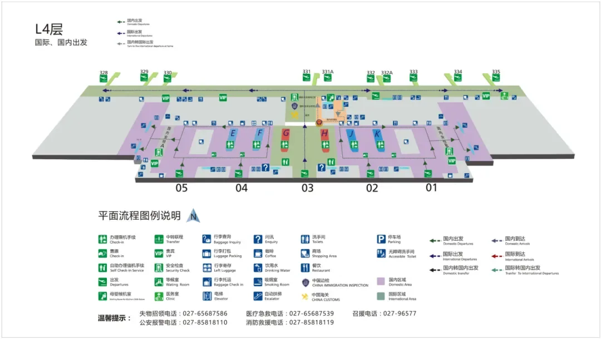

Con la fine delle vacanze estive che si sovrappone al rientro, l'aeroporto internazionale di Wuhan Tianhe è nel suo periodo più trafficato. Questa guida copre i dettagli pratici dei Terminal 2 e 3 in quattro parti: **partenze nazionali**, **arrivi nazionali**, **come raggiungere l'aeroporto e tornarvi** e **parcheggio**.

Tianhe ha due terminal in servizio: il **Terminal 3** (partenze al livello 4, arrivi al livello 2) e il **Terminal 2** (partenze al livello 2, arrivi al livello 1). Controllate quale terminal usa il vostro volo prima di partire; l'**Airport Route 3** fa la spola tra i due. Le piante dei terminal e gli schemi dei percorsi di parcheggio qui riportati provengono dal sito ufficiale dell'aeroporto.

## 1. Partenze nazionali

### Terminal 3

1. **Arrivo in terminal.** Presentatevi 2 ore prima e confermate il terminal con la vostra compagnia. Il livello 4 è il piano partenze del Terminal 3.
2. **Check-in e consegna bagagli.** Le isole check-in E, F, J e K gestiscono check-in e bagagli. Il check-in chiude **30 minuti** prima della partenza, quindi lasciate tempo sufficiente. Sono disponibili check-in e consegna bagagli self-service, ma fare il check-in online in anticipo è una buona idea.
3. **Sicurezza.** Tenete pronti carta d'imbarco e documento o passaporto per l'agente di sicurezza.
4. **Attesa e imbarco.** Seguite i monitor delle informazioni voli e la segnaletica, e siate al gate **30–40 minuti** prima della partenza.

### Terminal 2

1. **Arrivo in terminal.** Presentatevi 2 ore prima e confermate il terminal con la vostra compagnia. Il livello 2 è il piano partenze del Terminal 2.
2. **Check-in e consegna bagagli.** Le isole check-in A e B gestiscono check-in e bagagli. Il check-in chiude **30 minuti** prima della partenza, quindi lasciate tempo sufficiente. Sono disponibili check-in e consegna bagagli self-service, ma fare il check-in online in anticipo è una buona idea.
3. **Sicurezza.** Tenete pronti carta d'imbarco e documento o passaporto per l'agente di sicurezza.
4. **Attesa e imbarco.** Seguite i monitor delle informazioni voli e la segnaletica, e siate al gate **30–40 minuti** prima della partenza.

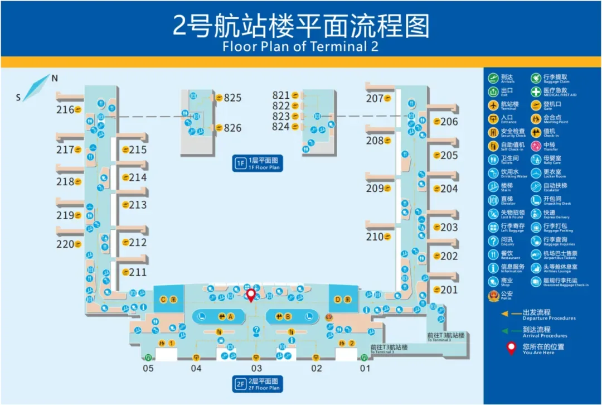

## 2. Arrivi nazionali

### Terminal 3

1. **Arrivo.** Se qualcuno vi viene a prendere, ditegli in anticipo a quale terminal arriva il vostro volo. Il livello 2 è il piano arrivi del Terminal 3.
2. **Ritiro bagagli.** Trovate il nastro del vostro volo sui monitor informativi. Per evitare che i bagagli vengano presi per errore, il personale può controllare a campione il talloncino del bagaglio con il codice a barre sul biglietto, quindi tenete a portata di mano la ricevuta del bagaglio e collaborate.
3. **Uscire dall'aeroporto.** Per la vostra sicurezza, non accettate servizi da chi non ha un tesserino ufficiale dell'aeroporto fuori dall'area riservata e non salite su auto di conducenti abusivi che vi avvicinano.

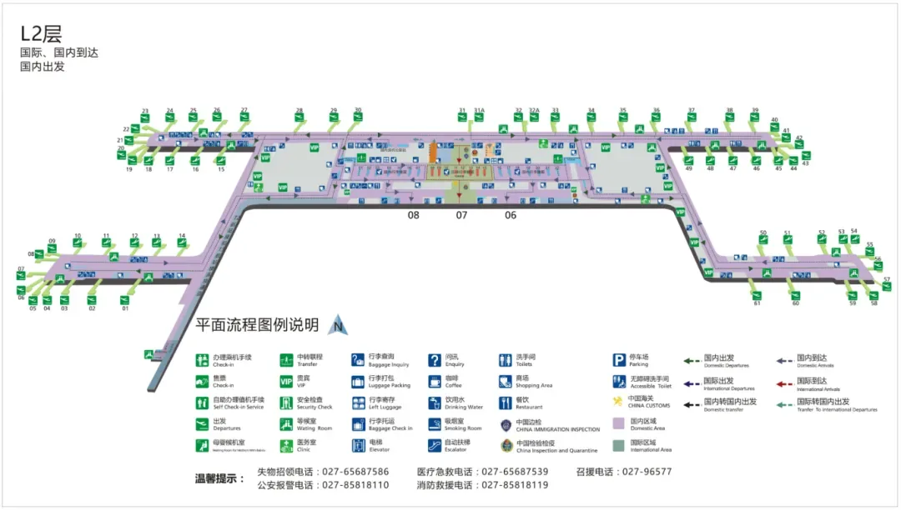

### Terminal 2

1. **Arrivo.** Se qualcuno vi viene a prendere, ditegli in anticipo a quale terminal arriva il vostro volo. Il livello 1 è il piano arrivi del Terminal 2.
2. **Ritiro bagagli.** Trovate il nastro del vostro volo sui monitor informativi e collaborate allo stesso modo con eventuali controlli a campione.
3. **Uscire dall'aeroporto.** Non accettate servizi da chi non ha un tesserino ufficiale dell'aeroporto fuori dall'area riservata e non salite su auto di conducenti abusivi.

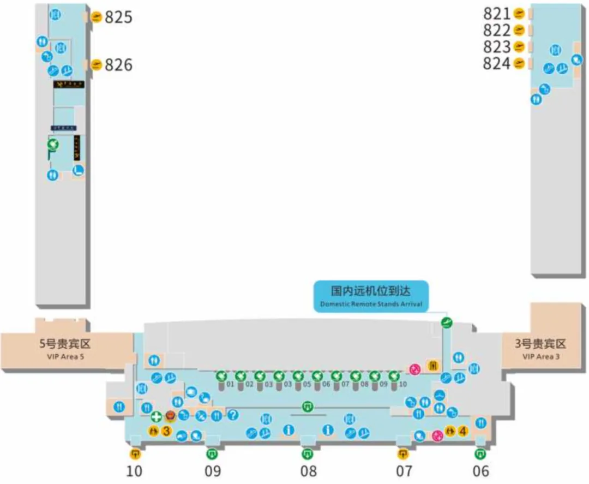

## 3. Come raggiungere l'aeroporto e tornare

Il trasporto terrestre a Tianhe è costruito intorno ai **bus aeroportuali**, alla **linea 2 della metropolitana**, all'**Airport Route 3** e alla **stazione ferroviaria**. Ogni collegamento tra i due terminal, e tra i terminal e il centro trasporti, è segnalato.

### Bus aeroportuali

- **Orari:** dalle 08:30 ogni giorno fino all'ultimo volo; ordinate online tramite il mini-program "天河畅行" (Tianhe Changxing).
- **Frequenza:** ogni 30 minuti, fino all'ultimo volo.
- **Biglietti di persona:** Terminal 2, livello 1, gate da 9 a 10; Terminal 3, all'interno del gate 12.
- **Servizio clienti:** 13387631827

| Percorso | Fermate (tariffa) |
| --- | --- |
| Linea 1 | T3 / T2 → Yuanboyuan Nord (metro, ¥10) → zona residenziale di Minhang (¥10) → stazione ferroviaria di Hankou (¥12) → CBD Wealth Centre, Fanhu (¥12) → Qingnian Road (¥12) → Guqintai (¥15) → Shouyi Square (¥18) → stazione ferroviaria di Wuchang (¥20) → Wushang Dream Plaza (¥20; i biglietti per questa fermata sono in vendita dalle 21:30) |
| Linea 2 | T3 / T2 → Yangchahu (¥10) → Jinqiao Aeon (¥10) → Huangpu Road / Gongnongbing Road (¥12) → Xudong Shopping Mall (¥15) → Yuejiazui (¥15) → Dongting (¥18) → Chuhe Han Street (¥20) → Hongshan Square (¥20) → stazione ferroviaria di Wuhan (¥45) |
| Navetta ferro-aeroporto | Wuhan Tianhe International Airport ⇄ stazione ferroviaria di Wuhan, senza fermate e gratuita (provvisoria, 09:25–17:55); stessi punti di biglietteria e imbarco dei bus aeroportuali |

### Pullman a lunga percorrenza

Chiamate la linea del servizio clienti per orari e percorsi di partenza; la vendita al banco è l'orario definitivo. I biglietti si comprano negli stessi punti dei bus aeroportuali (Terminal 2, livello 1, gate da 9 a 10; Terminal 3, all'interno del gate 12), telefonando al 13387631827.

### Linea 2 della metropolitana

- **Orari:** 06:00–23:00 nei giorni feriali, 06:30–23:00 nei giorni festivi; treni ogni 5–8 minuti.
- Gli annunci della metropolitana di Wuhan sono quelli definitivi.

Percorsi da e per l'aeroporto:

- **Per le partenze del T3:** linea 2 della metropolitana fino alla stazione di Tianhe Airport → uscita B → centro trasporti livello 2, corridoi di collegamento 1, 2 e 3 → Terminal 3, hall partenze livello 4.
- **Dagli arrivi del T3:** Terminal 3, hall arrivi livello 2 → gate 6, 7 e 8 al livello 2 → uscita B della metro → linea 2 della metropolitana.
- **Per le partenze del T2:** linea 2 della metropolitana fino alla stazione di Tianhe Airport → uscita B → centro trasporti livello 2, corridoi di collegamento 1, 2 e 3 → fuori dal gate 12 del Terminal 3 → cambio su Airport Route 3 → gate 7 del Terminal 2 → hall partenze livello 2.
- **Dagli arrivi del T2:** Terminal 2, hall arrivi livello 1 → fermata al gate 10 del livello 1 → cambio su Airport Route 3 → gate 12 del Terminal 3 → centro trasporti livello 2, corridoi di collegamento 1, 2 e 3 → uscita B della metro → linea 2 della metropolitana.

### Airport Route 3 (navetta tra i terminal)

- **Fermate:** Terminal 3 gate 12 (discesa e salita) → Terminal 2, livello 1, gate 7 (discesa) → Terminal 2, livello 1, gate 10 (salita) → Terminal 3 gate 12 (discesa e salita).
- **Frequenza:** circa ogni 5 minuti.
- **Orari:** 06:00–23:00.

### Ferrovia

I treni dalla stazione di Tianhe Airport fermano a Hankou e Wuchang, a Wuhan, e in diverse città della provincia; gli annunci dell'operatore ferroviario sono definitivi.

- **Per le partenze del T3:** arrivo alla stazione di Tianhe Airport → uscita C → centro trasporti livello 2, corridoi di collegamento 1, 2 e 3 → Terminal 3, hall partenze livello 4.
- **Dagli arrivi del T3:** Terminal 3, hall arrivi livello 2 → gate 6, 7 e 8 al livello 2 → uscita C → stazione di Tianhe Airport.
- **Per le partenze del T2:** arrivo alla stazione di Tianhe Airport → uscita B della metro → centro trasporti livello 2, corridoi di collegamento 1, 2 e 3 → fuori dal gate 12 del Terminal 3 → cambio su Airport Route 3 → gate 7 del Terminal 2 → hall partenze livello 2.
- **Dagli arrivi del T2:** Terminal 2, hall arrivi livello 1 → fermata al gate 10 del livello 1 → cambio su Airport Route 3 → gate 12 del Terminal 3 → centro trasporti livello 2, corridoi di collegamento 1, 2 e 3 → uscita C → stazione di Tianhe Airport.

### In auto

**Dalla città**

| Destinazione | Percorso |
| --- | --- |
| Sosta breve al T2 | Dritto lungo Konggang Avenue, tenete la destra sulla rampa del Terminal 2 ed entrate nella viabilità circolare del Terminal 2, tenete la destra e salite sul viadotto fino al livello partenze del Terminal 2 |
| Parcheggio al T2 | Dritto lungo Konggang Avenue, tenete la destra sulla rampa del Terminal 2 ed entrate nella viabilità circolare del Terminal 2, tenete la sinistra verso P1 (parcheggio in superficie del Terminal 2) o P2 (parcheggio sotterraneo del Terminal 2) |
| Sosta breve al T3 | Dritto lungo Konggang Avenue, tenete la destra sulla rampa del cavalcavia del Terminal 3 e fermatevi al livello partenze del Terminal 3 |
| Parcheggio al T3 | Dritto lungo Konggang Avenue, poi la corsia centrale verso P7 (parcheggio sotterraneo del Terminal 3) |
| Parcheggio del centro trasporti | Dritto lungo Konggang Avenue, poi la corsia di sinistra verso P6 (parcheggio del centro trasporti) |
| Complesso servizi passeggeri (Crowne Plaza, Holiday Inn) | Dritto lungo Konggang Avenue, tenete la destra sulla rampa del Terminal 2 ed entrate nella viabilità circolare del Terminal 2, tenete la sinistra verso P2 (parcheggio sotterraneo del Terminal 2) |

**Da Huangpi**

| Destinazione | Percorso |
| --- | --- |
| Sosta breve al T2 | Dritto lungo Konggang Avenue nel tunnel di Konggang, tenete la destra all'uscita del tunnel sulla rampa e invertite la marcia, salite al livello partenze del Terminal 3, tenete la destra sul ponte di collegamento tra i Terminal 3 e 2 e fermatevi al livello partenze del Terminal 2 |
| Parcheggio al T2 | Dritto lungo Konggang Avenue nel tunnel di Konggang, tenete la destra all'uscita del tunnel sulla rampa e invertite la marcia, salite al livello partenze del Terminal 3, tenete la destra sul ponte di collegamento tra i Terminal 3 e 2, seguite la viabilità circolare del Terminal 2 e tenete la sinistra verso P1 o P2 |
| Sosta breve al T3 | Dritto lungo Konggang Avenue nel tunnel di Konggang, tenete la destra all'uscita del tunnel sulla rampa e invertite la marcia fino al livello partenze del Terminal 3, e fermatevi lì |
| Parcheggio al T3 | Dritto lungo Konggang Avenue nel tunnel di Konggang, tenete la destra all'uscita del tunnel sulla rampa e invertite la marcia su Konggang Avenue, poi la corsia centrale verso P7 (parcheggio sotterraneo del Terminal 3) |
| Parcheggio del centro trasporti | Dritto lungo Konggang Avenue nel tunnel di Konggang, tenete la destra all'uscita del tunnel sulla rampa e invertite la marcia su Konggang Avenue, poi la corsia di sinistra verso P6 (parcheggio del centro trasporti) |
| Complesso servizi passeggeri (Crowne Plaza, Holiday Inn) | Dritto lungo Konggang Avenue nel tunnel di Konggang, tenete la destra all'uscita del tunnel sulla rampa e invertite la marcia, salite al livello partenze del Terminal 3, tenete la destra sul ponte di collegamento tra i Terminal 3 e 2, seguite la viabilità circolare del Terminal 2 e tenete la sinistra verso P2 |

### Taxi

- **Terminal 2:** fuori dal gate 7 al livello 1; mettetevi in fila al posteggio taxi.
- **Terminal 3:** fuori dal gate 12 al livello 1; mettetevi in fila al posteggio taxi.

### Auto con conducente

- **Terminal 2:** hall arrivi livello 1 → gate 9 al livello 1 → presa a P1 (parcheggio in superficie del Terminal 2) → centro di Wuhan.
- **Terminal 3:** hall arrivi livello 2 → gate 6, 7 e 8 al livello 2 → punto di presa dell'auto con conducente al livello 1 del centro trasporti → centro di Wuhan.

## 4. Parcheggio

### Terminal 3

**1. Parcheggio sotterraneo (P7)**

S19 / S18 → Konggang Avenue → parcheggio sotterraneo del T3 → Terminal 3, hall partenze livello 4 (circa 5 minuti a piedi).

549 posti ai livelli B1 e B2, solo per auto piccole.

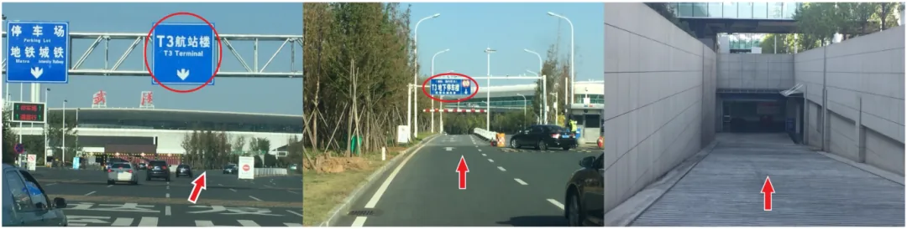

**2. Parcheggio del centro trasporti (P6)**

S19 / S18 → Konggang Avenue → parcheggio del centro trasporti → centro trasporti livello 2, corridoi di collegamento 1, 2 e 3 → Terminal 3, gate 8, 7 e 6 al livello 2 → Terminal 3, hall partenze livello 4 (circa 10 minuti a piedi).

3300 posti tra il livello B1, il piano terra e il livello 2 fuori terra.

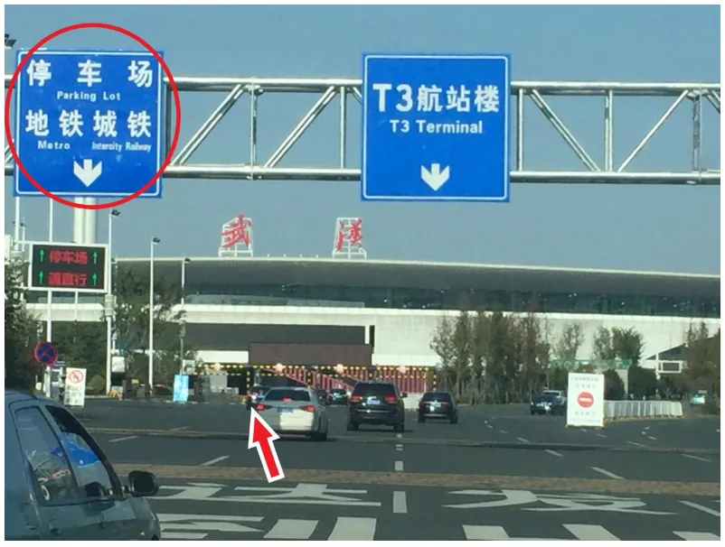

### Terminal 2

**1. Dalla città**

Dritto lungo Konggang Avenue, tenete la destra sulla rampa del Terminal 2 ed entrate nella viabilità circolare del Terminal 2.

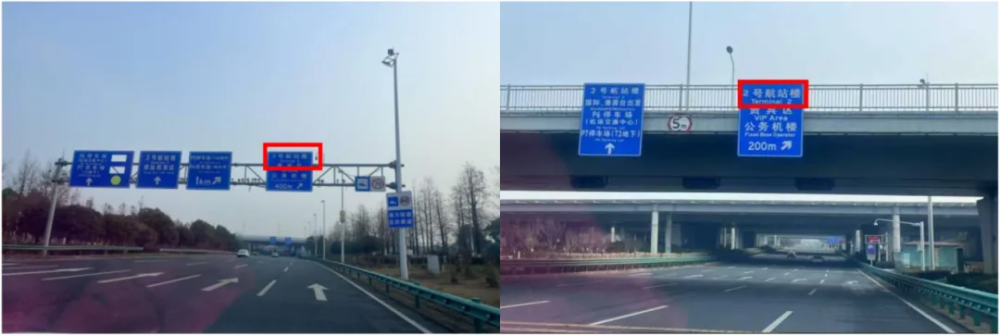

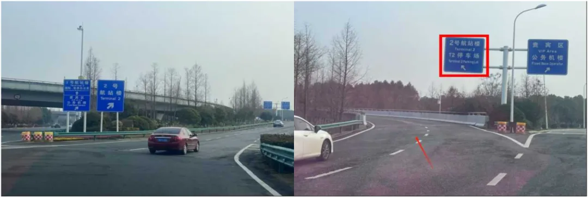

**Verso P1 (parcheggio in superficie del Terminal 2):** seguite la viabilità circolare del Terminal 2 e tenete la sinistra verso P1.

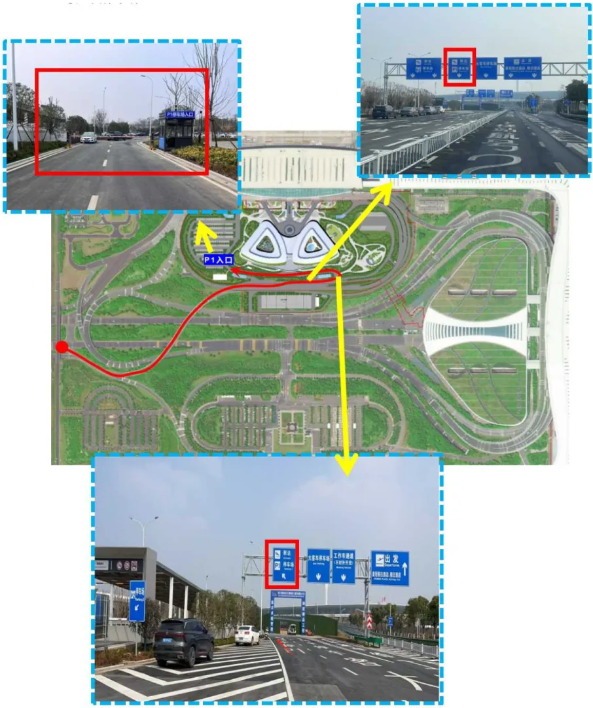

**Verso P2 (parcheggio sotterraneo del Terminal 2):** seguite la viabilità circolare del Terminal 2 e tenete la sinistra verso P2.

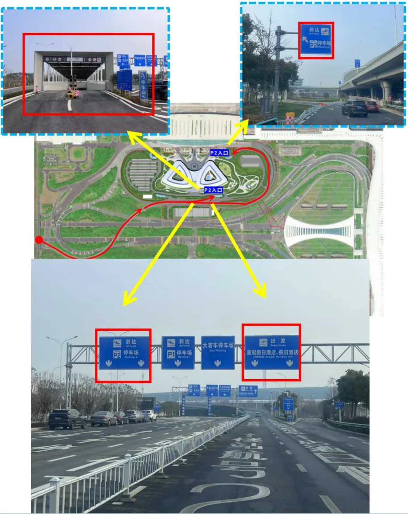

**2. Da Huangpi**

Dritto lungo Konggang Avenue nel tunnel di Konggang, tenete la destra all'uscita del tunnel sulla rampa e invertite la marcia, salite al livello partenze del Terminal 3, poi tenete la destra sul ponte di collegamento tra i Terminal 3 e 2.

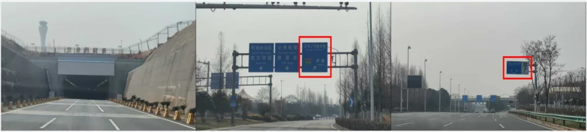

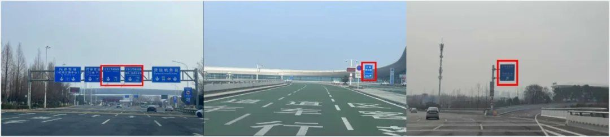

**Verso P1 (parcheggio in superficie del Terminal 2):** seguite la viabilità circolare del Terminal 2 e tenete la sinistra verso P1.

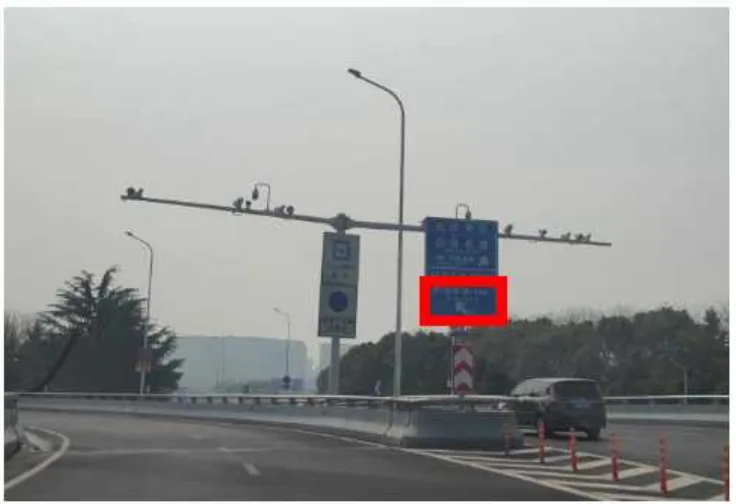

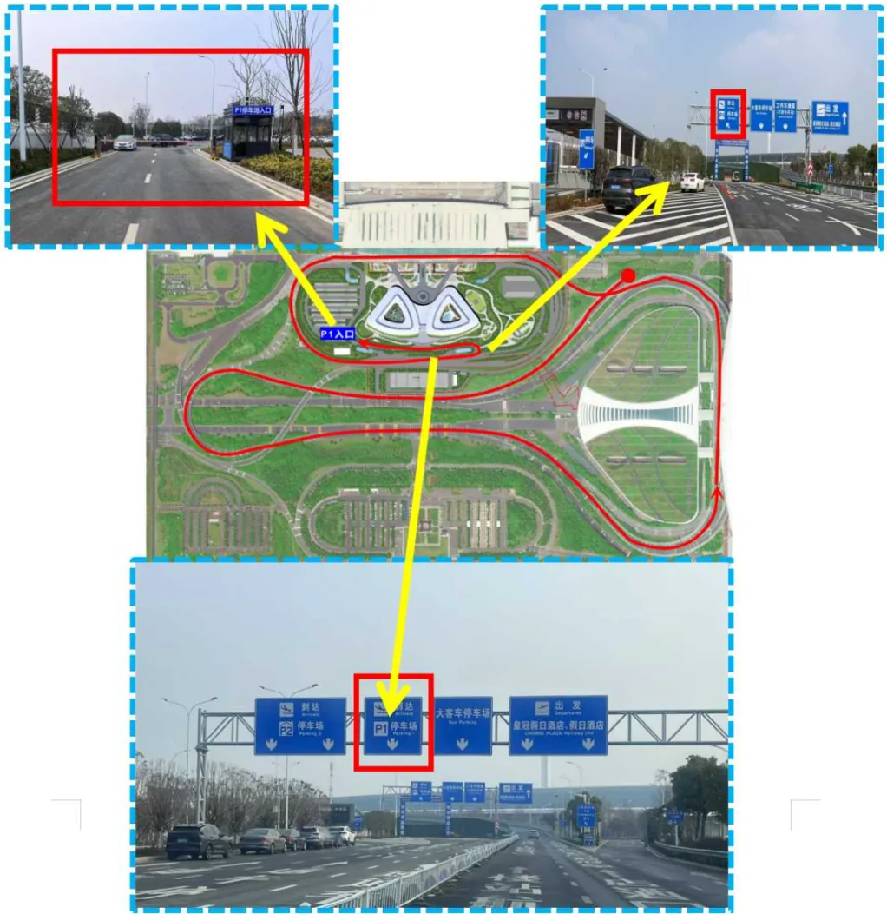

**Verso P2 (parcheggio sotterraneo del Terminal 2):** seguite la viabilità circolare del Terminal 2 e tenete la sinistra verso P2.

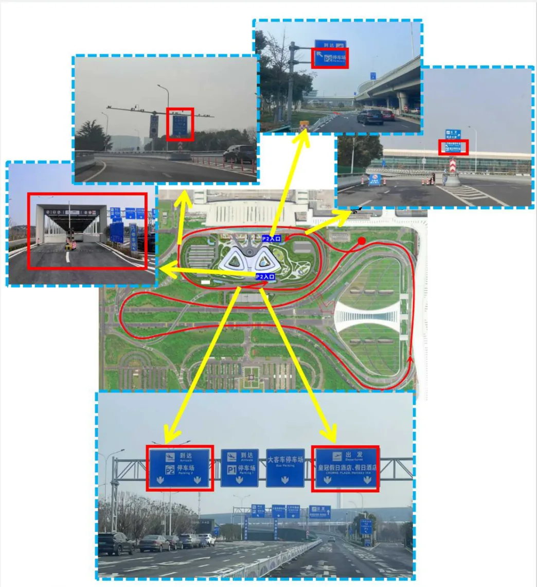

## Link utili

- **Su questo sito**: [Cina (CN)](/country/CN)
- **Wikipedia**: [Wuhan Tianhe International Airport](https://en.wikipedia.org/wiki/Wuhan_Tianhe_International_Airport)
- **Baidu Baike**: [Wuhan Tianhe International Airport](https://baike.baidu.com/item/%E6%AD%A6%E6%B1%89%E5%A4%A9%E6%B2%B3%E5%9B%BD%E9%99%85%E6%9C%BA%E5%9C%BA)
