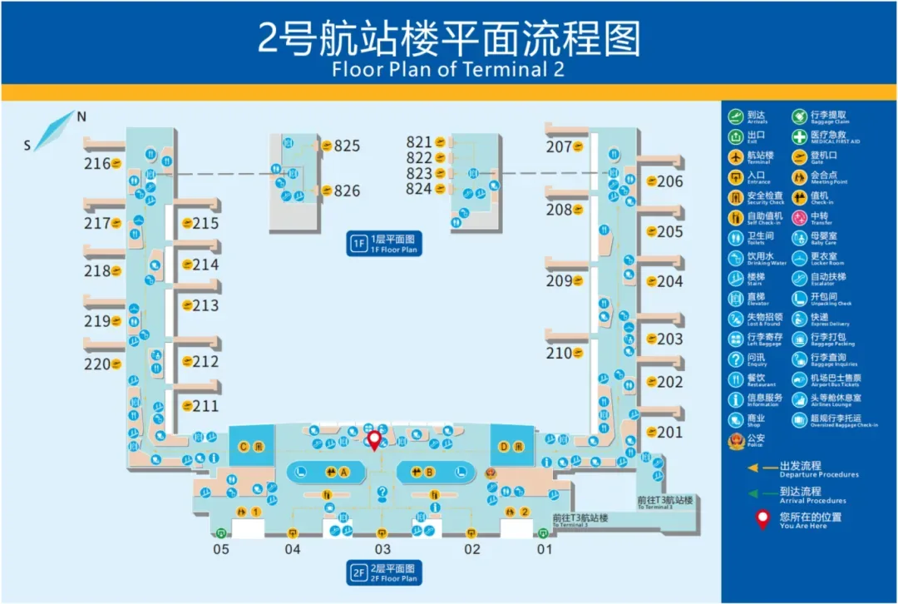
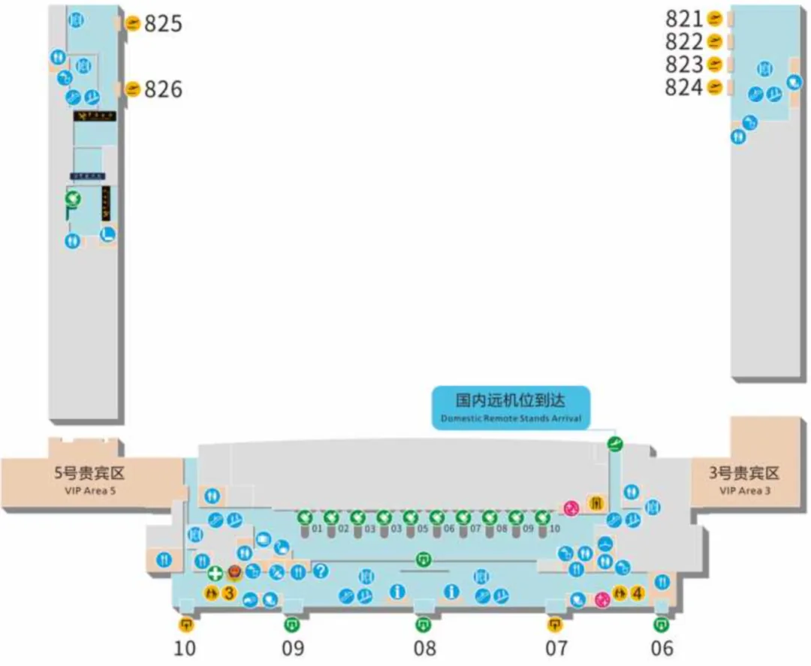

Nu de zomervakantie ten einde is en samenvalt met de drukte van de terugreis, is Wuhan Tianhe International Airport op zijn drukst. Deze gids behandelt de praktische details van Terminal 2 en 3 in vier delen — **binnenlandse vertrekken**, **binnenlandse aankomsten**, **van en naar de luchthaven reizen** en **parkeren**.

Tianhe heeft twee terminals in gebruik: **Terminal 3** (vertrek op niveau 4, aankomst op niveau 2) en **Terminal 2** (vertrek op niveau 2, aankomst op niveau 1). Controleer voordat u vertrekt welke terminal uw vlucht gebruikt; **luchthavenroute 3** pendelt tussen de twee. De terminalplattegronden en parkeerroutekaarten hier komen van de officiële website van de luchthaven.

## 1. Binnenlandse vertrekken

### Terminal 3

1. **Kom aan bij de terminal.** Zorg dat u er 2 uur van tevoren bent en bevestig bij uw luchtvaartmaatschappij welke terminal u nodig hebt. Niveau 4 is de vertrekverdieping van Terminal 3.
2. **Check in en lever uw bagage in.** Incheckeilanden E, F, J en K verzorgen inchecken en bagage. Het inchecken sluit **30 minuten** voor vertrek, dus zorg voor voldoende tijd. Selfservice-inchecken en bagageafgifte zijn beschikbaar, maar online vooraf inchecken is verstandig.
3. **Veiligheidscontrole.** Houd uw instapkaart en identiteitsbewijs of paspoort gereed voor de beveiligingsmedewerker.
4. **Wachten en instappen.** Volg de vluchtinformatieschermen en borden en wees **30–40 minuten** voor vertrek bij uw gate.

### Terminal 2

1. **Kom aan bij de terminal.** Zorg dat u er 2 uur van tevoren bent en bevestig bij uw luchtvaartmaatschappij welke terminal u nodig hebt. Niveau 2 is de vertrekverdieping van Terminal 2.
2. **Check in en lever uw bagage in.** Incheckeilanden A en B verzorgen inchecken en bagage. Het inchecken sluit **30 minuten** voor vertrek, dus zorg voor voldoende tijd. Selfservice-inchecken en bagageafgifte zijn beschikbaar, maar online vooraf inchecken is verstandig.
3. **Veiligheidscontrole.** Houd uw instapkaart en identiteitsbewijs of paspoort gereed voor de beveiligingsmedewerker.
4. **Wachten en instappen.** Volg de vluchtinformatieschermen en borden en wees **30–40 minuten** voor vertrek bij uw gate.

## 2. Binnenlandse aankomsten

### Terminal 3

1. **Aankomst.** Als iemand u komt ophalen, vertel die persoon dan vooraf in welke terminal uw vlucht aankomt. Niveau 2 is de aankomstverdieping van Terminal 3.
2. **Bagage ophalen.** Zoek de bagageband van uw vlucht op de informatieschermen. Om te voorkomen dat koffers per ongeluk worden meegenomen, kan het personeel steekproefsgewijs controleren of het bagagelabel overeenkomt met de barcode op uw ticket; houd uw bagagereçu bij de hand en werk mee.
3. **De luchthaven verlaten.** Accepteer voor uw eigen veiligheid buiten het afgeschermde gebied geen diensten van personen zonder officiële luchthavenpas, en stap niet in bij niet-gelicenseerde chauffeurs die klanten ronselen.

### Terminal 2

1. **Aankomst.** Als iemand u komt ophalen, vertel die persoon dan vooraf in welke terminal uw vlucht aankomt. Niveau 1 is de aankomstverdieping van Terminal 2.
2. **Bagage ophalen.** Zoek de bagageband van uw vlucht op de informatieschermen en werk op dezelfde manier mee aan eventuele steekproefcontroles.
3. **De luchthaven verlaten.** Accepteer buiten het afgeschermde gebied geen diensten van personen zonder officiële luchthavenpas en stap niet in bij niet-gelicenseerde chauffeurs.

## 3. Van en naar de luchthaven

Het grondvervoer op Tianhe is opgebouwd rond de **luchthavenbussen**, **metrolijn 2**, **luchthavenroute 3** en het **spoorwegstation**. Elke verbinding tussen de twee terminals, en tussen de terminals en het Transportcentrum, is bewegwijzerd.

### Luchthavenbussen

- **Openingstijden:** dagelijks vanaf 08:30 tot de laatste vlucht; bestel online via het mini-programma "天河畅行" (Tianhe Changxing).
- **Frequentie:** elke 30 minuten, tot de laatste vlucht.
- **Kaartverkoop ter plaatse:** Terminal 2, niveau 1, gates 9 en 10; Terminal 3, binnen gate 12.
- **Klantenservice:** 13387631827

| Route | Haltes (tarief) |
| --- | --- |
| Lijn 1 | T3 / T2 → Yuanboyuan Noord (metro, ¥10) → woonwijk Minhang (¥10) → Hankou Railway Station (¥12) → CBD Wealth Centre, Fanhu (¥12) → Qingnian Road (¥12) → Guqintai (¥15) → Shouyi Square (¥18) → Wuchang Railway Station (¥20) → Wushang Dream Plaza (¥20; kaartjes voor deze halte zijn vanaf 21:30 te koop) |
| Lijn 2 | T3 / T2 → Yangchahu (¥10) → Jinqiao Aeon (¥10) → Huangpu Road / Gongnongbing Road (¥12) → Xudong Shopping Mall (¥15) → Yuejiazui (¥15) → Dongting (¥18) → Chuhe Han Street (¥20) → Hongshan Square (¥20) → Wuhan Railway Station (¥45) |
| Spoorverbinding | Wuhan Tianhe International Airport ⇄ Wuhan Railway Station, rechtstreeks en gratis (voorlopig, 09:25–17:55); dezelfde kaartverkoop- en instappunten als bij de luchthavenbussen |

### Langeafstandsbussen

Bel de klantenservice voor vertrektijden en routes; de verkoop aan de balie is de definitieve dienstregeling. Kaartjes koopt u op dezelfde plaatsen als voor de luchthavenbussen (Terminal 2, niveau 1, gates 9 en 10; Terminal 3, binnen gate 12), via 13387631827.

### Metrolijn 2

- **Openingstijden:** 06:00–23:00 op weekdagen, 06:30–23:00 op feestdagen; treinen elke 5–8 minuten.
- De eigen omroepberichten van de metro van Wuhan zijn leidend.

Routes van en naar de luchthaven:

- **Naar de vertrekhal van T3:** metrolijn 2 naar station Tianhe Airport → uitgang B → niveau 2 van het Transportcentrum, verbindingsgangen 1, 2 en 3 → Terminal 3, vertrekhal op niveau 4.
- **Vanaf de aankomsthal van T3:** Terminal 3, aankomsthal op niveau 2 → gates 6, 7 en 8 op niveau 2 → metro-uitgang B → metrolijn 2.
- **Naar de vertrekhal van T2:** metrolijn 2 naar station Tianhe Airport → uitgang B → niveau 2 van het Transportcentrum, verbindingsgangen 1, 2 en 3 → buiten gate 12 van Terminal 3 → overstappen op luchthavenroute 3 → gate 7 van Terminal 2 → vertrekhal op niveau 2.
- **Vanaf de aankomsthal van T2:** Terminal 2, aankomsthal op niveau 1 → halte bij gate 10 op niveau 1 → overstappen op luchthavenroute 3 → gate 12 van Terminal 3 → niveau 2 van het Transportcentrum, verbindingsgangen 1, 2 en 3 → metro-uitgang B → metrolijn 2.

### Luchthavenroute 3 (terminalshuttle)

- **Haltes:** Terminal 3 gate 12 (uitstappen en instappen) → Terminal 2, niveau 1, gate 7 (uitstappen) → Terminal 2, niveau 1, gate 10 (instappen) → Terminal 3 gate 12 (uitstappen en instappen).
- **Frequentie:** ongeveer elke 5 minuten.
- **Openingstijden:** 06:00–23:00.

### Spoor

Treinen vanaf station Tianhe Airport stoppen bij de stations Hankou en Wuchang in Wuhan en bij diverse steden in de provincie; de eigen omroepberichten van de spoorwegmaatschappij zijn leidend.

- **Naar de vertrekhal van T3:** aankomst op station Tianhe Airport → uitgang C → niveau 2 van het Transportcentrum, verbindingsgangen 1, 2 en 3 → Terminal 3, vertrekhal op niveau 4.
- **Vanaf de aankomsthal van T3:** Terminal 3, aankomsthal op niveau 2 → gates 6, 7 en 8 op niveau 2 → uitgang C → station Tianhe Airport.
- **Naar de vertrekhal van T2:** aankomst op station Tianhe Airport → metro-uitgang B → niveau 2 van het Transportcentrum, verbindingsgangen 1, 2 en 3 → buiten gate 12 van Terminal 3 → overstappen op luchthavenroute 3 → gate 7 van Terminal 2 → vertrekhal op niveau 2.
- **Vanaf de aankomsthal van T2:** Terminal 2, aankomsthal op niveau 1 → halte bij gate 10 op niveau 1 → overstappen op luchthavenroute 3 → gate 12 van Terminal 3 → niveau 2 van het Transportcentrum, verbindingsgangen 1, 2 en 3 → uitgang C → station Tianhe Airport.

### Met de auto

**Vanuit de stad**

| Bestemming | Route |
| --- | --- |
| Afzetten bij T2 | Rechtdoor over Konggang Avenue, rechts aanhouden naar de oprit van Terminal 2 en de ringweg van Terminal 2 op, rechts aanhouden en omhoog de viaduct op, en passagiers afzetten op de vertrekverdieping van Terminal 2 |
| Parkeren bij T2 | Rechtdoor over Konggang Avenue, rechts aanhouden naar de oprit van Terminal 2 en de ringweg van Terminal 2 op, links aanhouden naar P1 (bovengrondse parkeerplaats van Terminal 2) of P2 (ondergrondse parkeerplaats van Terminal 2) |
| Afzetten bij T3 | Rechtdoor over Konggang Avenue, rechts aanhouden naar de flyoveroprit van Terminal 3 en passagiers afzetten op de vertrekverdieping van Terminal 3 |
| Parkeren bij T3 | Rechtdoor over Konggang Avenue en dan via de middelste rijstrook naar P7 (ondergrondse parkeerplaats van Terminal 3) |
| Parkeerplaats Transportcentrum | Rechtdoor over Konggang Avenue en dan via de linkerrijstrook naar P6 (parkeerplaats van het Transportcentrum) |
| Passagiersservicecomplex (Crowne Plaza, Holiday Inn) | Rechtdoor over Konggang Avenue, rechts aanhouden naar de oprit van Terminal 2 en de ringweg van Terminal 2 op, links aanhouden naar P2 (ondergrondse parkeerplaats van Terminal 2) |

**Vanuit Huangpi**

| Bestemming | Route |
| --- | --- |
| Afzetten bij T2 | Rechtdoor over Konggang Avenue de Konggangtunnel in, bij het verlaten van de tunnel rechts aanhouden de oprit op en keren, omhoog naar de vertrekverdieping van Terminal 3, rechts aanhouden de verbindingsbrug tussen Terminal 3 en 2 op en passagiers afzetten op de vertrekverdieping van Terminal 2 |
| Parkeren bij T2 | Rechtdoor over Konggang Avenue de Konggangtunnel in, bij het verlaten van de tunnel rechts aanhouden de oprit op en keren, omhoog naar de vertrekverdieping van Terminal 3, rechts aanhouden de verbindingsbrug tussen Terminal 3 en 2 op, de ringweg van Terminal 2 volgen en links aanhouden naar P1 of P2 |
| Afzetten bij T3 | Rechtdoor over Konggang Avenue de Konggangtunnel in, bij het verlaten van de tunnel rechts aanhouden de oprit op en keren omhoog naar de vertrekverdieping van Terminal 3, en daar passagiers afzetten |
| Parkeren bij T3 | Rechtdoor over Konggang Avenue de Konggangtunnel in, bij het verlaten van de tunnel rechts aanhouden de oprit op en keren naar Konggang Avenue, en dan via de middelste rijstrook naar P7 (ondergrondse parkeerplaats van Terminal 3) |
| Parkeerplaats Transportcentrum | Rechtdoor over Konggang Avenue de Konggangtunnel in, bij het verlaten van de tunnel rechts aanhouden de oprit op en keren naar Konggang Avenue, en dan via de linkerrijstrook naar P6 (parkeerplaats van het Transportcentrum) |
| Passagiersservicecomplex (Crowne Plaza, Holiday Inn) | Rechtdoor over Konggang Avenue de Konggangtunnel in, bij het verlaten van de tunnel rechts aanhouden de oprit op en keren, omhoog naar de vertrekverdieping van Terminal 3, rechts aanhouden de verbindingsbrug tussen Terminal 3 en 2 op, de ringweg van Terminal 2 volgen en links aanhouden naar P2 |

### Taxi's

- **Terminal 2:** buiten gate 7 op niveau 1; sluit aan bij de wachtrij op de taxistandplaats.
- **Terminal 3:** buiten gate 12 op niveau 1; sluit aan bij de wachtrij op de taxistandplaats.

### Taxi-apps

- **Terminal 2:** aankomsthal op niveau 1 → gate 9 op niveau 1 → ophalen bij P1 (bovengrondse parkeerplaats van Terminal 2) → centrum van Wuhan.
- **Terminal 3:** aankomsthal op niveau 2 → gates 6, 7 en 8 op niveau 2 → het ophaalpunt voor taxi-apps op niveau 1 van het Transportcentrum → centrum van Wuhan.

## 4. Parkeren

### Terminal 3

**1. Ondergrondse parkeerplaats (P7)**

S19 / S18 → Konggang Avenue → ondergrondse parkeerplaats van T3 → Terminal 3, vertrekhal op niveau 4 (ongeveer 5 minuten lopen).

549 plaatsen op de niveaus B1 en B2, alleen voor kleine auto's.

**2. Parkeerplaats van het Transportcentrum (P6)**

S19 / S18 → Konggang Avenue → parkeerplaats van het Transportcentrum → niveau 2 van het Transportcentrum, verbindingsgangen 1, 2 en 3 → Terminal 3, gates 8, 7 en 6 op niveau 2 → Terminal 3, vertrekhal op niveau 4 (ongeveer 10 minuten lopen).

3300 plaatsen, verdeeld over niveau B1, de begane grond en het tweede bovengrondse niveau.

### Terminal 2

**1. Vanuit de stad**

Rechtdoor over Konggang Avenue, rechts aanhouden naar de oprit van Terminal 2 en de ringweg van Terminal 2 op.

**Naar P1 (bovengrondse parkeerplaats van Terminal 2):** volg de ringweg van Terminal 2 en houd links aan naar P1.

**Naar P2 (ondergrondse parkeerplaats van Terminal 2):** volg de ringweg van Terminal 2 en houd links aan naar P2.

**2. Vanuit Huangpi**

Rechtdoor over Konggang Avenue de Konggangtunnel in, bij het verlaten van de tunnel rechts aanhouden de oprit op en keren, omhoog naar de vertrekverdieping van Terminal 3, en dan rechts aanhouden de verbindingsbrug tussen Terminal 3 en 2 op.

**Naar P1 (bovengrondse parkeerplaats van Terminal 2):** volg de ringweg van Terminal 2 en houd links aan naar P1.

**Naar P2 (ondergrondse parkeerplaats van Terminal 2):** volg de ringweg van Terminal 2 en houd links aan naar P2.

## Gerelateerde links

- **Op deze site**: [China (CN)](/country/CN)
- **Wikipedia**: [Wuhan Tianhe International Airport](https://en.wikipedia.org/wiki/Wuhan_Tianhe_International_Airport)
- **Baidu Baike**: [Wuhan Tianhe International Airport](https://baike.baidu.com/item/%E6%AD%A6%E6%B1%89%E5%A4%A9%E6%B2%B3%E5%9B%BD%E9%99%85%E6%9C%BA%E5%9C%BA)
