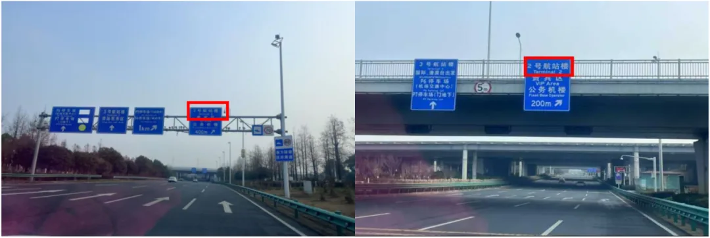

Окончание летних каникул совпадает с пиком возвращений, и международный аэропорт Ухань Тяньхэ переживает самый загруженный период. Этот гид охватывает практические детали терминалов 2 и 3 в четырёх частях — **внутренние вылеты**, **внутренние прилёты**, **как добраться до аэропорта и обратно** и **парковка**.

В Тяньхэ работают два терминала: **терминал 3** (вылеты на уровне 4, прилёты на уровне 2) и **терминал 2** (вылеты на уровне 2, прилёты на уровне 1). Перед выездом уточните, какой терминал обслуживает ваш рейс; между ними курсирует **маршрут 3 аэропортового шаттла**. Схемы терминалов и маршруты к парковкам здесь взяты с официального сайта аэропорта.

## 1. Внутренние вылеты

### Терминал 3

1. **Приезд в терминал.** Приезжайте за 2 часа и уточните терминал у авиакомпании. Уровень 4 — этаж вылетов терминала 3.
2. **Регистрация и сдача багажа.** Регистрацией и багажом занимаются островки E, F, J и K. Регистрация закрывается **за 30 минут** до вылета, поэтому оставьте достаточно времени. Доступны самостоятельная регистрация и сдача багажа, но заранее зарегистрироваться онлайн — хорошая идея.
3. **Досмотр.** Держите посадочный талон и удостоверение личности или паспорт наготове для сотрудника досмотра.
4. **Ожидание и посадка.** Следите за табло информации о рейсах и указателями и будьте у выхода **за 30–40 минут** до вылета.

### Терминал 2

1. **Приезд в терминал.** Приезжайте за 2 часа и уточните терминал у авиакомпании. Уровень 2 — этаж вылетов терминала 2.
2. **Регистрация и сдача багажа.** Регистрацией и багажом занимаются островки A и B. Регистрация закрывается **за 30 минут** до вылета, поэтому оставьте достаточно времени. Доступны самостоятельная регистрация и сдача багажа, но заранее зарегистрироваться онлайн — хорошая идея.
3. **Досмотр.** Держите посадочный талон и удостоверение личности или паспорт наготове для сотрудника досмотра.
4. **Ожидание и посадка.** Следите за табло информации о рейсах и указателями и будьте у выхода **за 30–40 минут** до вылета.

## 2. Внутренние прилёты

### Терминал 3

1. **Прилёт.** Если вас встречают, заранее скажите, в какой терминал прибывает ваш рейс. Уровень 2 — этаж прилётов терминала 3.
2. **Получение багажа.** Найдите ленту выдачи для своего рейса на информационных экранах. Чтобы сумки не забрали по ошибке, сотрудники могут выборочно сверить багажную бирку со штрихкодом на вашем талоне, поэтому держите багажную квитанцию под рукой и сотрудничайте.
3. **Выход из аэропорта.** Ради собственной безопасности не соглашайтесь на услуги людей без официального удостоверения аэропорта за пределами охраняемой зоны и не садитесь к нелицензированным водителям, предлагающим поездки.

### Терминал 2

1. **Прилёт.** Если вас встречают, заранее скажите, в какой терминал прибывает ваш рейс. Уровень 1 — этаж прилётов терминала 2.
2. **Получение багажа.** Найдите ленту выдачи для своего рейса на информационных экранах и так же сотрудничайте при выборочных проверках.
3. **Выход из аэропорта.** Не соглашайтесь на услуги людей без официального удостоверения аэропорта за пределами охраняемой зоны и не пользуйтесь услугами нелицензированных перевозчиков.

## 3. Как добраться до аэропорта и обратно

Наземный транспорт в Тяньхэ строится вокруг **автобусов аэропорта**, **линии 2 метро**, **маршрута 3 аэропортового шаттла** и **железнодорожной станции**. Все переходы между двумя терминалами, а также между терминалами и транспортным центром обозначены указателями.

### Автобусы аэропорта

- **Часы работы:** с 08:30 ежедневно до последнего рейса; заказ онлайн через мини-программу «Тяньхэ Чансин» (天河畅行).
- **Частота:** каждые 30 минут, до последнего рейса.
- **Покупка билетов на месте:** терминал 2, уровень 1, выходы 9–10; терминал 3, внутри выхода 12.
- **Служба поддержки:** 13387631827

| Маршрут | Остановки (стоимость) |
| --- | --- |
| Линия 1 | T3 / T2 → Юаньбоюань Северный (метро, ¥10) → жилой район Миньхан (¥10) → вокзал Ханькоу (¥12) → CBD Wealth Centre, Фаньху (¥12) → улица Циннянь (¥12) → Гуциньтай (¥15) → площадь Шоуи (¥18) → вокзал Учан (¥20) → Wushang Dream Plaza (¥20; билеты до этой остановки продаются с 21:30) |
| Линия 2 | T3 / T2 → Янчаху (¥10) → Jinqiao Aeon (¥10) → улица Хуанпу / улица Гуннунбин (¥12) → торговый центр Сюйдун (¥15) → Юэцзяцзуй (¥15) → Дунтин (¥18) → Чухэ Ханьцзе (¥20) → площадь Хуншань (¥20) → вокзал Ухань (¥45) |
| Аэропоезд | Международный аэропорт Ухань Тяньхэ ⇄ вокзал Ухань, без остановок и бесплатно (предварительно, 09:25–17:55); билеты и посадка — в тех же местах, что и на автобусы аэропорта |

### Междугородние автобусы

Позвоните на линию поддержки, чтобы узнать время отправления и маршруты; расписание у кассы имеет решающее значение. Билеты покупают там же, где на автобусы аэропорта (терминал 2, уровень 1, выходы 9–10; терминал 3, внутри выхода 12), по телефону 13387631827.

### Линия 2 метро

- **Часы работы:** 06:00–23:00 по будням, 06:30–23:00 в праздничные дни; поезда каждые 5–8 минут.
- Официальные объявления Уханьского метро имеют решающее значение.

Маршруты к аэропорту и из аэропорта:

- **К вылетам из T3:** линия 2 метро до станции «Аэропорт Тяньхэ» → выход B → транспортный центр, уровень 2, соединительные коридоры 1, 2 и 3 → терминал 3, зал вылетов на уровне 4.
- **Из прилётов T3:** терминал 3, зал прилётов на уровне 2 → выходы 6, 7 и 8 на уровне 2 → выход B метро → линия 2 метро.
- **К вылетам из T2:** линия 2 метро до станции «Аэропорт Тяньхэ» → выход B → транспортный центр, уровень 2, соединительные коридоры 1, 2 и 3 → снаружи выхода 12 терминала 3 → пересадка на маршрут 3 аэропортового шаттла → выход 7 терминала 2 → зал вылетов на уровне 2.
- **Из прилётов T2:** терминал 2, зал прилётов на уровне 1 → остановка у выхода 10 на уровне 1 → пересадка на маршрут 3 аэропортового шаттла → выход 12 терминала 3 → транспортный центр, уровень 2, соединительные коридоры 1, 2 и 3 → выход B метро → линия 2 метро.

### Маршрут 3 аэропортового шаттла (межтерминальный шаттл)

- **Остановки:** терминал 3, выход 12 (высадка и посадка) → терминал 2, уровень 1, выход 7 (высадка) → терминал 2, уровень 1, выход 10 (посадка) → терминал 3, выход 12 (высадка и посадка).
- **Частота:** примерно каждые 5 минут.
- **Часы работы:** 06:00–23:00.

### Железная дорога

Поезда со станции «Аэропорт Тяньхэ» останавливаются на вокзалах Ханькоу и Учан в Ухане и в нескольких городах провинции; официальные объявления железнодорожного оператора имеют решающее значение.

- **К вылетам из T3:** приезжайте на станцию «Аэропорт Тяньхэ» → выход C → транспортный центр, уровень 2, соединительные коридоры 1, 2 и 3 → терминал 3, зал вылетов на уровне 4.
- **Из прилётов T3:** терминал 3, зал прилётов на уровне 2 → выходы 6, 7 и 8 на уровне 2 → выход C → станция «Аэропорт Тяньхэ».
- **К вылетам из T2:** приезжайте на станцию «Аэропорт Тяньхэ» → выход B метро → транспортный центр, уровень 2, соединительные коридоры 1, 2 и 3 → снаружи выхода 12 терминала 3 → пересадка на маршрут 3 аэропортового шаттла → выход 7 терминала 2 → зал вылетов на уровне 2.
- **Из прилётов T2:** терминал 2, зал прилётов на уровне 1 → остановка у выхода 10 на уровне 1 → пересадка на маршрут 3 аэропортового шаттла → выход 12 терминала 3 → транспортный центр, уровень 2, соединительные коридоры 1, 2 и 3 → выход C → станция «Аэропорт Тяньхэ».

### На автомобиле

**Из города**

| Пункт назначения | Маршрут |
| --- | --- |
| Высадка у T2 | Прямо по проспекту Кунган, держитесь правее на съезд к терминалу 2 и выезжайте на кольцевую дорогу терминала 2, держитесь правее на эстакаду и высадитесь на уровне вылетов терминала 2 |
| Парковка у T2 | Прямо по проспекту Кунган, держитесь правее на съезд к терминалу 2 и выезжайте на кольцевую дорогу терминала 2, держитесь левее в P1 (наземная стоянка терминала 2) или P2 (подземная стоянка терминала 2) |
| Высадка у T3 | Прямо по проспекту Кунган, держитесь правее на эстакадный съезд к терминалу 3 и высадитесь на уровне вылетов терминала 3 |
| Парковка у T3 | Прямо по проспекту Кунган, затем средняя полоса в P7 (подземная стоянка терминала 3) |
| Стоянка транспортного центра | Прямо по проспекту Кунган, затем левая полоса в P6 (стоянка транспортного центра) |
| Пассажирский сервисный комплекс (Crowne Plaza, Holiday Inn) | Прямо по проспекту Кунган, держитесь правее на съезд к терминалу 2 и выезжайте на кольцевую дорогу терминала 2, держитесь левее в P2 (подземная стоянка терминала 2) |

**Из Хуанпи**

| Пункт назначения | Маршрут |
| --- | --- |
| Высадка у T2 | Прямо по проспекту Кунган в тоннель Кунган, после тоннеля держитесь правее на съезд и развернитесь, поднимитесь на уровень вылетов терминала 3, держитесь правее на соединительный мост между терминалами 3 и 2 и высадитесь на уровне вылетов терминала 2 |
| Парковка у T2 | Прямо по проспекту Кунган в тоннель Кунган, после тоннеля держитесь правее на съезд и развернитесь, поднимитесь на уровень вылетов терминала 3, держитесь правее на соединительный мост между терминалами 3 и 2, следуйте по кольцевой дороге терминала 2 и держитесь левее в P1 или P2 |
| Высадка у T3 | Прямо по проспекту Кунган в тоннель Кунган, после тоннеля держитесь правее на съезд и развернитесь на уровень вылетов терминала 3, высадитесь там |
| Парковка у T3 | Прямо по проспекту Кунган в тоннель Кунган, после тоннеля держитесь правее на съезд и развернитесь на проспект Кунган, затем средняя полоса в P7 (подземная стоянка терминала 3) |
| Стоянка транспортного центра | Прямо по проспекту Кунган в тоннель Кунган, после тоннеля держитесь правее на съезд и развернитесь на проспект Кунган, затем левая полоса в P6 (стоянка транспортного центра) |
| Пассажирский сервисный комплекс (Crowne Plaza, Holiday Inn) | Прямо по проспекту Кунган в тоннель Кунган, после тоннеля держитесь правее на съезд и развернитесь, поднимитесь на уровень вылетов терминала 3, держитесь правее на соединительный мост между терминалами 3 и 2, следуйте по кольцевой дороге терминала 2 и держитесь левее в P2 |

### Такси

- **Терминал 2:** снаружи выхода 7 на уровне 1; очередь на стоянке такси.
- **Терминал 3:** снаружи выхода 12 на уровне 1; очередь на стоянке такси.

### Заказ автомобиля через приложение

- **Терминал 2:** зал прилётов на уровне 1 → выход 9 на уровне 1 → посадка в P1 (наземная стоянка терминала 2) → центр Уханя.
- **Терминал 3:** зал прилётов на уровне 2 → выходы 6, 7 и 8 на уровне 2 → точка посадки заказанных автомобилей на уровне 1 транспортного центра → центр Уханя.

## 4. Парковка

### Терминал 3

**1. Подземная стоянка (P7)**

S19 / S18 → проспект Кунган → подземная стоянка T3 → терминал 3, зал вылетов на уровне 4 (около 5 минут пешком).

549 мест на уровнях B1 и B2, только для малолитражных автомобилей.

**2. Стоянка транспортного центра (P6)**

S19 / S18 → проспект Кунган → стоянка транспортного центра → транспортный центр, уровень 2, соединительные коридоры 1, 2 и 3 → терминал 3, выходы 8, 7 и 6 на уровне 2 → терминал 3, зал вылетов на уровне 4 (около 10 минут пешком).

3300 мест на уровне B1, на первом и втором наземных уровнях.

### Терминал 2

**1. Из города**

Прямо по проспекту Кунган, держитесь правее на съезд к терминалу 2 и выезжайте на кольцевую дорогу терминала 2.

**К P1 (наземная стоянка терминала 2):** следуйте по кольцевой дороге терминала 2 и держитесь левее в P1.

**К P2 (подземная стоянка терминала 2):** следуйте по кольцевой дороге терминала 2 и держитесь левее в P2.

**2. Из Хуанпи**

Прямо по проспекту Кунган в тоннель Кунган, после тоннеля держитесь правее на съезд и развернитесь, поднимитесь на уровень вылетов терминала 3, затем держитесь правее на соединительный мост между терминалами 3 и 2.

**К P1 (наземная стоянка терминала 2):** следуйте по кольцевой дороге терминала 2 и держитесь левее в P1.

**К P2 (подземная стоянка терминала 2):** следуйте по кольцевой дороге терминала 2 и держитесь левее в P2.

## Ссылки по теме

- **На этом сайте**: [Китай (CN)](/country/CN)
- **Википедия**: [Международный аэропорт Ухань Тяньхэ](https://en.wikipedia.org/wiki/Wuhan_Tianhe_International_Airport)
- **Baidu Baike**: [Международный аэропорт Ухань Тяньхэ](https://baike.baidu.com/item/%E6%AD%A6%E6%B1%89%E5%A4%A9%E6%B2%B3%E5%9B%BD%E9%99%85%E6%9C%BA%E5%9C%BA)
