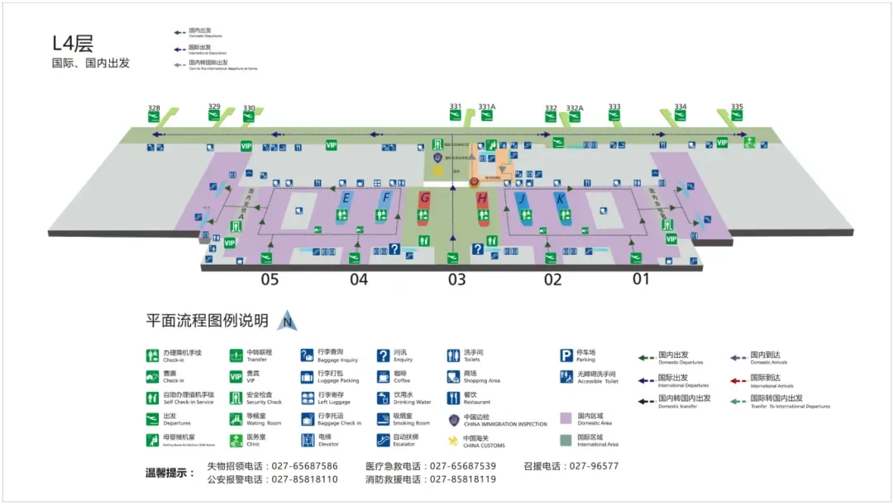
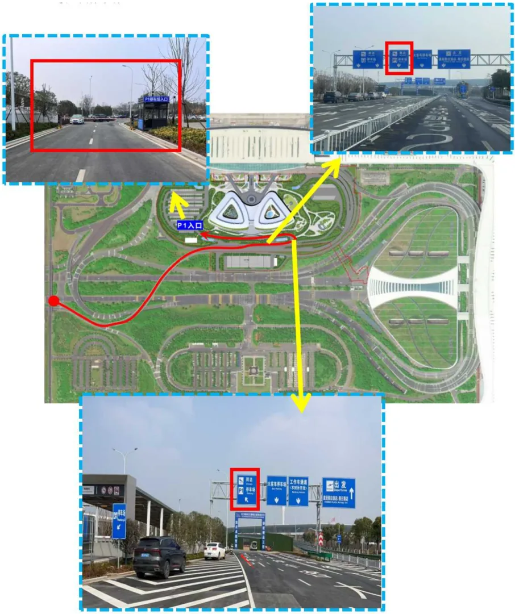
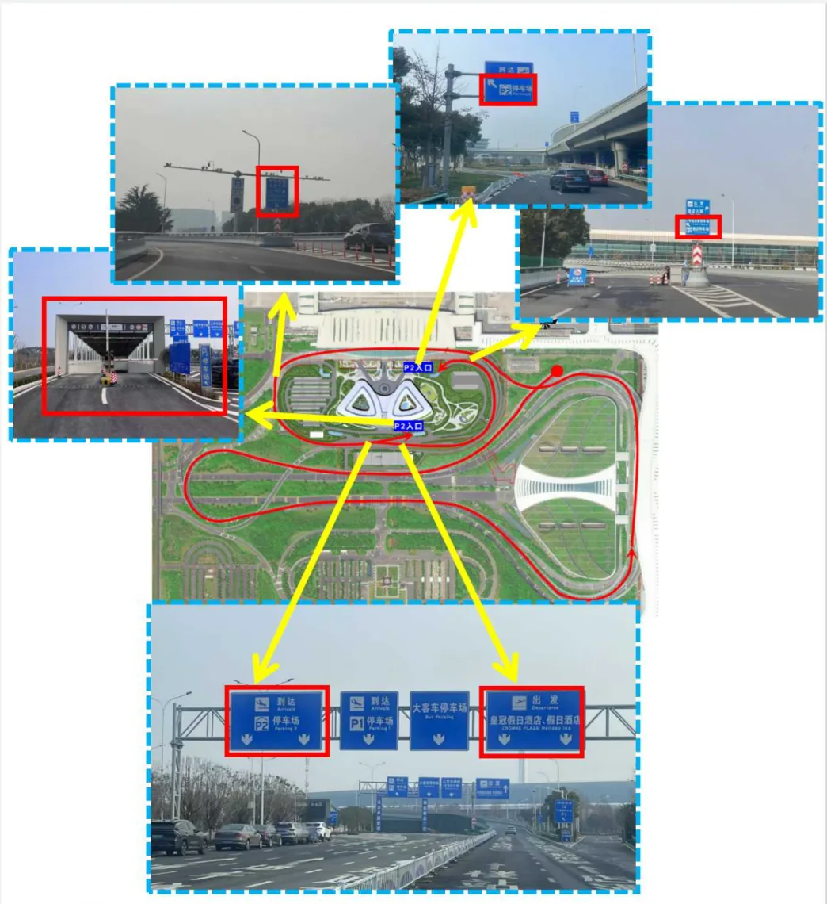

Кінець літніх канікул збігається з піком повернень, тож Міжнародний аеропорт Ухань Тяньхе переживає найбільш завантажений час. Цей путівник охоплює практичні деталі терміналів 2 і 3 у чотирьох частинах — **внутрішні вильоти**, **внутрішні прильоти**, **як дістатися до аеропорту та з нього** і **паркування**.

У Тяньхе працюють два термінали: **термінал 3** (вильоти на 4-му рівні, прильоти на 2-му) і **термінал 2** (вильоти на 2-му рівні, прильоти на 1-му). Перш ніж вирушати, уточніть, з якого термінала вилітає ваш рейс; між ними курсує **маршрут 3 аеропорту**. Плани терміналів і схеми маршрутів до паркінгів узято з офіційного сайту аеропорту.

## 1. Внутрішні вильоти

### Термінал 3

1. **Прибудьте до термінала.** Будьте на місці за 2 години до вильоту й уточніть термінал у своїй авіакомпанії. 4-й рівень — це поверх вильотів у терміналі 3.
2. **Зареєструйтеся й здайте багаж.** Реєстрацію та багаж обслуговують острови E, F, J і K. Реєстрація закривається за **30 хвилин** до вильоту, тож майте достатньо часу. Доступні самостійна реєстрація та здавання багажу, але зареєструватися онлайн заздалегідь — слушна ідея.
3. **Контроль безпеки.** Тримайте посадковий талон і посвідчення особи або паспорт напоготові для працівника служби безпеки.
4. **Зачекайте й сідайте на рейс.** Стежте за табло інформації про рейси та вказівниками й будьте біля виходу на посадку за **30–40 хвилин** до вильоту.

### Термінал 2

1. **Прибудьте до термінала.** Будьте на місці за 2 години до вильоту й уточніть термінал у своїй авіакомпанії. 2-й рівень — це поверх вильотів у терміналі 2.
2. **Зареєструйтеся й здайте багаж.** Реєстрацію та багаж обслуговують острови A і B. Реєстрація закривається за **30 хвилин** до вильоту, тож майте достатньо часу. Доступні самостійна реєстрація та здавання багажу, але зареєструватися онлайн заздалегідь — слушна ідея.
3. **Контроль безпеки.** Тримайте посадковий талон і посвідчення особи або паспорт напоготові для працівника служби безпеки.
4. **Зачекайте й сідайте на рейс.** Стежте за табло інформації про рейси та вказівниками й будьте біля виходу на посадку за **30–40 хвилин** до вильоту.

## 2. Внутрішні прильоти

### Термінал 3

1. **Прибуття.** Якщо вас зустрічають, заздалегідь скажіть, у який термінал прибуває ваш рейс. 2-й рівень — це поверх прильотів у терміналі 3.
2. **Заберіть багаж.** Знайдіть на табло інформації карусель для свого рейсу. Щоб уберегти валізи від випадкової підміни, працівники можуть вибірково звірити багажну бирку зі штрихкодом на вашому квитку, тож тримайте багажну квитанцію напоготові й сприяйте їм.
3. **Вихід з аеропорту.** Задля власної безпеки не приймайте послуг від будь-кого без офіційного посвідчення аеропорту поза контрольною зоною і не користуйтеся послугами неліцензованих водіїв-перекупників.

### Термінал 2

1. **Прибуття.** Якщо вас зустрічають, заздалегідь скажіть, у який термінал прибуває ваш рейс. 1-й рівень — це поверх прильотів у терміналі 2.
2. **Заберіть багаж.** Знайдіть на табло інформації карусель для свого рейсу й так само сприяйте вибірковим перевіркам.
3. **Вихід з аеропорту.** Не приймайте послуг від будь-кого без офіційного посвідчення аеропорту поза контрольною зоною і не користуйтеся неліцензованим транспортом.

## 3. Як дістатися до аеропорту та з нього

Наземний транспорт Тяньхе побудований навколо **аеропортових автобусів**, **лінії метро 2**, **маршруту 3 аеропорту** і **залізничної станції**. Кожен перехід між двома терміналами та між терміналами й Транспортним центром позначений вказівниками.

### Аеропортові автобуси

- **Години роботи:** щодня з 08:30 до останнього рейсу; замовлення онлайн через мініпрограму «天河畅行» (Тяньхе Чансін).
- **Інтервал:** кожні 30 хвилин, до останнього рейсу.
- **Квитки на місці:** термінал 2, 1-й рівень, виходи 9–10; термінал 3, усередині виходу 12.
- **Довідкова служба:** 13387631827

| Маршрут | Зупинки (вартість) |
| --- | --- |
| Лінія 1 | T3 / T2 → Північний Юаньбоюань (метро, ¥10) → житловий район Міньхан (¥10) → залізничний вокзал Ханькоу (¥12) → діловий центр CBD Wealth Centre, Фаньху (¥12) → вулиця Ціннянь (¥12) → Гуціньтай (¥15) → площа Шоуї (¥18) → залізничний вокзал Учан (¥20) → Wushang Dream Plaza (¥20; квитки на цю зупинку продають з 21:30) |
| Лінія 2 | T3 / T2 → Янчаху (¥10) → Цзіньцяо Aeon (¥10) → вулиця Хуанпу / вулиця Гуннунбін (¥12) → торговий центр Сюйдун (¥15) → Юецзяцзуй (¥15) → Дунтін (¥18) → вулиця Чухе Хань (¥20) → площа Хуншань (¥20) → залізничний вокзал Уханя (¥45) |
| Залізнично-авіаційне сполучення | Міжнародний аеропорт Ухань Тяньхе ⇄ залізничний вокзал Уханя, без зупинок і безкоштовно (попередньо, 09:25–17:55); ті самі пункти продажу квитків і посадки, що й в аеропортових автобусів |

### Міжміські автобуси

Телефонуйте на лінію обслуговування, щоб дізнатися час відправлення й маршрути; остаточним розкладом є той, що в касі. Квитки купують у тих самих місцях, що й на аеропортові автобуси (термінал 2, 1-й рівень, виходи 9–10; термінал 3, усередині виходу 12), за телефоном 13387631827.

### Лінія метро 2

- **Години роботи:** 06:00–23:00 у будні, 06:30–23:00 у святкові дні; потяги кожні 5–8 хвилин.
- Остаточною вважається інформація самого метрополітену Уханя.

Маршрути до аеропорту та з нього:

- **До вильотів T3:** лінія метро 2 до станції «Аеропорт Тяньхе» → вихід B → 2-й рівень Транспортного центру, сполучні коридори 1, 2 і 3 → термінал 3, зал вильотів на 4-му рівні.
- **З прильотів T3:** термінал 3, зал прильотів на 2-му рівні → виходи 6, 7 і 8 на 2-му рівні → вихід B метро → лінія метро 2.
- **До вильотів T2:** лінія метро 2 до станції «Аеропорт Тяньхе» → вихід B → 2-й рівень Транспортного центру, сполучні коридори 1, 2 і 3 → зовні виходу 12 термінала 3 → пересадка на маршрут 3 аеропорту → вихід 7 термінала 2 → зал вильотів на 2-му рівні.
- **З прильотів T2:** термінал 2, зал прильотів на 1-му рівні → зупинка біля виходу 10 на 1-му рівні → пересадка на маршрут 3 аеропорту → вихід 12 термінала 3 → 2-й рівень Транспортного центру, сполучні коридори 1, 2 і 3 → вихід B метро → лінія метро 2.

### Маршрут 3 аеропорту (шатл між терміналами)

- **Зупинки:** термінал 3, вихід 12 (висадка й посадка) → термінал 2, 1-й рівень, вихід 7 (висадка) → термінал 2, 1-й рівень, вихід 10 (посадка) → термінал 3, вихід 12 (висадка й посадка).
- **Інтервал:** приблизно кожні 5 хвилин.
- **Години роботи:** 06:00–23:00.

### Залізниця

Потяги зі станції «Аеропорт Тяньхе» зупиняються на вокзалах Ханькоу та Учан в Ухані, а також у кількох містах провінції; остаточною вважається інформація самого залізничного оператора.

- **До вильотів T3:** прибуття на станцію «Аеропорт Тяньхе» → вихід C → 2-й рівень Транспортного центру, сполучні коридори 1, 2 і 3 → термінал 3, зал вильотів на 4-му рівні.
- **З прильотів T3:** термінал 3, зал прильотів на 2-му рівні → виходи 6, 7 і 8 на 2-му рівні → вихід C → станція «Аеропорт Тяньхе».
- **До вильотів T2:** прибуття на станцію «Аеропорт Тяньхе» → вихід B метро → 2-й рівень Транспортного центру, сполучні коридори 1, 2 і 3 → зовні виходу 12 термінала 3 → пересадка на маршрут 3 аеропорту → вихід 7 термінала 2 → зал вильотів на 2-му рівні.
- **З прильотів T2:** термінал 2, зал прильотів на 1-му рівні → зупинка біля виходу 10 на 1-му рівні → пересадка на маршрут 3 аеропорту → вихід 12 термінала 3 → 2-й рівень Транспортного центру, сполучні коридори 1, 2 і 3 → вихід C → станція «Аеропорт Тяньхе».

### Автомобілем

**З міста**

| Призначення | Маршрут |
| --- | --- |
| Висадка пасажирів біля T2 | Прямо проспектом Конган, тримайтеся праворуч на з'їзд до термінала 2 і далі на кільцеву дорогу термінала 2, тримайтеся праворуч, підніміться на естакаду й висадіть пасажирів на рівні вильотів термінала 2 |
| Паркування біля T2 | Прямо проспектом Конган, тримайтеся праворуч на з'їзд до термінала 2 і далі на кільцеву дорогу термінала 2, тримайтеся ліворуч до P1 (наземний паркінг термінала 2) або P2 (підземний паркінг термінала 2) |
| Висадка пасажирів біля T3 | Прямо проспектом Конган, тримайтеся праворуч на естакадний з'їзд до термінала 3 і висадіть пасажирів на рівні вильотів термінала 3 |
| Паркування біля T3 | Прямо проспектом Конган, далі середньою смугою до P7 (підземний паркінг термінала 3) |
| Паркінг Транспортного центру | Прямо проспектом Конган, далі лівою смугою до P6 (паркінг Транспортного центру) |
| Комплекс пасажирських послуг (Crowne Plaza, Holiday Inn) | Прямо проспектом Конган, тримайтеся праворуч на з'їзд до термінала 2 і далі на кільцеву дорогу термінала 2, тримайтеся ліворуч до P2 (підземний паркінг термінала 2) |

**З Хуанпі**

| Призначення | Маршрут |
| --- | --- |
| Висадка пасажирів біля T2 | Прямо проспектом Конган у тунель Конган, після тунелю тримайтеся праворуч на з'їзд і розверніться, підніміться до рівня вильотів термінала 3, тримайтеся праворуч на сполучний міст між терміналами 3 і 2 і висадіть пасажирів на рівні вильотів термінала 2 |
| Паркування біля T2 | Прямо проспектом Конган у тунель Конган, після тунелю тримайтеся праворуч на з'їзд і розверніться, підніміться до рівня вильотів термінала 3, тримайтеся праворуч на сполучний міст між терміналами 3 і 2, їдьте кільцевою дорогою термінала 2 і тримайтеся ліворуч до P1 або P2 |
| Висадка пасажирів біля T3 | Прямо проспектом Конган у тунель Конган, після тунелю тримайтеся праворуч на з'їзд, розверніться до рівня вильотів термінала 3 і висадіть пасажирів там |
| Паркування біля T3 | Прямо проспектом Конган у тунель Конган, після тунелю тримайтеся праворуч на з'їзд і розверніться на проспект Конган, далі середньою смугою до P7 (підземний паркінг термінала 3) |
| Паркінг Транспортного центру | Прямо проспектом Конган у тунель Конган, після тунелю тримайтеся праворуч на з'їзд і розверніться на проспект Конган, далі лівою смугою до P6 (паркінг Транспортного центру) |
| Комплекс пасажирських послуг (Crowne Plaza, Holiday Inn) | Прямо проспектом Конган у тунель Конган, після тунелю тримайтеся праворуч на з'їзд і розверніться, підніміться до рівня вильотів термінала 3, тримайтеся праворуч на сполучний міст між терміналами 3 і 2, їдьте кільцевою дорогою термінала 2 і тримайтеся ліворуч до P2 |

### Таксі

- **Термінал 2:** зовні виходу 7 на 1-му рівні; станьте в чергу на стоянці таксі.
- **Термінал 3:** зовні виходу 12 на 1-му рівні; станьте в чергу на стоянці таксі.

### Виклик авто через застосунки

- **Термінал 2:** зал прильотів на 1-му рівні → вихід 9 на 1-му рівні → посадка в P1 (наземний паркінг термінала 2) → центр Уханя.
- **Термінал 3:** зал прильотів на 2-му рівні → виходи 6, 7 і 8 на 2-му рівні → пункт посадки викликаних авто на 1-му рівні Транспортного центру → центр Уханя.

## 4. Паркування

### Термінал 3

**1. Підземний паркінг (P7)**

S19 / S18 → проспект Конган → підземний паркінг T3 → термінал 3, зал вильотів на 4-му рівні (приблизно 5 хвилин пішки).

549 місць на рівнях B1 і B2, лише для малих автомобілів.

**2. Паркінг Транспортного центру (P6)**

S19 / S18 → проспект Конган → паркінг Транспортного центру → 2-й рівень Транспортного центру, сполучні коридори 1, 2 і 3 → термінал 3, виходи 8, 7 і 6 на 2-му рівні → термінал 3, зал вильотів на 4-му рівні (приблизно 10 хвилин пішки).

3300 місць на рівні B1, на нульовому поверсі та на 2-му наземному рівні.

### Термінал 2

**1. З міста**

Прямо проспектом Конган, тримайтеся праворуч на з'їзд до термінала 2 і далі на кільцеву дорогу термінала 2.

**До P1 (наземний паркінг термінала 2):** їдьте кільцевою дорогою термінала 2 і тримайтеся ліворуч до P1.

**До P2 (підземний паркінг термінала 2):** їдьте кільцевою дорогою термінала 2 і тримайтеся ліворуч до P2.

**2. З Хуанпі**

Прямо проспектом Конган у тунель Конган, після тунелю тримайтеся праворуч на з'їзд і розверніться, підніміться до рівня вильотів термінала 3, а далі тримайтеся праворуч на сполучний міст між терміналами 3 і 2.

**До P1 (наземний паркінг термінала 2):** їдьте кільцевою дорогою термінала 2 і тримайтеся ліворуч до P1.

**До P2 (підземний паркінг термінала 2):** їдьте кільцевою дорогою термінала 2 і тримайтеся ліворуч до P2.

## Пов'язані посилання

- **На цьому сайті**: [Китай (CN)](/country/CN)
- **Вікіпедія**: [Міжнародний аеропорт Ухань Тяньхе](https://en.wikipedia.org/wiki/Wuhan_Tianhe_International_Airport)
- **Baidu Baike**: [Міжнародний аеропорт Ухань Тяньхе](https://baike.baidu.com/item/%E6%AD%A6%E6%B1%89%E5%A4%A9%E6%B2%B3%E5%9B%BD%E9%99%85%E6%9C%BA%E5%9C%BA)
