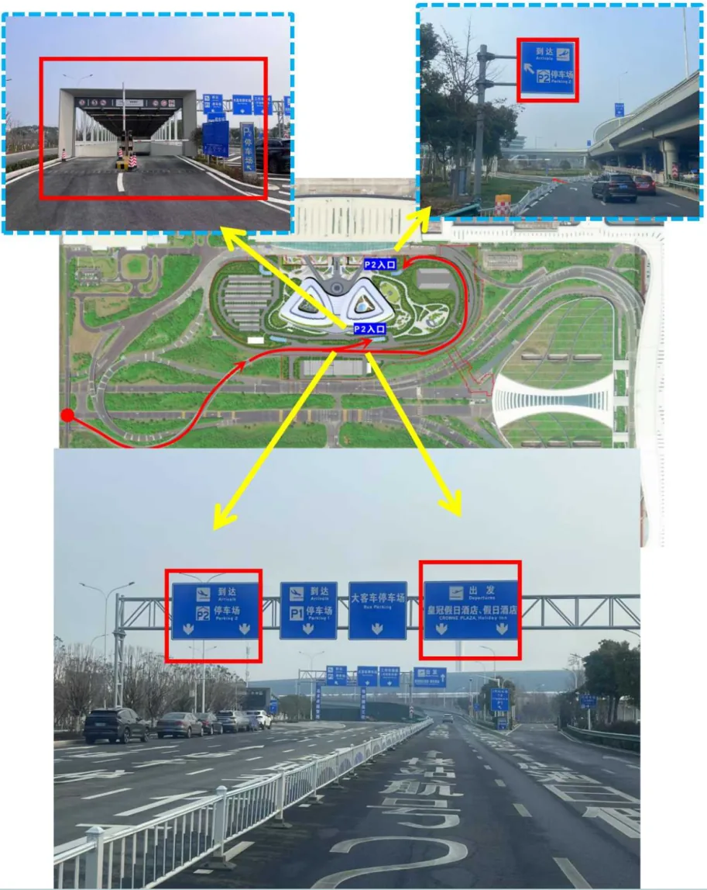

Khi kỳ nghỉ hè kết thúc trùng với đợt cao điểm về quê, Sân bay Quốc tế Thiên Hà Vũ Hán đang vào lúc đông đúc nhất. Hướng dẫn này trình bày những chi tiết thực tế về Nhà ga 2 và 3 trong bốn phần — **khởi hành nội địa**, **đến nội địa**, **đi và đến sân bay**, và **đỗ xe**.

Thiên Hà có hai nhà ga đang hoạt động: **Nhà ga 3** (khởi hành ở tầng 4, đến ở tầng 2) và **Nhà ga 2** (khởi hành ở tầng 2, đến ở tầng 1). Hãy kiểm tra nhà ga của chuyến bay trước khi lên đường; **tuyến 3 sân bay** chạy xe đưa đón giữa hai nhà ga. Sơ đồ nhà ga và sơ đồ đường đỗ xe ở đây lấy từ trang web chính thức của sân bay.

## 1. Khởi hành nội địa

### Nhà ga 3

1. **Đến nhà ga.** Hãy đến sớm 2 giờ và xác nhận nhà ga với hãng hàng không. Tầng 4 là tầng khởi hành của Nhà ga 3.
2. **Làm thủ tục và gửi hành lý.** Các đảo check-in E, F, J và K phụ trách check-in và hành lý. Quầy check-in đóng **30 phút** trước giờ khởi hành, nên hãy dành đủ thời gian. Có check-in tự phục vụ và tự gửi hành lý, nhưng làm thủ tục trực tuyến trước vẫn là ý hay.
3. **An ninh.** Chuẩn bị thẻ lên máy bay và giấy tờ tùy thân hoặc hộ chiếu để trình nhân viên an ninh.
4. **Chờ và lên máy bay.** Theo dõi màn hình thông tin chuyến bay và biển chỉ dẫn, và có mặt tại cổng **30–40 phút** trước giờ khởi hành.

### Nhà ga 2

1. **Đến nhà ga.** Hãy đến sớm 2 giờ và xác nhận nhà ga với hãng hàng không. Tầng 2 là tầng khởi hành của Nhà ga 2.
2. **Làm thủ tục và gửi hành lý.** Các đảo check-in A và B phụ trách check-in và hành lý. Quầy check-in đóng **30 phút** trước giờ khởi hành, nên hãy dành đủ thời gian. Có check-in tự phục vụ và tự gửi hành lý, nhưng làm thủ tục trực tuyến trước vẫn là ý hay.
3. **An ninh.** Chuẩn bị thẻ lên máy bay và giấy tờ tùy thân hoặc hộ chiếu để trình nhân viên an ninh.
4. **Chờ và lên máy bay.** Theo dõi màn hình thông tin chuyến bay và biển chỉ dẫn, và có mặt tại cổng **30–40 phút** trước giờ khởi hành.

## 2. Đến nội địa

### Nhà ga 3

1. **Đến nơi.** Nếu có người đón, hãy báo trước nhà ga mà chuyến bay của bạn sẽ đến. Tầng 2 là tầng đến của Nhà ga 3.
2. **Nhận hành lý.** Tìm băng chuyền của chuyến bay trên màn hình thông tin. Để tránh hành lý bị lấy nhầm, nhân viên có thể kiểm tra đột xuất thẻ hành lý với mã vạch trên vé, nên hãy để sẵn biên nhận hành lý và hợp tác.
3. **Rời sân bay.** Vì an toàn và an ninh của bạn, đừng nhận dịch vụ từ bất kỳ ai không có thẻ nhân viên sân bay chính thức bên ngoài khu vực hạn chế, và đừng đi xe của tài xế không có giấy phép, chèo kéo khách.

### Nhà ga 2

1. **Đến nơi.** Nếu có người đón, hãy báo trước nhà ga mà chuyến bay của bạn sẽ đến. Tầng 1 là tầng đến của Nhà ga 2.
2. **Nhận hành lý.** Tìm băng chuyền của chuyến bay trên màn hình thông tin, và hợp tác với mọi đợt kiểm tra đột xuất theo cùng cách.
3. **Rời sân bay.** Đừng nhận dịch vụ từ bất kỳ ai không có thẻ nhân viên sân bay chính thức bên ngoài khu vực hạn chế, và đừng đi xe không có giấy phép.

## 3. Đi và đến sân bay

Giao thông mặt đất tại Thiên Hà xoay quanh **xe buýt sân bay**, **tuyến metro số 2**, **tuyến 3 sân bay** và **ga đường sắt**. Mọi lối kết nối giữa hai nhà ga, cũng như giữa các nhà ga và Trung tâm Giao thông, đều có biển chỉ dẫn.

### Xe buýt sân bay

- **Giờ chạy:** 08:30 hằng ngày đến chuyến bay cuối; đặt vé trực tuyến qua tiểu trình "天河畅行" (Thiên Hà Sướng Hành).
- **Tần suất:** 30 phút một chuyến, đến chuyến bay cuối.
- **Bán vé trực tiếp:** Nhà ga 2, tầng 1, cổng 9 đến 10; Nhà ga 3, phía trong cổng 12.
- **Dịch vụ khách hàng:** 13387631827

| Tuyến | Điểm dừng (giá vé) |
| --- | --- |
| Tuyến 1 | T3 / T2 → Bắc Viên Bác Viên (metro, ¥10) → khu dân cư Mẫn Hàng (¥10) → Ga đường sắt Hán Khẩu (¥12) → Trung tâm Tài phú CBD, Phàm Hồ (¥12) → Đường Thanh Niên (¥12) → Cổ Cầm Đài (¥15) → Quảng trường Thủ Nghĩa (¥18) → Ga đường sắt Vũ Xương (¥20) → Quảng trường Wushang Dream (¥20; vé cho điểm dừng này mở bán lúc 21:30) |
| Tuyến 2 | T3 / T2 → Dương Xuân Hồ (¥10) → Aeon Kim Kiều (¥10) → Đường Hoàng Phố / Đường Công Nông Binh (¥12) → Trung tâm mua sắm Từ Đông (¥15) → Việt Gia Chủy (¥15) → Đông Đình (¥18) → Phố Sở Hà Hán (¥20) → Quảng trường Hồng Sơn (¥20) → Ga đường sắt Vũ Hán (¥45) |
| Tuyến liên vận sân bay – đường sắt | Sân bay Quốc tế Thiên Hà Vũ Hán ⇄ Ga đường sắt Vũ Hán, chạy thẳng không dừng và miễn phí (tạm thời, 09:25–17:55); cùng điểm bán vé và lên xe với xe buýt sân bay |

### Xe khách đường dài

Gọi đường dây dịch vụ khách hàng để biết giờ khởi hành và tuyến đường; vé bán tại quầy là lịch trình chính thức. Vé được mua tại cùng địa điểm với xe buýt sân bay (Nhà ga 2, tầng 1, cổng 9 đến 10; Nhà ga 3, phía trong cổng 12), qua số 13387631827.

### Tuyến metro số 2

- **Giờ chạy:** 06:00–23:00 các ngày thường, 06:30–23:00 ngày lễ; tàu chạy 5–8 phút một chuyến.
- Thông báo của Metro Vũ Hán là căn cứ chính thức.

Các tuyến vào và ra sân bay:

- **Đến khu khởi hành T3:** Metro số 2 đến Ga Sân bay Thiên Hà → lối ra B → Trung tâm Giao thông tầng 2, hành lang liên kết 1, 2 và 3 → Nhà ga 3, sảnh khởi hành tầng 4.
- **Từ khu đến T3:** Nhà ga 3, sảnh đến tầng 2 → cổng 6, 7 và 8 ở tầng 2 → lối ra B của metro → tuyến metro số 2.
- **Đến khu khởi hành T2:** Metro số 2 đến Ga Sân bay Thiên Hà → lối ra B → Trung tâm Giao thông tầng 2, hành lang liên kết 1, 2 và 3 → bên ngoài cổng 12 của Nhà ga 3 → chuyển sang tuyến 3 sân bay → cổng 7 của Nhà ga 2 → sảnh khởi hành tầng 2.
- **Từ khu đến T2:** Nhà ga 2, sảnh đến tầng 1 → điểm dừng ở cổng 10 tầng 1 → chuyển sang tuyến 3 sân bay → cổng 12 của Nhà ga 3 → Trung tâm Giao thông tầng 2, hành lang liên kết 1, 2 và 3 → lối ra B của metro → tuyến metro số 2.

### Tuyến 3 sân bay (xe đưa đón giữa các nhà ga)

- **Điểm dừng:** Nhà ga 3 cổng 12 (trả khách và đón khách) → Nhà ga 2, tầng 1, cổng 7 (trả khách) → Nhà ga 2, tầng 1, cổng 10 (đón khách) → Nhà ga 3 cổng 12 (trả khách và đón khách).
- **Tần suất:** khoảng 5 phút một chuyến.
- **Giờ chạy:** 06:00–23:00.

### Đường sắt

Tàu từ Ga Sân bay Thiên Hà dừng tại ga Hán Khẩu và Vũ Xương ở Vũ Hán cùng một số thành phố trong tỉnh; thông báo của đơn vị vận hành đường sắt là căn cứ chính thức.

- **Đến khu khởi hành T3:** đến Ga Sân bay Thiên Hà → lối ra C → Trung tâm Giao thông tầng 2, hành lang liên kết 1, 2 và 3 → Nhà ga 3, sảnh khởi hành tầng 4.
- **Từ khu đến T3:** Nhà ga 3, sảnh đến tầng 2 → cổng 6, 7 và 8 ở tầng 2 → lối ra C → Ga Sân bay Thiên Hà.
- **Đến khu khởi hành T2:** đến Ga Sân bay Thiên Hà → lối ra B của metro → Trung tâm Giao thông tầng 2, hành lang liên kết 1, 2 và 3 → bên ngoài cổng 12 của Nhà ga 3 → chuyển sang tuyến 3 sân bay → cổng 7 của Nhà ga 2 → sảnh khởi hành tầng 2.
- **Từ khu đến T2:** Nhà ga 2, sảnh đến tầng 1 → điểm dừng ở cổng 10 tầng 1 → chuyển sang tuyến 3 sân bay → cổng 12 của Nhà ga 3 → Trung tâm Giao thông tầng 2, hành lang liên kết 1, 2 và 3 → lối ra C → Ga Sân bay Thiên Hà.

### Lái xe

**Từ thành phố**

| Điểm đến | Cung đường |
| --- | --- |
| Trả khách tại T2 | Đi thẳng theo Đại lộ Không Cảng, giữ phải vào dốc lên Nhà ga 2 và vào đường vòng Nhà ga 2, giữ phải lên cầu vượt và trả khách tại tầng khởi hành Nhà ga 2 |
| Đỗ xe tại T2 | Đi thẳng theo Đại lộ Không Cảng, giữ phải vào dốc lên Nhà ga 2 và vào đường vòng Nhà ga 2, giữ trái vào P1 (bãi đỗ xe mặt đất Nhà ga 2) hoặc P2 (bãi đỗ xe ngầm Nhà ga 2) |
| Trả khách tại T3 | Đi thẳng theo Đại lộ Không Cảng, giữ phải vào dốc cầu vượt Nhà ga 3 và trả khách tại tầng khởi hành Nhà ga 3 |
| Đỗ xe tại T3 | Đi thẳng theo Đại lộ Không Cảng, rồi đi làn giữa vào P7 (bãi đỗ xe ngầm Nhà ga 3) |
| Bãi đỗ Trung tâm Giao thông | Đi thẳng theo Đại lộ Không Cảng, rồi đi làn trái vào P6 (bãi đỗ Trung tâm Giao thông) |
| Khu phức hợp dịch vụ hành khách (Crowne Plaza, Holiday Inn) | Đi thẳng theo Đại lộ Không Cảng, giữ phải vào dốc lên Nhà ga 2 và vào đường vòng Nhà ga 2, giữ trái vào P2 (bãi đỗ xe ngầm Nhà ga 2) |

**Từ Hoàng Pha**

| Điểm đến | Cung đường |
| --- | --- |
| Trả khách tại T2 | Đi thẳng theo Đại lộ Không Cảng vào hầm Không Cảng, giữ phải ra khỏi hầm vào dốc và quay đầu, lên tầng khởi hành Nhà ga 3, giữ phải lên cầu nối giữa Nhà ga 3 và 2, và trả khách tại tầng khởi hành Nhà ga 2 |
| Đỗ xe tại T2 | Đi thẳng theo Đại lộ Không Cảng vào hầm Không Cảng, giữ phải ra khỏi hầm vào dốc và quay đầu, lên tầng khởi hành Nhà ga 3, giữ phải lên cầu nối giữa Nhà ga 3 và 2, đi theo đường vòng Nhà ga 2 và giữ trái vào P1 hoặc P2 |
| Trả khách tại T3 | Đi thẳng theo Đại lộ Không Cảng vào hầm Không Cảng, giữ phải ra khỏi hầm vào dốc và quay đầu lên tầng khởi hành Nhà ga 3, và trả khách tại đó |
| Đỗ xe tại T3 | Đi thẳng theo Đại lộ Không Cảng vào hầm Không Cảng, giữ phải ra khỏi hầm vào dốc và quay đầu lên Đại lộ Không Cảng, rồi đi làn giữa vào P7 (bãi đỗ xe ngầm Nhà ga 3) |
| Bãi đỗ Trung tâm Giao thông | Đi thẳng theo Đại lộ Không Cảng vào hầm Không Cảng, giữ phải ra khỏi hầm vào dốc và quay đầu lên Đại lộ Không Cảng, rồi đi làn trái vào P6 (bãi đỗ Trung tâm Giao thông) |
| Khu phức hợp dịch vụ hành khách (Crowne Plaza, Holiday Inn) | Đi thẳng theo Đại lộ Không Cảng vào hầm Không Cảng, giữ phải ra khỏi hầm vào dốc và quay đầu, lên tầng khởi hành Nhà ga 3, giữ phải lên cầu nối giữa Nhà ga 3 và 2, đi theo đường vòng Nhà ga 2 và giữ trái vào P2 |

### Taxi

- **Nhà ga 2:** bên ngoài cổng 7 ở tầng 1; xếp hàng tại bến taxi.
- **Nhà ga 3:** bên ngoài cổng 12 ở tầng 1; xếp hàng tại bến taxi.

### Gọi xe công nghệ

- **Nhà ga 2:** sảnh đến tầng 1 → cổng 9 ở tầng 1 → đón xe tại P1 (bãi đỗ xe mặt đất Nhà ga 2) → trung tâm Vũ Hán.
- **Nhà ga 3:** sảnh đến tầng 2 → cổng 6, 7 và 8 ở tầng 2 → điểm đón xe công nghệ ở Trung tâm Giao thông tầng 1 → trung tâm Vũ Hán.

## 4. Đỗ xe

### Nhà ga 3

**1. Bãi đỗ xe ngầm (P7)**

S19 / S18 → Đại lộ Không Cảng → bãi đỗ xe ngầm T3 → Nhà ga 3, sảnh khởi hành tầng 4 (đi bộ khoảng 5 phút).

549 chỗ đỗ ở tầng B1 và B2, chỉ dành cho xe nhỏ.

**2. Bãi đỗ Trung tâm Giao thông (P6)**

S19 / S18 → Đại lộ Không Cảng → bãi đỗ Trung tâm Giao thông → Trung tâm Giao thông tầng 2, hành lang liên kết 1, 2 và 3 → Nhà ga 3, cổng 8, 7 và 6 ở tầng 2 → Nhà ga 3, sảnh khởi hành tầng 4 (đi bộ khoảng 10 phút).

3300 chỗ đỗ trên tầng B1, tầng trệt và tầng mặt đất 2.

### Nhà ga 2

**1. Từ thành phố**

Đi thẳng theo Đại lộ Không Cảng, giữ phải vào dốc lên Nhà ga 2 và vào đường vòng Nhà ga 2.

**Đến P1 (bãi đỗ xe mặt đất Nhà ga 2):** đi theo đường vòng Nhà ga 2 và giữ trái vào P1.

**Đến P2 (bãi đỗ xe ngầm Nhà ga 2):** đi theo đường vòng Nhà ga 2 và giữ trái vào P2.

**2. Từ Hoàng Pha**

Đi thẳng theo Đại lộ Không Cảng vào hầm Không Cảng, giữ phải ra khỏi hầm vào dốc và quay đầu, lên tầng khởi hành Nhà ga 3, rồi giữ phải lên cầu nối giữa Nhà ga 3 và 2.

**Đến P1 (bãi đỗ xe mặt đất Nhà ga 2):** đi theo đường vòng Nhà ga 2 và giữ trái vào P1.

**Đến P2 (bãi đỗ xe ngầm Nhà ga 2):** đi theo đường vòng Nhà ga 2 và giữ trái vào P2.

## Liên kết liên quan

- **Trên trang này**: [Trung Quốc (CN)](/country/CN)
- **Wikipedia**: [Sân bay Quốc tế Thiên Hà Vũ Hán](https://en.wikipedia.org/wiki/Wuhan_Tianhe_International_Airport)
- **Baidu Baike**: [Sân bay Quốc tế Thiên Hà Vũ Hán](https://baike.baidu.com/item/%E6%AD%A6%E6%B1%89%E5%A4%A9%E6%B2%B3%E5%9B%BD%E9%99%85%E6%9C%BA%E5%9C%BA)
