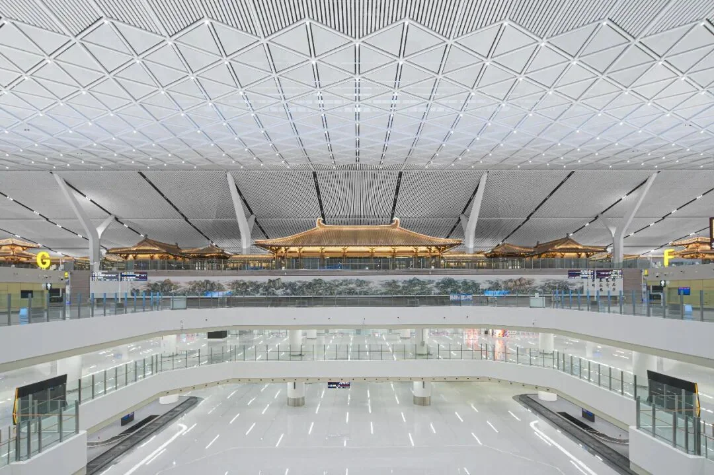

Cuando se anunciaron los Skytrax World Airport Awards 2025, la Terminal 5 del aeropuerto internacional de Xi'an Xianyang quedó en segundo lugar en la categoría de mejor nuevo terminal aeroportuario del mundo, y el aeropuerto se situó quinto entre los mejores aeropuertos regionales de China. Para quienes diseñan aeropuertos, el peso del resultado está en otro sitio: un edificio concreto se puso delante de los viajeros internacionales, con una tarjeta de puntuación.

La Terminal 5 y su centro de transporte integrado los diseñó el Instituto de Diseño e Investigación Arquitectónica del Noroeste de China. El proyecto ocupa unos 705.500 metros cuadrados, mide 47,5 metros de altura y su sala principal tiene 495 metros de anchura y 252 de profundidad. Lo que sigue repasa la configuración, la cubierta, la zonificación y el transporte frente a tres exigencias que suelen tirar en direcciones opuestas: aparcar aviones, caminar poco y mostrar cultura.

## Las cifras, primero

| Elemento | Cifra |
| --- | --- |
| Superficie total construida | unos 705.500 m² |
| Altura | 47,5 m |
| Anchura de la sala principal | 495 m |
| Profundidad de la sala principal | 252 m |
| Configuración de muelles | planta radial de seis dedos (la primera de China) |
| Capacidad de diseño | 80 millones de pasajeros al año |

La cifra menos evidente es la de 495 por 252 metros: los dos lados del rectángulo de la sala principal, que determinan lo que se camina desde el bordillo hasta la puerta más lejana. La altura de 47,5 metros también importa. Para un edificio pensado para 80 millones de pasajeros al año, es poca: la Terminal 5 se extiende a lo ancho en lugar de apilarse en altura, y así el proceso queda en un solo plano. El precio es la distancia, y ahí entran en juego los muelles.

## Seis dedos en lugar de un solo pasillo largo

Primero, dos términos. El lado de una terminal que da a la plataforma es el lado aire, más allá del control de seguridad, donde aparcan los aviones; el otro lado es el lado tierra, donde están las carreteras, los autobuses y la facturación. Un muelle es el pasillo que sale del edificio principal, con puertas a ambos lados.

Las terminales más antiguas suelen usar un único muelle largo, o una T. Es sencillo de construir, pero el paseo hasta la última puerta es largo y el número de puestos queda limitado por la longitud del pasillo. La Terminal 5 emplea una planta radial de seis dedos, la primera de este tipo en China: la sala principal en el centro y seis muelles que se abren en abanico como los dedos de una mano abierta.

La planta resuelve dos problemas a la vez. El primero es la fachada del lado aire. Un avión que aparca en pasarela necesita un puesto junto al borde del edificio, así que cuanto más largo sea ese borde, más puestos de contacto tiene el aeropuerto. Seis muelles multiplican la longitud de edificio que toca la plataforma, elevan el número de puestos y hacen que más pasajeros embarquen por pasarela en lugar de por autobús. El segundo es la distancia a pie: como todos los muelles parten de la misma sala principal, la puerta más lejana queda más cerca y los pasajeros en conexión no tienen que cruzar todo el edificio.

## Una cubierta Tang sobre una estructura de acero

El concepto se resume en cuatro frases: una gran sala para Chang'an, un puerto nuevo en la Ruta de la Seda, el estilo Han y Tang y un capítulo para la ciudad. En forma construida se reduce a dos gestos: una cubierta de “doble pendiente y doble cumbrera, tres niveles de aleros” y columnas en forma de Y que la sostienen.

En palabras sencillas: la cubierta no es una tapa plana. Tiene dos pendientes y dos cumbreras, con tres niveles de aleros superpuestos debajo, así que de lejos se lee como varios tejados de palacio Tang ampliados, aplanados y unidos en uno. Los aleros escalonados toman prestado de la construcción tradicional, donde cada voladizo proyecta su propia sombra; eso evita que una cubierta metálica enorme se convierta en una tapa lisa.

Las columnas en Y responden al mismo problema desde la estructura. Las luces son enormes, y columnas cada pocos metros dividirían la sala en rodajas. La Y permite que cada columna se abra cerca de la cubierta y sostenga lo de arriba como ramas: menos columnas llegan al suelo, cada fuste puede ser más esbelto, las líneas de visión quedan despejadas y la carga se reparte por una superficie mayor de cubierta.

La forma también responde al plano amurallado de Xi'an: el contorno recto de la terminal se hace eco del orden cuadrado de la muralla, y los espacios a modo de salas, las cubiertas inclinadas y las columnas convierten el “estilo Han y Tang” de eslogan en algo que el pasajero puede ver. Los materiales ecológicos y la explotación de bajo consumo también forman parte del encargo.

## Cuatro niveles, dos salidas y dos llegadas

La Terminal 5 se organiza en cuatro niveles funcionales más una doble salida y una doble llegada: cuatro niveles por función, con la salida y la llegada repartidas cada una entre dos de ellos, de modo que flujos distintos usan plantas distintas.

Con una capacidad de diseño de 80 millones de pasajeros al año, las aglomeraciones en hora punta son enormes. Si todos los pasajeros de salida facturaran y pasaran el control en un solo nivel, ningún número de mostradores y carriles daría abasto. Dividir las salidas reparte la misma hora en dos corrientes, cada una con sus islas de facturación, sus carriles de seguridad y sus rutas a los muelles; dividir las llegadas hace lo mismo con la recogida de equipajes y las zonas de encuentro. El pasajero lo nota como menos gentío: tu nivel solo atiende a una parte del horario. La capacidad sale de repartir los flujos, no de construir más grande.

## Una sola cara hasta el final y cero transbordos

En la operación, la Terminal 5 aplica un control de “una sola cara hasta el final”: la cara se convierte en la credencial de identidad que enlaza facturación, seguridad y embarque, así que los documentos salen menos veces y no se repite la misma cola. No es una función de una máquina concreta, sino un cambio en cómo se comprueba la identidad: registrada una vez, válida en todo el recorrido, en lugar de una vez por cada paso.

El equipaje circula por una plataforma de acero suspendida y totalmente cerrada, que los diseñadores presentan como pionera en China. Cerrada significa que las maletas viajan en un sistema estanco que nunca cruza los flujos de pasajeros; plataforma de acero suspendida significa que el equipo se apoya en un forjado de acero colgado de la estructura principal y no en una losa de hormigón rellena, de modo que la estructura pesa menos y el espacio inferior gana altura. Para el pasajero, el efecto es concreto y limitado: se pierden menos maletas.

La terminal se une además al centro de transporte integrado y forma una red aire-tren-carretera cuyo objetivo declarado es cero transbordos y un control rápido: el pasajero que llega en metro o en autocar no sale de un edificio, entra en otro y vuelve a hacer cola, sino que sigue un único recorrido por facturación y seguridad. Terminal y centro de transporte salieron del mismo instituto, y por eso ese recorrido se mantiene continuo sobre el plano.

## Más allá del premio

A Skytrax se la conoce a menudo como los Óscar del sector de la aviación; sus resultados se basan en encuestas de satisfacción de pasajeros en más de 500 aeropuertos de más de 100 países. Según los diseñadores, el segundo puesto reconoce el concepto, la eficiencia operativa y el cuidado humano que hay detrás del edificio.

Pero una terminal responde a preguntas más llanas que un trofeo: si el pasajero camina menos, si las maletas llegan a tiempo, si una conexión es tranquila y no una carrera. Los seis muelles, la doble salida y llegada, la plataforma suspendida de equipajes y el centro de transporte sin fisuras son las respuestas técnicas. Las pendientes y cumbreras, las columnas ramificadas y la sala en el eje son la otra respuesta: te dicen que has aterrizado en Xi'an.

## Enlaces relacionados

- **En este sitio**: [China (CN)](/country/CN)
- **Wikipedia**: [Xi'an Xianyang International Airport](https://en.wikipedia.org/wiki/Xi%27an_Xianyang_International_Airport)
- **Baidu Baike**: [Xi'an Xianyang International Airport](https://baike.baidu.com/item/%E8%A5%BF%E5%AE%89%E5%92%B8%E9%98%B3%E5%9B%BD%E9%99%85%E6%9C%BA%E5%9C%BA)

Fuente de las imágenes: Sociedad de Ingeniería Civil de Shanghái e Instituto de Diseño e Investigación Arquitectónica del Noroeste de China. Los nombres de los premios y las posiciones son los publicados por Skytrax, y las cifras del edificio, las publicadas por el instituto de diseño; para vuelos y conexiones de transporte, consulta los canales del aeropuerto y de los operadores.
