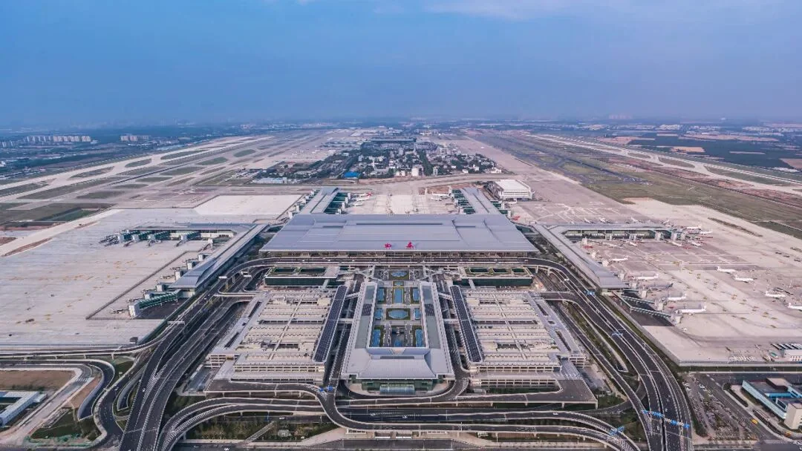

जब 2025 स्काईट्रैक्स वर्ल्ड एयरपोर्ट अवॉर्ड्स की घोषणा हुई, तो शीआन श्यानयांग अंतर्राष्ट्रीय हवाई अड्डे के टर्मिनल 5 ने विश्व का सर्वश्रेष्ठ नया हवाई अड्डा टर्मिनल श्रेणी में दूसरा स्थान पाया, और हवाई अड्डा चीन के सर्वश्रेष्ठ क्षेत्रीय हवाई अड्डों में पांचवें स्थान पर रहा। हवाई अड्डा डिज़ाइनरों के लिए इस नतीजे का महत्व कहीं और है: एक विशिष्ट इमारत को स्कोरकार्ड के साथ अंतरराष्ट्रीय यात्रियों के सामने रखा गया।

टर्मिनल 5 और उसका एकीकृत परिवहन केंद्र चाइना नॉर्थवेस्ट आर्किटेक्चर डिज़ाइन एंड रिसर्च इंस्टीट्यूट ने डिज़ाइन किया है। परियोजना लगभग 705,500 वर्ग मीटर में फैली है, 47.5 मीटर ऊंची है, और इसका मुख्य हॉल 495 मीटर चौड़ा और 252 मीटर गहरा है। आगे विन्यास, छत, ज़ोनिंग और परिवहन पर उन तीन मांगों के सामने चर्चा होगी जो आम तौर पर एक-दूसरे से टकराती हैं: विमानों की पार्किंग, कम चलना, और दिखने वाली संस्कृति।

## पहले आंकड़े पढ़ें

| मद | आंकड़ा |
| --- | --- |
| कुल फर्श क्षेत्र | लगभग 705,500 वर्ग मीटर |
| ऊंचाई | 47.5 मीटर |
| मुख्य हॉल की चौड़ाई | 495 मीटर |
| मुख्य हॉल की गहराई | 252 मीटर |
| पियर विन्यास | छह-उंगली रेडियल योजना (चीन में पहली) |
| डिज़ाइन क्षमता | प्रति वर्ष 80 मिलियन यात्री |

सबसे कम स्पष्ट आंकड़ा 495 गुणा 252 मीटर है: यह मुख्य हॉल के आयत की दो भुजाएं हैं, जो कर्बसाइड से सबसे दूर के गेट तक की दूरी तय करती हैं। 47.5 मीटर की ऊंचाई भी मायने रखती है। प्रति वर्ष 80 मिलियन यात्रियों के लिए डिज़ाइन की गई इमारत के लिए यह कम है — टर्मिनल 5 ऊपर की ओर परतों में चढ़ने के बजाय बगल में फैलता है, जिससे पूरी प्रक्रिया एक ही तल पर रहती है। इसकी कीमत दूरी है, और यहीं पियर काम आते हैं।

## एक लंबे कॉरिडोर के बजाय छह उंगलियां

पहले दो शब्द। टर्मिनल का जो हिस्सा एप्रन की ओर है वह एयरसाइड है, सुरक्षा जांच के पार, जहां विमान खड़े होते हैं; दूसरा हिस्सा लैंडसाइड है, जहां सड़कें, बसें और चेक-इन हैं। पियर वह कॉरिडोर है जो मुख्य इमारत से बाहर की ओर जाता है और जिसके दोनों किनारों पर गेट होते हैं।

पुराने टर्मिनल अक्सर एक लंबा पियर या T आकार इस्तेमाल करते हैं। इसे बनाना आसान है, लेकिन आखिरी गेट तक चलना लंबा होता है, और स्टैंड की संख्या कॉरिडोर की लंबाई तक सीमित रहती है। टर्मिनल 5 छह-उंगली रेडियल योजना अपनाता है, जो चीन में अपनी तरह की पहली है: बीच में मुख्य हॉल, और छह पियर खुली हथेली की उंगलियों की तरह बाहर फैले हुए।

यह योजना एक साथ दो समस्याएं हल करती है। पहली है एयरसाइड फ्रंटेज। ब्रिज पर खड़ा विमान इमारत के किनारे पर स्टैंड चाहता है, इसलिए वह किनारा जितना लंबा होगा, हवाई अड्डे के पास उतने ही अधिक कॉन्टैक्ट स्टैंड होंगे। छह पियर एप्रन को छूने वाली इमारत की लंबाई को कई गुना बढ़ा देते हैं, जिससे स्टैंड की संख्या बढ़ती है और अधिक यात्री बस के बजाय ब्रिज से गुज़रते हैं। दूसरी समस्या है चलने की दूरी: चूंकि हर पियर एक ही मुख्य हॉल से शुरू होता है, सबसे दूर का गेट पास हो जाता है, और ट्रांसफर करने वाले यात्रियों को पूरी इमारत पार नहीं करनी पड़ती।

## स्टील ढांचे पर तांग शैली की छत

संकल्पना चार वाक्यांशों में चलती है: चांगआन के लिए एक विशाल हॉल, सिल्क रोड पर एक नया बंदरगाह, हान और तांग की शैली, शहर के लिए एक अध्याय। निर्मित रूप में यह दो कदमों पर उतरती है — "दोहरी ढलान और दोहरी कटक, तीन स्तरों के छज्जे" वाली छत, और उसे सहारा देते Y आकार के स्तंभ।

सीधे शब्दों में, छत सपाट ढक्कन नहीं है। इसमें दो ढलानें और दो कटकें हैं, नीचे तीन स्तरों में छज्जे टिके हैं, इसलिए दूर से यह कई तांग महलों की छतों को बड़ा कर, चपटा कर और जोड़कर बनी एक छत जैसी दिखती है। परतों वाले छज्जे पारंपरिक निर्माण से लिए गए हैं, जहां हर बाहर निकला हिस्सा अपनी छाया बनाता है; इससे विशाल धातु की छत एक खाली आवरण बनने से बच जाती है।

Y आकार के स्तंभ इसी समस्या का संरचनात्मक जवाब हैं। स्पैन विशाल हैं, और हर कुछ मीटर पर स्तंभ हॉल को टुकड़ों में काट देंगे। Y आकार से हर स्तंभ छत के पास दो हिस्सों में बंट जाता है और ऊपर की संरचना को शाखाओं की तरह थाम लेता है: फर्श तक कम स्तंभ पहुंचते हैं, हर डंडी पतली हो सकती है, दृष्टि रेखाएं खुली रहती हैं, और भार छत के बड़े क्षेत्र में फैल जाता है।

यह रूप शीआन की परकोटे वाली शहर योजना का भी जवाब देता है: टर्मिनल की सीधी रूपरेखा शहर की दीवार के वर्गाकार क्रम की प्रतिध्वनि है, और हॉल जैसे खुले स्थान, ढलुआ छतें और स्तंभ "हान और तांग शैली" को नारे से ऐसी चीज़ में बदल देते हैं जिसे यात्री देख सके। हरित सामग्री और कम ऊर्जा पर चलने वाला संचालन भी संक्षिप्त विवरण का हिस्सा हैं।

## चार स्तर, दो प्रस्थान, दो आगमन

टर्मिनल 5 चार कार्यात्मक स्तरों के साथ दोहरे प्रस्थान और दोहरे आगमन में व्यवस्थित है: कार्य के हिसाब से चार स्तर, जिनमें प्रस्थान और आगमन दोनों दो-दो स्तरों पर बंटे हैं, ताकि अलग-अलग प्रवाह अलग मंजिलों का उपयोग करें।

प्रति वर्ष 80 मिलियन यात्रियों की डिज़ाइन क्षमता पर व्यस्ततम घंटे की भीड़ बहुत बड़ी होती है। अगर हर प्रस्थान करने वाला यात्री एक ही स्तर पर चेक-इन और सुरक्षा जांच करे, तो कितने भी काउंटर और लेन काफी नहीं होंगे। प्रस्थान को बांटने से एक ही घंटे का भार दो धाराओं में बंट जाता है, जिनमें से हर एक के अपने चेक-इन आइलैंड, सुरक्षा लेन और पियर तक के मार्ग होते हैं; आगमन को बांटने से सामान वापसी और मिलने के क्षेत्रों के लिए भी वही होता है। यात्री इसे कम भीड़ के रूप में महसूस करते हैं: आपका स्तर समय-सारणी का केवल एक हिस्सा संभालता है। क्षमता बड़ा बनाने से नहीं, प्रवाह को फैलाने से आती है।

## शुरू से अंत तक एक ही चेहरा, और शून्य ट्रांसफर

संचालन के स्तर पर टर्मिनल 5 "शुरू से अंत तक एक ही चेहरा" वाली क्लीयरेंस चलाता है: चेहरा ही पहचान का टोकन बन जाता है जो चेक-इन, सुरक्षा और बोर्डिंग को जोड़ता है, इसलिए दस्तावेज़ बार-बार नहीं निकालने पड़ते और एक ही कतार दोहरानी नहीं पड़ती। यह किसी एक गेट मशीन की विशेषता नहीं, बल्कि पहचान जांचने के तरीके में बदलाव है — एक बार पंजीकरण, पूरे सफर में मान्य, हर कदम पर दोबारा नहीं।

सामान पूरी तरह बंद, लटके हुए स्टील प्लेटफॉर्म पर चलता है, जिसे डिज़ाइनर चीन में अग्रणी बताते हैं। बंद होने का मतलब है कि बैग एक सीलबंद प्रणाली में चलते हैं जो कभी यात्री प्रवाह को नहीं काटती; लटके हुए स्टील प्लेटफॉर्म का मतलब है कि उपकरण ठोस कंक्रीट स्लैब के बजाय मुख्य ढांचे से लटके स्टील डेक पर बैठता है, इसलिए ढांचा हल्का रहता है और नीचे की जगह में ऊंचाई मिलती है। यात्रियों के लिए असर संकीर्ण और ठोस है: कम बैग भटकते हैं।

टर्मिनल एकीकृत परिवहन केंद्र से भी जुड़ा है, जिससे एक एयर-रेल-रोड नेटवर्क बनता है जिसका घोषित लक्ष्य शून्य ट्रांसफर और तेज़ क्लीयरेंस है: मेट्रो या कोच से आने वाले यात्री को एक इमारत से निकलकर दूसरी में जाकर फिर कतार नहीं लगानी पड़ती, बल्कि वह चेक-इन और सुरक्षा से होते हुए एक ही मार्ग पर चलता है। टर्मिनल और परिवहन केंद्र एक ही संस्थान की रचना हैं, इसीलिए ड्राइंग पर वह मार्ग निरंतर रहता है।

## पुरस्कार से आगे

स्काईट्रैक्स को अक्सर विमानन उद्योग का ऑस्कर कहा जाता है; इसके नतीजे 100 से अधिक देशों के 500 से अधिक हवाई अड्डों पर यात्री संतुष्टि सर्वेक्षणों पर टिके हैं। डिज़ाइनरों के अनुसार दूसरा स्थान इमारत के पीछे की संकल्पना, संचालन कुशलता और मानवीय संवेदनशीलता को मान्यता देता है।

लेकिन टर्मिनल ट्रॉफी से कहीं सीधे सवालों के जवाब देता है: क्या यात्री को कम चलना पड़ता है, क्या बैग समय पर आते हैं, क्या कनेक्शन भागदौड़ के बजाय शांत है। छह पियर, दोहरे प्रस्थान और आगमन, लटका हुआ सामान डेक और निर्बाध परिवहन केंद्र तकनीकी जवाब हैं। ढलानें और कटकें, शाखाओं में बंटते स्तंभ और अक्ष पर बना हॉल दूसरा जवाब हैं: वे बताते हैं कि आप शीआन पहुंचे हैं।

## संबंधित लिंक

- **इस साइट पर**: [चीन (CN)](/country/CN)
- **विकिपीडिया**: [शीआन श्यानयांग अंतर्राष्ट्रीय हवाई अड्डा](https://en.wikipedia.org/wiki/Xi%27an_Xianyang_International_Airport)
- **बाइडू बाइके**: [शीआन श्यानयांग अंतर्राष्ट्रीय हवाई अड्डा](https://baike.baidu.com/item/%E8%A5%BF%E5%AE%89%E5%92%B8%E9%98%B3%E5%9B%BD%E9%99%85%E6%9C%BA%E5%9C%BA)

चित्र स्रोत: शांघाई सोसाइटी ऑफ सिविल इंजीनियरिंग और चाइना नॉर्थवेस्ट आर्किटेक्चर डिज़ाइन एंड रिसर्च इंस्टीट्यूट। पुरस्कारों के नाम और स्थान स्काईट्रैक्स द्वारा प्रकाशित के अनुसार, और इमारत के आंकड़े डिज़ाइन संस्थान द्वारा प्रकाशित के अनुसार हैं; उड़ानों और परिवहन कनेक्शनों के लिए हवाई अड्डे और ऑपरेटरों के अपने चैनल देखें।
