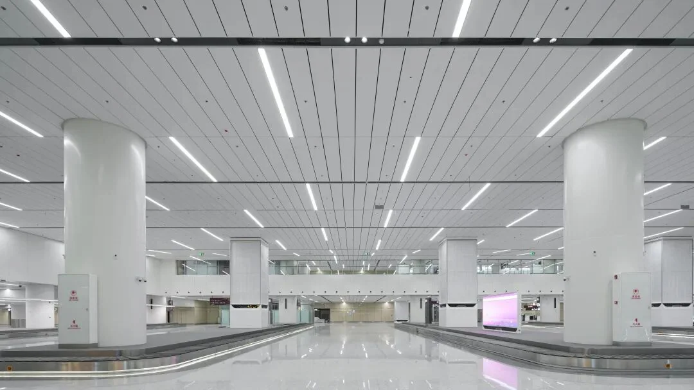

Când au fost anunțate rezultatele World Airport Awards 2025 ale Skytrax, Terminalul 5 al Aeroportului Internațional Xi'an Xianyang s-a clasat pe locul al doilea la categoria „Cel mai bun terminal nou de aeroport din lume”, iar aeroportul a ocupat locul al cincilea între cele mai bune aeroporturi regionale din China. Pentru proiectanții de aeroporturi, greutatea rezultatului stă în altă parte: o clădire anume a fost pusă în fața călătorilor internaționali, cu o fișă de punctaj.

Terminalul 5 și centrul său integrat de transport au fost proiectate de Institutul de Proiectare și Cercetare Arhitecturală China Northwest. Proiectul acoperă aproximativ 705.500 de metri pătrați, are o înălțime de 47,5 metri, iar sala sa principală are 495 de metri lățime și 252 de metri adâncime. În continuare trecem prin configurație, acoperiș, zonare și transport, raportat la trei cerințe care de obicei se contrazic: parcarea aeronavelor, distanțe scurte de mers și cultura vizibilă.

## Mai întâi cifrele

| Element | Valoare |
| --- | --- |
| Suprafață totală construită | aproximativ 705.500 m² |
| Înălțime | 47,5 m |
| Lățimea sălii principale | 495 m |
| Adâncimea sălii principale | 252 m |
| Configurația pierurilor | plan radial cu șase degete (primul din China) |
| Capacitate proiectată | 80 de milioane de pasageri pe an |

Cifra cea mai puțin evidentă este 495 pe 252 de metri: cele două laturi ale dreptunghiului sălii principale, care stabilesc distanța de mers de la bordura trotuarului până la cea mai îndepărtată poartă. Și înălțimea de 47,5 metri contează. Pentru o clădire proiectată să deservească 80 de milioane de pasageri pe an, este puțin — Terminalul 5 se întinde în lateral, nu se suprapune pe verticală, ceea ce ține procesul pe un singur plan. Prețul este distanța, iar aici intervin pierurile.

## Șase degete în loc de un singur coridor lung

Mai întâi, doi termeni. Latura unui terminal orientată spre platforma aeronavelor este partea aeriană, dincolo de controlul de securitate, unde staționează aeronavele; cealaltă latură este partea terestră, unde se află drumurile, autobuzele și check-inul. Un pier este coridorul care pornește din clădirea principală, cu porți de-a lungul ambelor flancuri.

Terminalele mai vechi folosesc adesea un singur pier lung, sau un T. Este simplu de construit, dar mersul până la ultima poartă este lung, iar numărul de standuri este limitat de lungimea coridorului. Terminalul 5 folosește un plan radial cu șase degete, primul de acest fel din China: sala principală la mijloc, șase pieruri întinse în evantai ca degetele unei mâini deschise.

Planul rezolvă două probleme deodată. Prima este frontul aerian. O aeronavă parcată la o pasarelă are nevoie de un stand de-a lungul marginii clădirii, așa că, cu cât acea margine este mai lungă, cu atât aeroportul are mai multe standuri cu îmbarcare directă. Șase pieruri multiplică lungimea clădirii care atinge platforma, crescând numărul de standuri și ducând mai mulți pasageri prin pasarelă, nu cu autobuzul. A doua este distanța de mers: pentru că fiecare pier pornește din aceeași sală principală, cea mai îndepărtată poartă este mai aproape, iar pasagerii în tranzit nu trebuie să traverseze toată clădirea.

## Un acoperiș Tang pe o structură de oțel

Conceptul se desfășoară în patru fraze: o mare sală pentru Chang'an, un port nou pe Drumul Mătăsii, maniera Han și Tang, un capitol pentru oraș. În formă construită, se reduce la două gesturi — un acoperiș cu „pante duble și coame duble, trei rânduri de streașini” și coloane în formă de Y care îl susțin.

Spus pe șleau, acoperișul nu este un capac plat. Are două pante și două coame, cu trei rânduri de streașini suprapuse dedesubt, așa că de la distanță se citește ca mai multe acoperișuri de palate Tang mărite, aplatizate și unite într-unul singur. Streașinile stratificate împrumută din construcția tradițională, unde fiecare consolă își aruncă propria umbră; asta împiedică un acoperiș metalic uriaș să devină un simplu capac anonim.

Coloanele în Y răspund aceleiași probleme din punct de vedere structural. Deschiderile sunt uriașe, iar coloane la fiecare câțiva metri ar felia sala. Forma în Y permite fiecărei coloane să se ramifice lângă acoperiș și să susțină structura de deasupra ca niște ramuri: mai puține coloane ajung la podea, fiecare trunchi poate fi mai subțire, liniile de vedere rămân deschise, iar sarcina se distribuie pe o suprafață mai mare de acoperiș.

Forma răspunde și planului de oraș fortificat al Xi'anului: conturul drept al terminalului reia ordinea pătrată a zidului cetății, iar spațiile de tip sală, acoperișurile înclinate și coloanele transformă „stilul Han și Tang” dintr-un slogan în ceva ce pasagerul poate vedea. Materialele ecologice și exploatarea cu consum redus de energie fac și ele parte din tema de proiectare.

## Patru niveluri, două plecări, două sosiri

Terminalul 5 este organizat pe patru niveluri funcționale, plus plecări duble și sosiri duble: patru niveluri după funcțiune, cu plecările și sosirile împărțite fiecare pe câte două dintre ele, așa că fluxuri diferite folosesc etaje diferite.

La o capacitate proiectată de 80 de milioane de pasageri pe an, aglomerația la orele de vârf este uriașă. Dacă fiecare pasager în plecare ar face check-inul și controlul de securitate la un singur nivel, niciun număr de ghișee și benzi nu ar ține pasul. Împărțirea plecărilor împarte aceeași oră în două fluxuri, fiecare cu insularele sale de check-in, benzile de securitate și rutele spre pieruri; împărțirea sosirilor face același lucru pentru ridicarea bagajelor și zonele de întâlnire. Pasagerii simt asta ca mai puțină aglomerație: nivelul dumneavoastră deservește doar o parte din program. Capacitatea vine din dispersarea fluxurilor, nu din construirea mai mare.

## O singură față până la capăt și zero transferuri

Operațional, Terminalul 5 aplică o verificare „cu o singură față până la capăt”: fața devine jetonul de identitate care leagă check-inul, securitatea și îmbarcarea, așa că documentele sunt scoase mai rar, iar aceeași coadă nu se mai repetă. Nu este o funcție a unei singure automate de poartă, ci o schimbare a modului în care este verificată identitatea — înregistrată o dată, valabilă pe tot parcursul, în loc de o dată la fiecare pas.

Bagajele circulă pe o platformă de oțel suspendată, complet închisă, despre care proiectanții spun că este o premieră în China. Închisă înseamnă că bagajele călătoresc într-un sistem sigilat care nu se intersectează niciodată cu fluxurile de pasageri; platformă de oțel suspendată înseamnă că echipamentul stă pe un planșeu de oțel suspendat de structura principală, nu pe o placă de beton plină, așa că structura este mai ușoară, iar spațiul de dedesubt câștigă înălțime. Pentru pasageri, efectul este simplu și concret: mai puține bagaje se rătăcesc.

Terminalul se conectează și la centrul integrat de transport, formând o rețea aer–feroviar–rutieră al cărei obiectiv declarat este zero transferuri și un control rapid: un pasager care sosește cu metroul sau cu autocarul nu părăsește o clădire, intră în alta și stă din nou la coadă, ci urmează o singură rută prin check-in și securitate. Terminalul și centrul de transport au fost proiectate de același institut, și de aceea ruta rămâne continuă pe desen.

## Dincolo de premiu

Skytrax este adesea numit Oscarul industriei aviației; rezultatele sale se bazează pe sondaje de satisfacție a pasagerilor din peste 500 de aeroporturi din mai mult de 100 de țări. Potrivit proiectanților, locul al doilea recunoaște conceptul, eficiența operațională și grija pentru oameni din spatele clădirii.

Dar un terminal răspunde la întrebări mai simple decât un trofeu: poate pasagerul să meargă mai puțin, ajung bagajele la timp, este o conexiune liniștită și nu o alergătură. Cele șase pieruri, plecările și sosirile duble, platforma suspendată de bagaje și centrul de transport fără rupturi sunt răspunsurile tehnice. Pantele și coamele, coloanele ramificate și sala de pe axă sunt celălalt răspuns: vă spun că ați aterizat în Xi'an.

## Linkuri utile

- **Pe acest site**: [China (CN)](/country/CN)
- **Wikipedia**: [Aeroportul Internațional Xi'an Xianyang](https://en.wikipedia.org/wiki/Xi%27an_Xianyang_International_Airport)
- **Baidu Baike**: [Aeroportul Internațional Xi'an Xianyang](https://baike.baidu.com/item/%E8%A5%BF%E5%AE%89%E5%92%B8%E9%98%B3%E5%9B%BD%E9%99%85%E6%9C%BA%E5%9C%BA)

Sursa imaginii: Societatea de Inginerie Civilă din Shanghai și Institutul de Proiectare și Cercetare Arhitecturală China Northwest. Numele premiilor și clasările sunt cele publicate de Skytrax, iar cifrele clădirii cele publicate de institutul de proiectare; pentru zboruri și legături de transport, verificați canalele proprii ale aeroportului și ale operatorilor.
