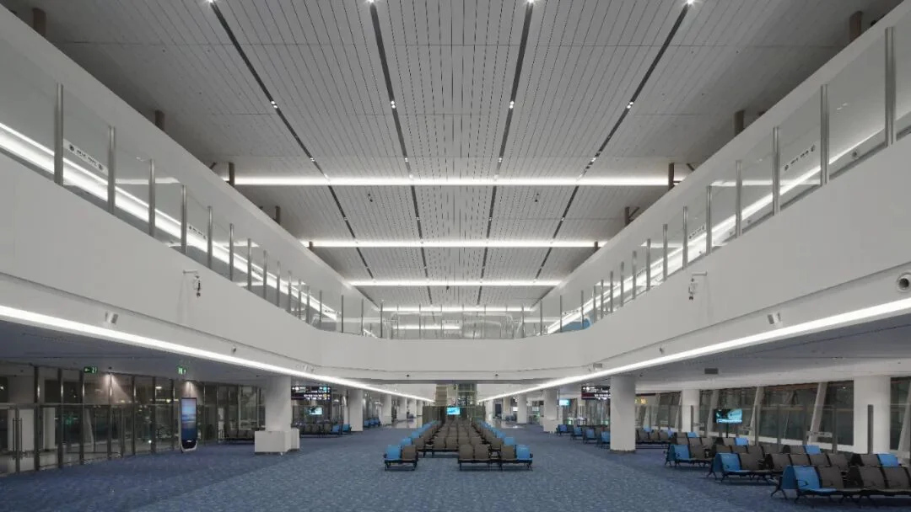

2025 Skytrax Dünya Havalimanı Ödülleri açıklandığında, Xi'an Xianyang Uluslararası Havalimanı'ndaki Terminal 5, Dünyanın En İyi Yeni Havalimanı Terminali kategorisinde ikinci sırayı aldı ve havalimanı, Çin'in En İyi Bölgesel Havalimanları sıralamasında beşinci oldu. Havalimanı tasarımcıları için sonucun ağırlığı başka bir yerde: uluslararası gezginlerin önüne, bir puan kartıyla birlikte belirli bir bina kondu.

Terminal 5 ve entegre ulaşım merkezi, Çin Kuzeybatı Mimarlık Tasarım ve Araştırma Enstitüsü tarafından tasarlandı. Proje yaklaşık 705.500 metrekarelik bir alanı kaplıyor, 47,5 metre yüksekliğinde ve ana salonu 495 metre genişliğinde, 252 metre derinliğinde. Aşağıda, genellikle birbirini zorlayan üç talebe — uçak park etme, kısa yürüyüşler, görünür kültür — karşı yapılandırma, çatı, bölgeleme ve ulaşım ele alınıyor.

## Önce rakamlar

| Öğe | Değer |
| --- | --- |
| Toplam kat alanı | yaklaşık 705.500 m² |
| Yükseklik | 47,5 m |
| Ana salon genişliği | 495 m |
| Ana salon derinliği | 252 m |
| Parmak düzeni | altı parmaklı radyal plan (Çin'de ilk) |
| Tasarım kapasitesi | yılda 80 milyon yolcu |

En az belirgin rakam 495'e 252 metre: ana salonun dikdörtgeninin iki kenarı, kaldırımdan en uzak kapıya yürüyüşü belirliyor. 47,5 metrelik yükseklik de önemli. Yılda 80 milyon yolcu için tasarlanmış bir bina için bu düşük — Terminal 5 yukarı doğru katlanmak yerine yanlara yayılıyor, böylece süreç tek bir düzlemde kalıyor. Bedeli mesafe; parmakların devreye girdiği yer burası.

## Tek uzun koridor yerine altı parmak

Önce iki terim. Bir terminalin apron tarafına bakan yüzü hava tarafıdır; güvenliğin ötesinde, uçakların park ettiği yerdir. Diğer yüzü kara tarafıdır; yollar, otobüsler ve check-in buradadır. Parmak ise ana binadan dışarı uzanan, iki yanında kapılar bulunan koridordur.

Eski terminaller genellikle tek bir uzun parmak ya da bir T kullanır. İnşası basittir, ancak son kapıya yürüyüş uzundur ve park pozisyonu sayısı koridorun uzunluğuyla sınırlıdır. Terminal 5, Çin'de türünün ilki olan altı parmaklı radyal bir plan kullanıyor: ortada ana salon, altı parmak açık bir elin parmakları gibi yelpaze şeklinde dışarı açılıyor.

Plan aynı anda iki sorunu çözüyor. Birincisi hava tarafı cephesi. Körüğe yanaşan bir uçak, binanın kenarı boyunca bir park pozisyonuna ihtiyaç duyar; bu kenar ne kadar uzunsa havalimanının o kadar fazla körüklü park pozisyonu olur. Altı parmak, aprona temas eden bina uzunluğunu katlar; park pozisyonu sayısını artırır ve daha fazla yolcuyu otobüs yerine körükten geçirir. İkincisi yürüme mesafesi: her parmak aynı ana salondan başladığı için en uzak kapı daha yakındır ve aktarma yapan yolcuların tüm binayı geçmesi gerekmez.

## Çelik iskelet üzerinde Tang çatısı

Konsept dört ifadeyle ilerliyor: Chang'an için büyük bir salon, İpek Yolu'nda yeni bir liman, Han ve Tang üslubu, şehir için bir bölüm. İnşa edilmiş hâlinde iş iki hamleye iniyor: “çift eğimli ve çift mahyalı, üç kademeli saçaklı” bir çatı ve onu ayakta tutan Y biçimli kolonlar.

Açıkça söylemek gerekirse çatı düz bir kapak değil. İki eğimi ve iki mahyası var; altında üç kademeli saçaklar üst üste binmiş, böylece uzaktan birkaç Tang sarayı çatısının büyütülmüş, yassılaştırılmış ve tek bir çatıda birleştirilmiş hâli gibi görünüyor. Katmanlı saçaklar, her çıkıntının kendi gölgesini düşürdüğü geleneksel yapıdan ödünç alınmış; bu, devasa bir metal çatının boş bir örtüye dönüşmesini engelliyor.

Y biçimli kolonlar aynı soruna yapısal bir yanıt veriyor. Açıklıklar çok büyük ve birkaç metrede bir kolon, salonu dilimlere bölerdi. Y biçimi, her kolonun çatıya yakın bir yerde ikiye ayrılmasını ve üstteki yapıyı dallar gibi tutmasını sağlıyor: yere daha az kolon iniyor, her gövde daha ince olabiliyor, görüş hatları açık kalıyor ve yük daha geniş bir çatı alanına yayılıyor.

Biçim, Xi'an'ın surlarla çevrili şehir planına da yanıt veriyor: terminalin düz hatlı dış çizgisi şehir surlarının kare düzenini yansıtıyor; salon benzeri mekânlar, eğimli çatılar ve kolonlar “Han ve Tang üslubunu” bir slogandan yolcunun görebileceği bir şeye dönüştürüyor. Yeşil malzemeler ve düşük enerjili işletme de projenin hedefleri arasında.

## Dört kat, iki kalkış, iki varış

Terminal 5, dört işlevsel kat ile çift kalkış ve çift varış olarak düzenlenmiş: işleve göre dört kat; kalkış ve varış ikişer kata bölünmüş, böylece farklı akışlar farklı katları kullanıyor.

Yılda 80 milyon yolcu tasarım kapasitesiyle yoğun saat kalabalıkları çok büyük. Kalkan her yolcu tek bir katta check-in yapıp güvenlikten geçseydi, hiçbir sayıda kontuar ve şerit yetişemezdi. Kalkışları bölmek aynı saati iki akışa ayırıyor; her akışın kendi check-in adaları, güvenlik şeritleri ve parmaklara giden güzergâhları var. Varışları bölmek de bagaj alımı ve karşılama alanları için aynısını yapıyor. Yolcular bunu daha az kalabalık olarak hissediyor: kendi katınız tarifenin yalnızca bir bölümüne hizmet ediyor. Kapasite daha büyük inşa etmekten değil, akışları yaymaktan geliyor.

## Baştan sona tek yüz ve sıfır aktarma

Operasyonel olarak Terminal 5, “baştan sona tek yüz” bir kontrol uyguluyor: yüz, check-in, güvenlik ve binişi birbirine bağlayan kimlik belirteci hâline geliyor; böylece belgeler daha seyrek çıkarılıyor ve aynı kuyruk tekrarlanmıyor. Bu, tek bir kapı makinesinin özelliği değil, kimliğin nasıl kontrol edildiğinde bir değişiklik: her adımda bir kez yerine bir kez kaydedilip baştan sona geçerli.

Bagaj, tamamen kapalı, asma çelik bir platform üzerinde ilerliyor; tasarımcılar bunu Çin'de öncü olarak nitelendiriyor. Kapalı, çantaların yolcu akışlarını hiç kesmeyen sızdırmaz bir sistemde yol aldığı anlamına geliyor; asma çelik platform ise ekipmanın doldurulmuş beton bir plaka yerine ana yapıdan asılan çelik bir güvertede durduğu anlamına geliyor; böylece yapı daha hafif oluyor ve altındaki alan yükseklik kazanıyor. Yolcular için etkisi dar ve somut: daha az çanta kayboluyor.

Terminal ayrıca entegre ulaşım merkezine bağlanıyor ve belirtilen hedefi sıfır aktarma ile hızlı kontrol olan bir hava-ray-kara ağı oluşturuyor: metro veya şehirlerarası otobüsle gelen yolcu bir binadan çıkıp diğerine girerek yeniden sıraya girmiyor, check-in ve güvenlikten geçen tek bir güzergâhı izliyor. Terminal ve ulaşım merkezi aynı enstitüden çıktı; güzergâhın çizim üzerinde kesintisiz kalması da bundan.

## Ödülün ötesinde

Skytrax'e sık sık havacılık sektörünün Oscar'ı deniyor; sonuçları 100'den fazla ülkedeki 500'den fazla havalimanında yapılan yolcu memnuniyeti anketlerine dayanıyor. Tasarımcılara göre ikincilik, binanın arkasındaki konsepti, işletme verimliliğini ve insana verilen özeni takdir ediyor.

Ama bir terminal, bir kupadan daha sade sorulara yanıt verir: yolcu daha az yürüyebiliyor mu, çantalar zamanında geliyor mu, bir aktarma telaştan çok sakin mi. Altı parmak, çift kalkış ve varışlar, asma bagaj güvertesi ve kesintisiz ulaşım merkezi teknik yanıtlar. Eğimler ve mahyalar, dallanan kolonlar ve eksen üzerindeki salon ise diğer yanıt: Xi'an'a indiğinizi söylüyorlar.

## İlgili bağlantılar

- **Bu sitede**: [Çin (CN)](/country/CN)
- **Wikipedia**: [Xi'an Xianyang Uluslararası Havalimanı](https://en.wikipedia.org/wiki/Xi%27an_Xianyang_International_Airport)
- **Baidu Baike**: [Xi'an Xianyang Uluslararası Havalimanı](https://baike.baidu.com/item/%E8%A5%BF%E5%AE%89%E5%92%B8%E9%98%B3%E5%9B%BD%E9%99%85%E6%9C%BA%E5%9C%BA)

Görsel kaynağı: Şanghay İnşaat Mühendisliği Derneği ve Çin Kuzeybatı Mimarlık Tasarım ve Araştırma Enstitüsü. Ödül adları ve sıralamalar Skytrax'in, bina rakamları tasarım enstitüsünün yayımladığı gibidir; uçuşlar ve ulaşım bağlantıları için havalimanının ve işletmecilerin kendi kanallarına bakın.
