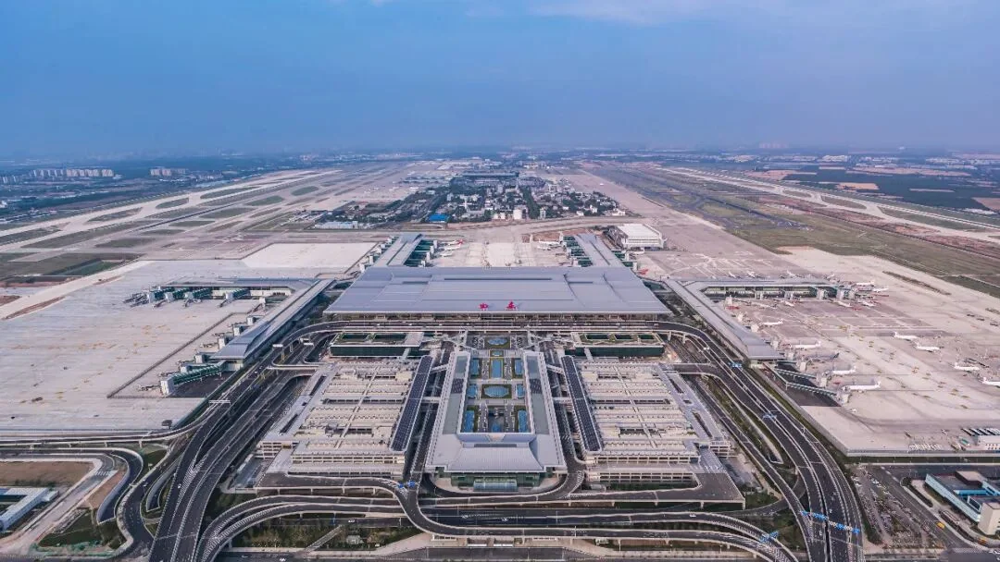
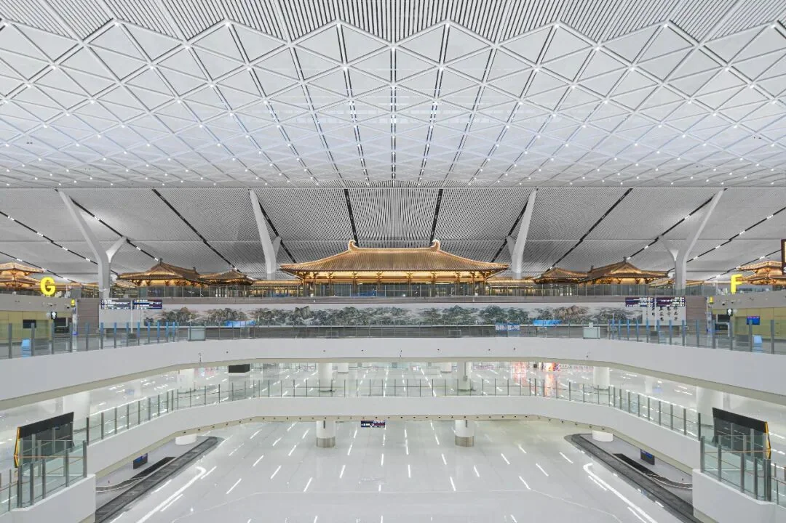
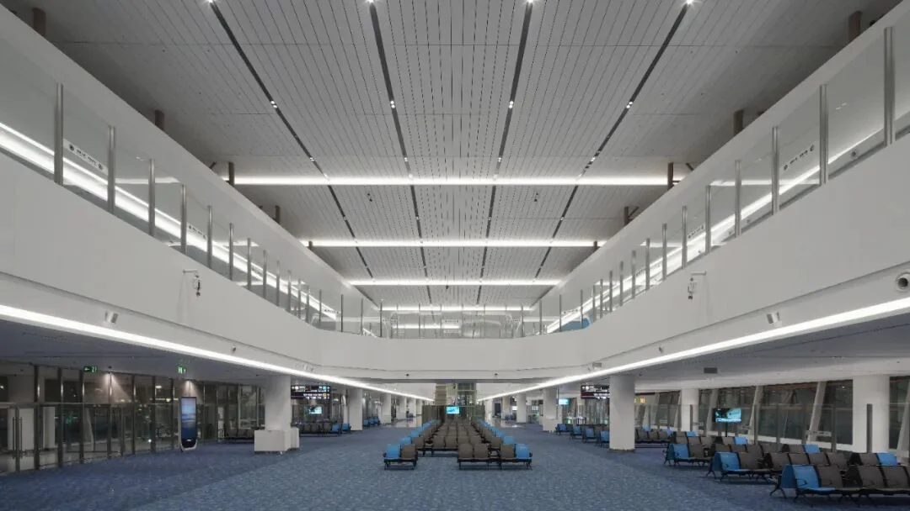
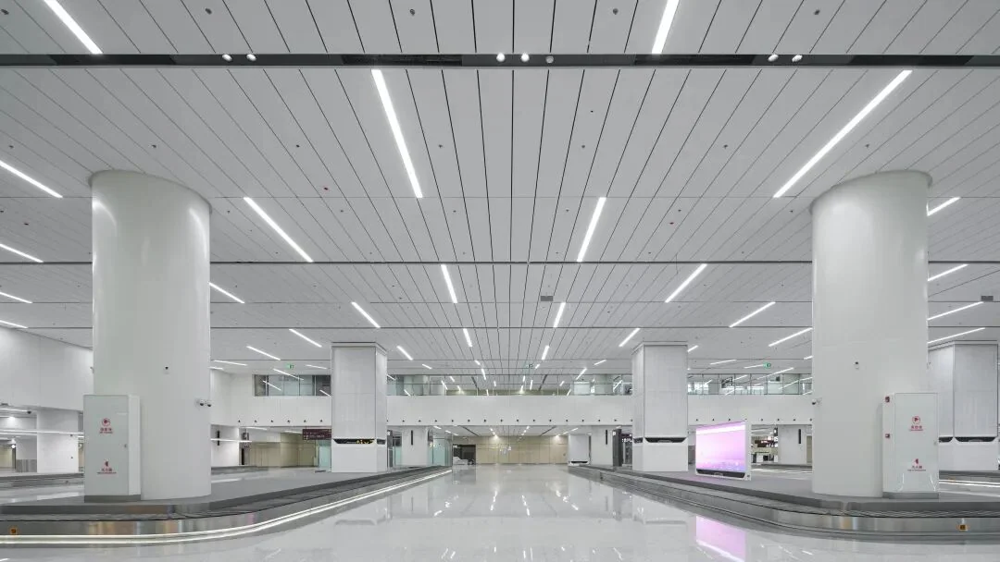

2025 年 Skytrax 全球機場大獎揭曉後，西安咸陽國際機場 T5 航廈拿到“全球最佳新機場航廈”第二名（TOP2），機場同時位列“中國區最佳區域機場”第五名。多數報道把它當作一條服務評比的新聞，但對建築設計行業來說，這份成績單的分量在別處：一個具體的建築作品，被放進了國際旅客的打分表。

T5 航廈及綜合交通中心專案由中建西北院設計，總建築面積約 70.55 萬平方米，建築高度 47.5 米，主樓面寬 495 米、進深 252 米。下面按構型、屋頂、分割槽、交通四個層次，把這座樓的建築邏輯講清楚——它如何在“讓飛機好停”“讓人少走路”“讓文化看得見”這幾件常常互相拉扯的事之間找平衡。

## 一、先把幾個數字讀一遍

| 專案 | 資料 |
| --- | --- |
| 設計單位 | 中建西北院 |
| 總建築面積 | 約 70.55 萬平方米 |
| 建築高度 | 47.5 米 |
| 主樓面寬 | 495 米 |
| 主樓進深 | 252 米 |
| 指廊構型 | 六指廊放射狀（國內首例） |
| 設計年旅客吞吐量 | 8000 萬人次 |

這組數字裡最容易被忽略的是“面寬 495 米、進深 252 米”。它描述的是主樓這個巨大矩形的兩條邊，也直接決定了從門口到最遠閘口的基本距離。

47.5 米的高度也值得一說：T5 是橫向展開的，不是向上堆疊的。好處是流程平鋪、旅客不必反覆上下樓；壞處是距離變長，於是就有了下面的“指廊”問題。

## 二、六指廊放射狀：為什麼“手掌”比“長廊”好走

先解釋兩個詞。航廈臨停機坪的一側叫“空側”，是過了安檢之後、飛機停靠的區域；另一側叫“陸側”，是公共交通、車道邊和值機大廳所在的區域。所謂“指廊”，就是從主樓伸向停機坪的候機廊道，旅客在指廊兩側的閘口上飛機。

傳統航廈常見“一”字形或“T”字形佈局：一條長長的候機廊，機位沿廊道排開。這種佈局施工簡單，但旅客走到盡頭要走很久，機位數量也受廊道長度限制。T5 採用的是國內首例的六指廊放射狀構型：主樓在中間，六條指廊像手指一樣向外伸出，整體像一隻攤開的手掌。

這個構型主要解決兩個問題。第一是“空側岸線”——飛機要靠橋停靠，就需要沿建築外牆佈置近機位，外牆越長，能停的近機位越多。六條指廊把建築與停機坪接觸的外牆面積成倍放大，機位數量隨之增加，旅客更多時候可以走廊橋，而不是坐擺渡車在機坪上繞。第二是步行距離——所有指廊都從同一座主樓出發，最遠端的距離被壓短，轉機旅客不必穿越整座建築再折返。

放射狀當然不是新發明，但“六指廊”的規模在國內是第一次。指廊越多，主樓與指廊的交接面越複雜：行李系統要在分叉處轉彎，機電管線和消防分割槽要重新計算。這類構型因此更常見於吞吐量足夠大的樞紐機場。

## 三、“長安盛殿”：唐風屋頂怎麼落到鋼結構上

T5 的設計理念是十六個字：“長安盛殿、絲路新港、漢唐風韻、城市華章”。落到具體形態上，是兩個可以指認的動作：屋頂的“雙坡雙脊、重簷三疊”，以及支撐屋面的 Y 形柱。

用直白的話說，屋面不是一個平板：兩道坡、兩道屋脊，再疊出三層簷口，遠看像幾座唐代宮殿的屋頂被放大、拉平、連成一片。它借的是傳統建築裡“簷”的層次感——屋簷層層出挑，光影有了深淺，巨大的金屬屋面因此不至於變成一塊平淡的蓋子。

Y 形柱則是結構上的應對。屋面的跨度很大，如果按常規每隔幾米落一根柱子，大廳會被切得支離破碎。Y 形柱讓柱子在接近屋面處分叉，像樹枝一樣托住上方結構：落地柱的數量減少，柱身可以做得細一些，視線更通透，荷載又通過分叉分散到更大的屋面面積上。

這套形態還呼應了西安“四方城”的城市格局：直線型的規整輪廓與城牆圍出的方形秩序同構，殿式空間、坡屋頂與柱式則把“漢唐風韻”從口號變成旅客能看見的形體。設計方同時強調綠色建材與低能耗執行，希望它成為低能耗空港的一個樣本。

## 四、四層分割槽、雙層出發到達：把 8000 萬人次拆開

T5 採用“四層功能分割槽 + 雙層出發、雙層到達”的模式。這句話聽著抽象，實際意思是：航廈按功能分成四層，出發和到達又各自分成兩層，不同方向、不同性質的客流走不同的樓層。

為什麼要這樣分？年設計容量 8000 萬人次的航廈，高峰時段的人流是驚人的。如果所有出發旅客都在同一層值機、同一層安檢，櫃檯和通道再怎麼加也會堵。把出發拆成兩層，等於把同一時刻的客流分成兩股，各自擁有值機島、安檢通道和通往指廊的路徑；到達拆成兩層，行李轉盤和接機區也一分為二，到達旅客不必和出發旅客對沖。

對旅客的感受是“分層不打架”：你所在的那一層，只服務一部分航班，隊伍短一些，找櫃檯也快一些。8000 萬人次的容量，靠的正是這種把客流拆散的佈局，而不是單純把樓蓋大。

## 五、“一張臉走到底”與“零換乘”

在流程層面，T5 部署了“一張臉走到底”的智慧通關服務：以人臉作為身份憑證，把值機、安檢、登機串起來，減少反覆掏證件、反覆排隊的次數。這不是某一個閘機的新功能，而是把身份核驗從“每個環節各做一次”改成“一次註冊、全程通行”。

行李系統用的是全國領先的全封閉式懸吊行李鋼平臺。拆成兩半看：全封閉，指行李在封閉通道里運輸，不與人流交叉；懸吊鋼平臺，指整套裝置架在懸掛於主體結構的鋼平臺上，而非填實的混凝土樓板上——自重更輕，下方空間的高度也被釋放出來。對旅客來說，這些術語的落點只有一個：行李更少出錯。

航廈還與綜合交通中心無縫銜接，組成“航空 + 軌道 + 公路”的立體交通網路，目標是“零換乘”“快通關”。對旅客來說，這意味著從軌道交通或長途巴士下車後，不必先出樓、再進樓、重新排隊，而是沿同一條通道完成值機和安檢。

## 六、獎項之外，一座建築要回答的問題

Skytrax 在國際航空運輸評級領域被稱作航空業的“奧斯卡”，評選基於對全球 100 多個國家、500 多座機場的旅客滿意度調查。按設計方的說法，T5 的“全球最佳新機場航廈”第二名，是國際旅客對其設計理念、執行效率和人文關懷的認可。

但一座航廈最終要回答的問題，比獎盃樸素得多：旅客能不能少走一點路，行李能不能準時出來，轉機能不能不慌，老人和孩子能不能找到座位。T5 的六條指廊、雙層出發到達、懸吊行李平臺和零換乘通道，都是對這幾個問題的技術回答；屋頂的坡與脊、柱子的分叉、中軸上的殿式空間，則是另一層回答——它告訴到達的人，你到的是西安。

這也解釋了設計方為什麼會用“以建築之美講好中國故事”來總結這個專案。對每天走過這座樓的人來說，故事講得好不好，取決於下一次從 T5 出發時，值機、安檢、走到閘口這幾步順不順。

## 相關連結

- **本站頁面**：[中國（CN）](/tw/country/CN)
- **維基百科**：[西安咸陽國際機場](https://zh.wikipedia.org/wiki/%E8%A5%BF%E5%AE%89%E5%92%B8%E9%98%B3%E5%9B%BD%E9%99%85%E6%9C%BA%E5%9C%BA)

圖片來源：上海市土木工程學會、中建西北院。獎項名稱與名次以 Skytrax 公佈為準，建築資料以設計單位公佈為準；航班與交通資訊請以機場和運營方官方渠道為準。
