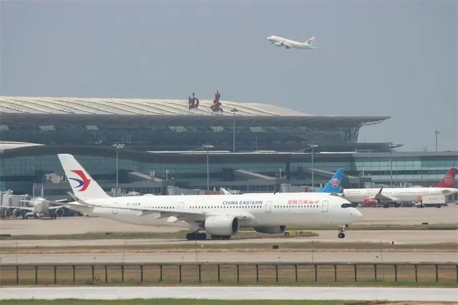
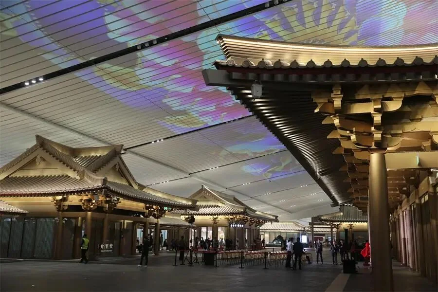
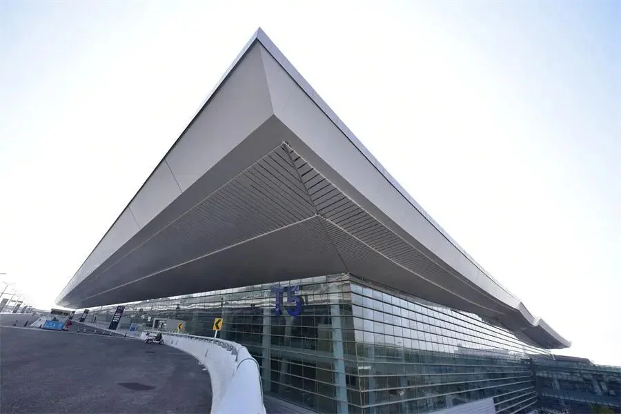
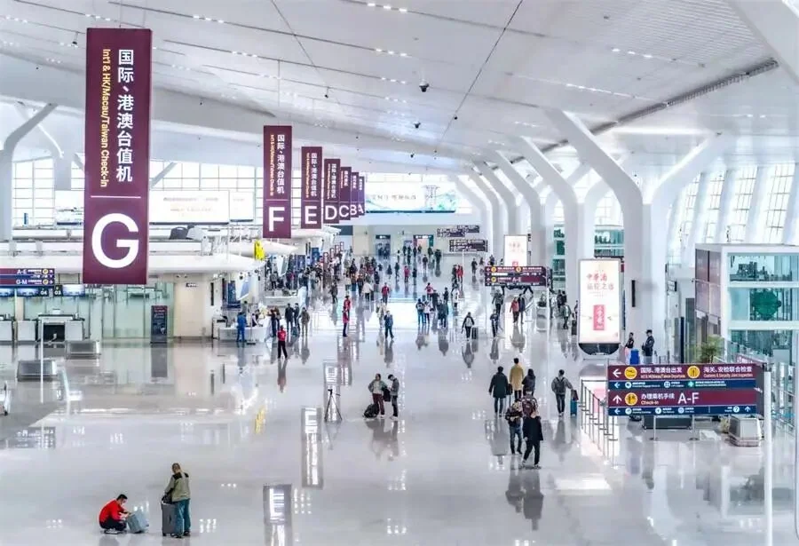

Il Terminal 5 dell'aeroporto internazionale di Xi'an Xianyang (XIY) è stato classificato secondo nella categoria World's Best New Airport Terminal ai Skytrax World Airport Awards 2025. Nello stesso ciclo di risultati l'aeroporto si è piazzato quinto nella classifica Skytrax Best Regional Airports in China. L'aeroporto ha comunicato i risultati ai media locali, che li hanno riportati il 20 marzo 2026.

I due piazzamenti misurano cose diverse. Il premio per il terminal giudica un singolo edificio nuovo: se lo spazio funziona, se i percorsi dei passeggeri sono efficienti, se le strutture superano la scheda di valutazione di un viaggiatore. Il premio per gli aeroporti regionali giudica l'aeroporto nel suo insieme, servizio e operazioni compresi. Per un viaggiatore il primo significa che probabilmente partirà da un terminal nuovo, con sistemi nuovi; il secondo che quei processi si collocano vicino alla testa del gruppo per aeroporti di questa dimensione. Quanto segue separa i due risultati, il modo in cui Skytrax ci arriva e dove si inserisce il Terminal 5 nell'espansione dello scalo.

## Due risultati, due gare diverse

La categoria World's Best New Airport Terminal copre i terminal aperti di recente, e il giudizio è dei passeggeri: se lo spazio funziona, se i percorsi sono brevi, se le strutture ci sono. La tabella dei risultati 2025 pubblicata con l'annuncio elenca i primi cinque:

| World's Best New Airport Terminal 2025 | Aeroporto e terminal |
| --- | --- |
| 1 | Almaty Terminal 2, Kazakistan |
| 2 | Xi'an Xianyang Terminal 5, Cina |
| 3 | Riyadh Terminal 1, Arabia Saudita |
| 4 | Saint Maarten |
| 5 | Luanda, Angola |

Quindi, sul fronte dei nuovi terminal, il Terminal 5 è arrivato secondo al mondo, dietro Almaty Terminal 2 e davanti a Riyadh Terminal 1, Saint Maarten e Luanda.

La classifica Best Regional Airports in China valuta un aeroporto nel suo insieme, coprendo servizio, operazioni e gestione tra gli aeroporti regionali del Paese. La stessa tabella dei risultati 2025 elenca i primi dieci:

| Best Regional Airports in China 2025 | Aeroporto (come elencato) |
| --- | --- |
| 1 | Haikou Meilan |
| 2 | Sanya Phoenix |
| 3 | Changsha |
| 4 | Xiamen |
| 5 | Xi'an |
| 6 | Hangzhou |
| 7 | Qingdao |
| 8 | Kunming |
| 9 | Wuhan |
| 10 | Tianjin Binhai |

Xi'an si è piazzato quinto, dietro Haikou Meilan, Sanya Phoenix, Changsha e Xiamen, e davanti a Hangzhou, Qingdao, Kunming, Wuhan e Tianjin Binhai. Per un hub occidentale di questa dimensione, significa stare nel gruppo alto degli aeroporti comparabili.

## Come Skytrax arriva ai risultati

Secondo l'aeroporto, Skytrax è tra gli organismi di valutazione più autorevoli per la qualità del servizio di compagnie e aeroporti, e i suoi risultati si basano su indagini sulla soddisfazione reale dei passeggeri che coprono oltre 500 aeroporti in più di 100 Paesi. Le sue classifiche annuali sono ampiamente considerate nel settore un parametro credibile.

Questo dà forma ai due tipi di premio. Un premio per un nuovo terminal dipende molto dalle prime impressioni: se lo spazio è facile da usare, se la camminata stanca, se la segnaletica è chiara, se ci sono abbastanza posti a sedere e prese di corrente. Un premio per aeroporti regionali dipende dalle prestazioni di lungo periodo: lunghezza delle file nelle ore di punta, se i bagagli arrivano in modo affidabile, come il personale gestisce un problema. Il primo si può vincere poco dopo l'apertura; il secondo richiede anni. Vincere entrambi suggerisce che non c'è un divario evidente tra hardware nuovo e operatività quotidiana.

## Il Terminal 5 come cuore dell'espansione

Il Terminal 5 è il pezzo centrale del programma di espansione dello scalo come hub e ha attirato attenzione fin dall'apertura. L'aeroporto afferma che l'edificio è entrato in lista grazie alla pianificazione dello spazio lungimirante, ai percorsi passeggeri efficienti e alle strutture pensate per le persone, e lo descrive come un nuovo biglietto da visita aereo per Xi'an.

Dietro quella frase c'è un rapporto semplice tra un terminal e un aeroporto. I colli di bottiglia della capacità spesso non sono in pista ma nel check-in, nella sicurezza, nella gestione dei bagagli e nell'imbarco: quando tutti arrivano nello stesso edificio nello stesso momento, banchi, corsie e nastri diventano il vincolo. Un nuovo terminal porta non solo più superficie ma la possibilità di riorganizzare il processo, distribuendo isole check-in, corsie di sicurezza, sistemi bagagli e gate intorno a un nuovo modello di traffico invece di adattarli a un edificio vecchio.

## Che cosa significa per i viaggiatori

Se volate presto da Xi'an, il terminal è il cambiamento pratico. Il Terminal 5 è nuovo, quindi anche le strutture e il flusso attraverso check-in, sicurezza e sala d'imbarco sono nuovi. L'aeroporto gestisce ancora più terminal contemporaneamente, quindi verificate il terminal sulle informazioni del volo prima di partire: presentarsi nell'edificio sbagliato è l'errore più comune in un aeroporto con più terminal.

Il secondo punto riguarda le aspettative. Il quinto posto tra gli aeroporti regionali cinesi non renderà un biglietto più economico o una fila alla sicurezza più corta, ma è un segnale che vale la pena leggere: le valutazioni dei passeggeri sul processo di servizio qui sono forti per un aeroporto di questa dimensione. Ciò che decide davvero un viaggio resta l'orario, i documenti e quanto presto arrivate in aeroporto. Lasciare un margine sufficiente fa più per un viaggio di qualsiasi trofeo.

L'aeroporto dice che continuerà a investire nell'innovazione del servizio e nel portare la cultura locale nell'edificio. Per i viaggiatori il test è semplice: la prossima volta che partite dal Terminal 5, quanto sono scorrevoli check-in, sicurezza e camminata fino al gate.

## Link utili

- **Su questo sito**: [Cina (CN)](/country/CN)
- **Wikipedia**: [Xi'an Xianyang International Airport](https://en.wikipedia.org/wiki/Xi%27an_Xianyang_International_Airport)
- **Baidu Baike**: [Xi'an Xianyang International Airport](https://baike.baidu.com/item/%E8%A5%BF%E5%AE%89%E5%92%B8%E9%98%B3%E5%9B%BD%E9%99%85%E6%9C%BA%E5%9C%BA)

Fonte delle immagini: Shaanxi Communication Society e Xi'an Daily. Nomi dei premi, piazzamenti e criteri sono quelli pubblicati da Skytrax e dall'aeroporto; per voli, terminal e orari di apertura, consultate i canali della compagnia e dell'aeroporto.
