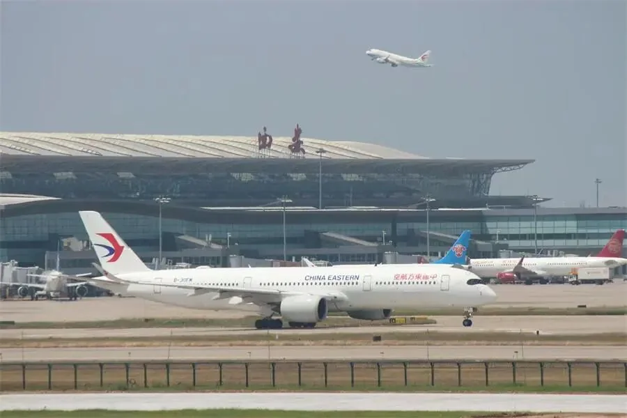

Terminal 5 på Xi'an Xianyang International Airport (XIY) har rankats tvåa i kategorin World's Best New Airport Terminal vid Skytrax World Airport Awards 2025. I samma omgång resultat kom flygplatsen femma i Skytrax rankning Best Regional Airports in China. Flygplatsen gav resultaten till lokal media, som rapporterade dem den 20 mars 2026.

De två placeringarna mäter olika saker. Terminalpriset bedömer en enskild ny byggnad: om utrymmet fungerar, om passagerarvägarna är effektiva, om faciliteterna håller måttet i en resenärs betyg. Priset för regionala flygplatser bedömer flygplatsen som helhet, inklusive service och drift. För en resenär betyder det första att du sannolikt avgår från eller ankommer till en terminal som är ny, med nya system; det andra att de processerna ligger nära täten bland flygplatser av den här storleken. Det följande skiljer de två resultaten åt, hur Skytrax kommer fram till dem och var terminal 5 passar in i flygplatsens utbyggnad.

## Två resultat, två olika lopp

Kategorin World's Best New Airport Terminal omfattar terminaler som öppnat nyligen, och bedömningen görs av passagerare: om utrymmet fungerar, om vägarna är korta, om faciliteterna finns. Resultattabellen för 2025 som publicerades med tillkännagivandet listar de fem bästa:

| World's Best New Airport Terminal 2025 | Flygplats och terminal |
| --- | --- |
| 1 | Almaty Terminal 2, Kazakstan |
| 2 | Xi'an Xianyang Terminal 5, Kina |
| 3 | Riyadh Terminal 1, Saudiarabien |
| 4 | Saint Maarten |
| 5 | Luanda, Angola |

Så på den nya terminalbanan slutade terminal 5 tvåa i världen, efter Almaty Terminal 2 och före Riyadh Terminal 1, Saint Maarten och Luanda.

Rankningen Best Regional Airports in China bedömer en flygplats som helhet, med service, drift och ledning över landets regionala flygplatser. Samma resultattabell för 2025 listar de tio bästa:

| Best Regional Airports in China 2025 | Flygplats (enligt listan) |
| --- | --- |
| 1 | Haikou Meilan |
| 2 | Sanya Phoenix |
| 3 | Changsha |
| 4 | Xiamen |
| 5 | Xi'an |
| 6 | Hangzhou |
| 7 | Qingdao |
| 8 | Kunming |
| 9 | Wuhan |
| 10 | Tianjin Binhai |

Xi'an kom femma, efter Haikou Meilan, Sanya Phoenix, Changsha och Xiamen, och före Hangzhou, Qingdao, Kunming, Wuhan och Tianjin Binhai. För en hub i västra Kina av den här storleken placerar det flygplatsen i den övre gruppen av jämförbara flygplatser.

## Hur Skytrax kommer fram till sina resultat

Enligt flygplatsen är Skytrax ett av de mest ansedda bedömningsorganen för flygbolags och flygplatsers servicekvalitet, och resultaten bygger på undersökningar av verklig passagerarnöjdhet som omfattar fler än 500 flygplatser i över 100 länder. Deras årliga rankningar betraktas allmänt i branschen som ett trovärdigt riktmärke.

Det präglar de två typerna av pris. Ett pris för ny terminal beror starkt på första intryck: om utrymmet är lätt att använda, om promenaden är tröttande, om skyltningen är tydlig, om det finns tillräckligt med sittplatser och eluttag. Ett pris för regional flygplats beror på långsiktig prestation: kölängder i rusning, om väskorna kommer fram pålitligt, hur personalen hanterar ett problem. Det första kan vinnas strax efter öppningen; det andra tar år. Att vinna båda tyder på inget uppenbart gap mellan ny hårdvara och vardaglig drift.

## Terminal 5 som kärnan i utbyggnaden

Terminal 5 är centrum i flygplatsens program för hubbutbyggnad och har väckt uppmärksamhet sedan den öppnade. Flygplatsen säger att byggnaden tog sig in på listan tack vare framåtblickande rumsplanering, effektiva passagerarvägar och människocentrerade faciliteter, och beskriver den som ett nytt flygande visitkort för Xi'an.

Bakom den formuleringen ligger ett enkelt förhållande mellan en terminal och en flygplats. Kapacitetsflaskhalsar sitter ofta inte på rullbanan utan i incheckning, säkerhetskontroll, bagagehantering och ombordstigning: när alla anländer till samma byggnad samtidigt blir diskar, banor och bagageband begränsningen. En ny terminal ger inte bara mer golvyta utan en chans att lägga om processen, med incheckningsöar, säkerhetsbanor, bagagesystem och gater ordnade kring en ny trafikmodell i stället för inpassade i en gammal byggnad.

## Vad det betyder för resenärer

Om du ska flyga från Xi'an snart är terminalen den praktiska förändringen. Terminal 5 är ny, så faciliteterna och flödet genom incheckning, säkerhetskontroll och avgångslounge är också nya. Flygplatsen driver fortfarande flera terminaler samtidigt, så bekräfta terminalen mot din flyginformation innan du åker: att dyka upp vid fel byggnad är det vanligaste misstaget på en flygplats med flera terminaler.

Den andra punkten handlar om förväntningar. En femteplats bland regionala flygplatser i Kina gör inte biljetten billigare eller säkerhetskön kortare, men det är en signal värd att läsa: passagerarnas betyg på serviceprocessen här är starka för en flygplats av den här storleken. Vad som faktiskt avgör en resa är fortfarande tidtabellen, dina dokument och hur tidigt du kommer till flygplatsen. Att lämna tillräcklig marginal gör mer för en resa än någon trofé.

Flygplatsen säger att man kommer att fortsätta investera i serviceinnovation och i att föra in lokalkultur i byggnaden. För resenärer är provet enkelt: nästa gång du åker från terminal 5, hur smidiga är incheckningen, säkerhetskontrollen och promenaden till gaten.

## Relaterade länkar

- **På den här sidan**: [Kina (CN)](/country/CN)
- **Wikipedia**: [Xi'an Xianyang International Airport](https://en.wikipedia.org/wiki/Xi%27an_Xianyang_International_Airport)
- **Baidu Baike**: [Xi'an Xianyang International Airport](https://baike.baidu.com/item/%E8%A5%BF%E5%AE%89%E5%92%B8%E9%98%B3%E5%9B%BD%E9%99%85%E6%9C%BA%E5%9C%BA)

Bildkälla: Shaanxi Communication Society och Xi'an Daily. Utmärkelsernas namn, placeringar och kriterier är som publicerade av Skytrax och flygplatsen; för flyg, terminaler och öppettider, kontrollera flygbolagets och flygplatsens egna kanaler.
