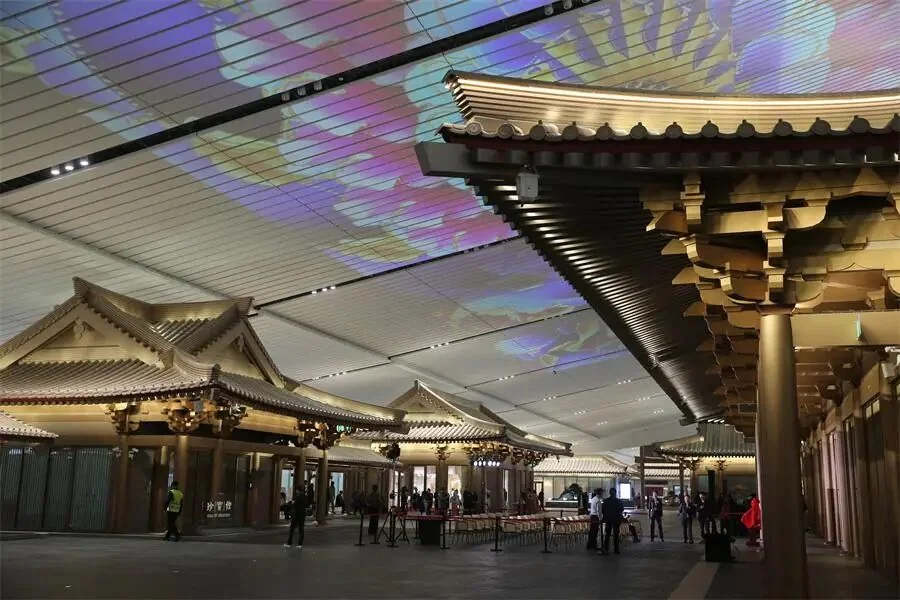
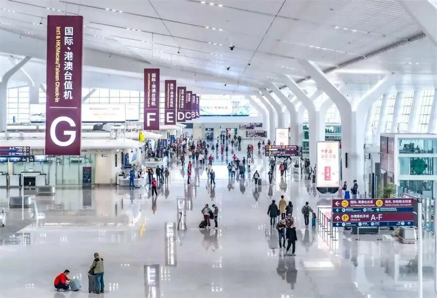

Terminali 5 katika Uwanja wa Ndege wa Kimataifa wa Xi'an Xianyang (XIY) imeshika nafasi ya pili katika kategoria ya Kituo Kipya Bora cha Uwanja wa Ndege Duniani kwenye Tuzo za Skytrax za Viwanja vya Ndege Duniani za 2025. Katika matokeo hayo hayo, uwanja umeshika nafasi ya tano katika orodha ya Skytrax ya Viwanja Bora vya Ndege vya Kikanda nchini China. Uwanja uliipa vyombo vya habari vya ndani matokeo hayo, ambavyo viliripoti tarehe 20 Machi 2026.

Nafasi hizi mbili hupima mambo tofauti. Tuzo ya terminali hupima jengo moja jipya: kama nafasi inafanya kazi, kama njia za abiria zina ufanisi, kama vifaa vinaweza kustahimili kadi ya alama ya msafiri. Tuzo ya uwanja wa kikanda hupima uwanja kwa ujumla, ikijumuisha huduma na uendeshaji. Kwa msafiri, ya kwanza inamaanisha kuwa una uwezekano mkubwa wa kuondoka au kuwasili katika terminali mpya, yenye mifumo mipya; ya pili inamaanisha kuwa michakato hiyo iko mbele kabisa kwa viwanja vya ukubwa huu. Kinachofuata kinatenganisha matokeo mawili, jinsi Skytrax inavyoyafikia na mahali Terminali 5 ilipo katika upanuzi wa uwanja.

## Matokeo mawili, mbio mbili tofauti

Kategoria ya Kituo Kipya Bora cha Uwanja wa Ndege Duniani inajumuisha terminali zilizofunguliwa hivi karibuni, na uamuzi hufanywa na abiria: kama nafasi inafanya kazi, kama njia ni fupi, kama vifaa vipo. Jedwali la matokeo ya 2025 lililochapishwa pamoja na tangazo linaorodhesha tano bora:

| Kituo Kipya Bora cha Uwanja wa Ndege Duniani 2025 | Uwanja wa ndege na terminali |
| --- | --- |
| 1 | Terminali 2 ya Almaty, Kazakhstan |
| 2 | Terminali 5 ya Xi'an Xianyang, China |
| 3 | Terminali 1 ya Riyadh, Saudi Arabia |
| 4 | Saint Maarten |
| 5 | Luanda, Angola |

Kwa hiyo kwenye kigezo cha terminali mpya, Terminali 5 ilimaliza kwenye nafasi ya pili duniani, nyuma ya Terminali 2 ya Almaty na mbele ya Terminali 1 ya Riyadh, Saint Maarten na Luanda.

Orodha ya Viwanja Bora vya Ndege vya Kikanda nchini China hupima uwanja kwa ujumla, ikijumuisha huduma, uendeshaji na usimamizi katika viwanja vya kikanda nchini humo. Jedwali lilelile la matokeo ya 2025 linaorodhesha kumi bora:

| Viwanja Bora vya Ndege vya Kikanda nchini China 2025 | Uwanja wa ndege (kama ulivyoorodheshwa) |
| --- | --- |
| 1 | Haikou Meilan |
| 2 | Sanya Phoenix |
| 3 | Changsha |
| 4 | Xiamen |
| 5 | Xi'an |
| 6 | Hangzhou |
| 7 | Qingdao |
| 8 | Kunming |
| 9 | Wuhan |
| 10 | Tianjin Binhai |

Xi'an ilishika nafasi ya tano, nyuma ya Haikou Meilan, Sanya Phoenix, Changsha na Xiamen, na mbele ya Hangzhou, Qingdao, Kunming, Wuhan na Tianjin Binhai. Kwa kitovu cha magharibi cha China cha ukubwa huu, hilo kinaiweka katika kundi la juu la viwanja vinavyolingana.

## Jinsi Skytrax inavyofikia matokeo yake

Kwa mujibu wa uwanja, Skytrax ni miongoni mwa mashirika yenye mamlaka zaidi ya kupima ubora wa huduma za mashirika ya ndege na viwanja vya ndege, na matokeo yake yanategemea tafiti za kuridhika kwa abiria halisi katika viwanja zaidi ya 500 katika nchi zaidi ya 100. Orodha zake za kila mwaka huchukuliwa sana katika sekta kama kipimo cha kuaminika.

Hilo linaunda aina mbili za tuzo. Tuzo ya terminali mpya inategemea sana maoni ya kwanza: kama nafasi ni rahisi kutumia, kama matembezi ni ya kuchosha, kama alama za mwelekeo ziko wazi, kama kuna viti na soketi za umeme vya kutosha. Tuzo ya uwanja wa kikanda inategemea utendaji wa muda mrefu: urefu wa foleni wakati wa kilele, kama mizigo hufika kwa uhakika, jinsi wafanyakazi wanavyoshughulikia tatizo. Tuzo ya kwanza inaweza kupatikana muda mfupi baada ya kufunguliwa; ya pili huchukua miaka. Kushinda zote mbili kunaonyesha hakuna pengo dhahiri kati ya vifaa vipya na uendeshaji wa kila siku.

## Terminali 5 kama kiini cha upanuzi

Terminali 5 ni kiini cha mpango wa upanuzi wa kitovu cha uwanja na imevutia umakini tangu ilipofunguliwa. Uwanja unasema jengo hilo liliingia kwenye orodha kutokana na upangaji wake wa nafasi wenye mtazamo wa mbele, njia za abiria zenye ufanisi na vifaa vinavyoweka binadamu katikati, na unalielezea kama kadi mpya ya mwaliko ya anga ya Xi'an.

Nyuma ya kifungu hicho cha maneno kuna uhusiano rahisi kati ya terminali na uwanja wa ndege. Vikwazo vya uwezo mara nyingi haviko kwenye njia ya ndege bali kwenye kujisajili, ulinzi, utunzaji wa mizigo na kupanda: watu wote wanapofika kwenye jengo moja kwa wakati mmoja, kaunta, njia na mizunguko ya mizigo huwa kikwazo. Terminali mpya haileti eneo kubwa zaidi la sakafu pekee bali nafasi ya kupanga upya mchakato, ikiweka visiwa vya kujisajili, njia za ulinzi, mifumo ya mizigo na malango kuzunguka mtindo mpya wa trafiki badala ya kuvibana ndani ya jengo la zamani.

## Maana yake kwa wasafiri

Ikiwa unaondoka Xi'an kwa ndege hivi karibuni, terminali ndiyo mabadiliko ya kivitendo. Terminali 5 ni mpya, kwa hiyo vifaa na mtiririko wa kujisajili, ulinzi na ukumbi wa kuondoka pia ni mpya. Uwanja bado unaendesha terminali kadhaa kwa wakati mmoja, kwa hiyo thibitisha terminali kwa kutumia taarifa za ndege yako kabla ya kuondoka: kufika kwenye jengo lisilofaa ni kosa la kawaida zaidi katika uwanja wenye terminali nyingi.

Jambo la pili linahusu matarajio. Nafasi ya tano kati ya viwanja vya kikanda nchini China haitafanya tiketi kuwa nafuu au foleni ya ulinzi kuwa fupi, lakini ni ishara inayofaa kutafsiriwa: tathmini za abiria kuhusu mchakato wa huduma hapa ni nzuri kwa uwanja wa ukubwa huu. Kinachoamua safari kwa kweli bado ni ratiba, nyaraka zako na jinsi unavyofika uwanjani mapema. Kuacha muda wa ziada kunafanya zaidi kwa safari kuliko kombe lolote.

Uwanja unasema utaendelea kuwekeza katika uvumbuzi wa huduma na kuleta utamaduni wa eneo hilo ndani ya jengo. Kwa wasafiri, kipimo ni rahisi: mara ijayo unapoondoka kutoka Terminali 5, kujisajili, ulinzi na matembezi hadi langoni ni laini kiasi gani.

## Viungo vinavyohusiana

- **Kwenye tovuti hii**: [China (CN)](/country/CN)
- **Wikipedia**: [Uwanja wa Ndege wa Kimataifa wa Xi'an Xianyang](https://en.wikipedia.org/wiki/Xi%27an_Xianyang_International_Airport)
- **Baidu Baike**: [Uwanja wa Ndege wa Kimataifa wa Xi'an Xianyang](https://baike.baidu.com/item/%E8%A5%BF%E5%AE%89%E5%92%B8%E9%98%B3%E5%9B%BD%E9%99%85%E6%9C%BA%E5%9C%BA)

Chanzo cha picha: Shaanxi Communication Society na Xi'an Daily. Majina ya tuzo, nafasi na vigezo ni kama yalivyochapishwa na Skytrax na uwanja; kwa safari za ndege, terminali na saa za kufungua, angalia njia za shirika la ndege na uwanja wenyewe.
