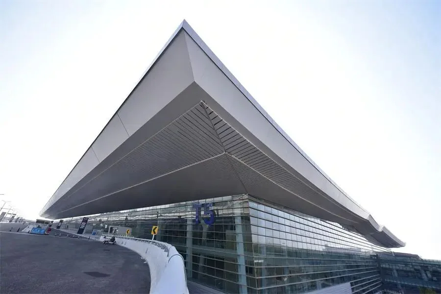

Термінал 5 Міжнародного аеропорту Сіань Сяньян (XIY) посів друге місце в категорії «Найкращий новий термінал аеропорту світу» на премії Skytrax World Airport Awards 2025. У тому самому турі результатів аеропорт став п'ятим у рейтингу Skytrax «Найкращі регіональні аеропорти Китаю». Аеропорт передав результати місцевим медіа, які повідомили про них 20 березня 2026 року.

Ці два місця вимірюють різне. Нагорода за термінал оцінює одну нову будівлю: чи працює простір, чи ефективні пасажирські маршрути, чи витримують об'єкти оцінку мандрівника. Нагорода за регіональний аеропорт оцінює аеропорт загалом, разом із сервісом і операціями. Для мандрівника перше означає, що ви, найімовірніше, вилетите або прилетите в термінал, який є новим і має нові системи; друге означає, що ці процеси перебувають близько до передової для аеропортів такого розміру. Далі йтиметься про те, чим відрізняються ці два результати, як Skytrax до них доходить і яке місце термінал 5 посідає в розбудові аеропорту.

## Два результати — дві різні гонки

Категорія «Найкращий новий термінал аеропорту світу» охоплює термінали, що відкрилися нещодавно, і оцінюють їх пасажири: чи працює простір, чи короткі маршрути, чи є потрібні об'єкти. Опублікована з оголошенням таблиця результатів 2025 року містить першу п'ятірку:

| Найкращий новий термінал аеропорту світу 2025 | Аеропорт і термінал |
| --- | --- |
| 1 | Термінал 2, Алмати, Казахстан |
| 2 | Термінал 5 Сіань Сяньяна, Китай |
| 3 | Термінал 1, Ер-Ріяд, Саудівська Аравія |
| 4 | Сінт-Мартен |
| 5 | Луанда, Ангола |

Отже, на новій термінальній дистанції термінал 5 фінішував другим у світі — після термінала 2 в Алмати й перед терміналом 1 в Ер-Ріяді, Сінт-Мартеном і Луандою.

Рейтинг «Найкращі регіональні аеропорти Китаю» оцінює аеропорт загалом, охоплюючи сервіс, операції та управління серед регіональних аеропортів країни. Та сама таблиця результатів 2025 року містить першу десятку:

| Найкращі регіональні аеропорти Китаю 2025 | Аеропорт (як у списку) |
| --- | --- |
| 1 | Хайкоу Мейлань |
| 2 | Санья Фенікс |
| 3 | Чанша |
| 4 | Сямень |
| 5 | Сіань |
| 6 | Ханчжоу |
| 7 | Ціндао |
| 8 | Куньмін |
| 9 | Ухань |
| 10 | Тяньцзінь Біньхай |

Сіань став п'ятим — після Хайкоу Мейлань, Санья Фенікс, Чанші та Сяменя й перед Ханчжоу, Ціндао, Куньміном, Уханем і Тяньцзінь Біньхаєм. Для західного хаба такого розміру це ставить його до верхньої групи порівнянних аеропортів.

## Як Skytrax доходить до результатів

За даними аеропорту, Skytrax належить до найавторитетніших рейтингових організацій у сфері якості обслуговування авіакомпаній та аеропортів, а його результати спираються на опитування реальної задоволеності пасажирів у понад 500 аеропортах у більш ніж 100 країнах. Галузь широко сприймає його щорічні рейтинги як надійний орієнтир.

Це формує два типи нагород. Нагорода за новий термінал сильно залежить від першого враження: чи легко користуватися простором, чи не втомлює дорога, чи зрозумілі вказівники, чи достатньо місць для сидіння та розеток. Нагорода за регіональний аеропорт залежить від тривалої роботи: довжина черг у пікові години, чи надійно прибуває багаж, як персонал діє в разі проблеми. Першу можна здобути невдовзі після відкриття; друга потребує років. Перемога в обох свідчить, що між новим обладнанням і щоденною роботою немає очевидної прогалини.

## Термінал 5 як ядро розбудови

Термінал 5 — центральний елемент програми розбудови хаба аеропорту, і він привертає увагу від самого відкриття. Аеропорт каже, що будівля потрапила до списку завдяки далекоглядному плануванню простору, ефективним пасажирським маршрутам і об'єктам, орієнтованим на людину, і називає її новою повітряною візитівкою Сіаня.

За цією фразою стоїть просте співвідношення між терміналом і аеропортом. Вузькі місця пропускної здатності часто не на злітній смузі, а в реєстрації, контролі безпеки, обробці багажу й посадці: коли всі прибувають в одну будівлю одночасно, стійки, смуги й каруселі стають обмеженням. Новий термінал дає не лише більше площі, а й шанс перебудувати процес — розкласти острови реєстрації, смуги контролю, багажні системи та виходи на посадку навколо нової моделі руху, а не втискати їх у стару будівлю.

## Що це означає для мандрівників

Якщо ви скоро вилітаєте з Сіаня, практична зміна — це термінал. Термінал 5 новий, тож нові й об'єкти, і потік через реєстрацію, контроль безпеки та зал очікування. Аеропорт досі працює з кількома терміналами одночасно, тому перед виїздом звірте термінал з інформацією про ваш рейс: приїхати не до тієї будівлі — найпоширеніша помилка в багатотермінальному аеропорту.

Другий момент — про очікування. П'яте місце серед регіональних аеропортів Китаю не зробить квиток дешевшим, а чергу на контролі коротшою, але це сигнал, який варто прочитати: оцінки пасажирів щодо обслуговування тут високі для аеропорту такого розміру. Подорож і далі вирішують розклад, ваші документи й те, наскільки рано ви приїдете в аеропорт. Достатній запас часу робить для поїздки більше, ніж будь-який трофей.

Аеропорт каже, що й надалі інвестуватиме в інновації в обслуговуванні та в те, щоб привносити місцеву культуру в будівлю. Для мандрівників перевірка проста: наступного разу, коли ви вилітатимете з термінала 5, наскільки гладко пройдуть реєстрація, контроль і дорога до виходу на посадку.

## Пов'язані посилання

- **На цьому сайті**: [Китай (CN)](/country/CN)
- **Вікіпедія**: [Міжнародний аеропорт Сіань Сяньян](https://en.wikipedia.org/wiki/Xi%27an_Xianyang_International_Airport)
- **Baidu Baike**: [Міжнародний аеропорт Сіань Сяньян](https://baike.baidu.com/item/%E8%A5%BF%E5%AE%89%E5%92%B8%E9%98%B3%E5%9B%BD%E9%99%85%E6%9C%BA%E5%9C%BA)

Джерело зображення: Товариство зв'язку Шеньсі та Xi'an Daily. Назви нагород, місця й критерії наведено за публікаціями Skytrax і аеропорту; щодо рейсів, терміналів і годин роботи перевіряйте власні канали авіакомпанії та аеропорту.
