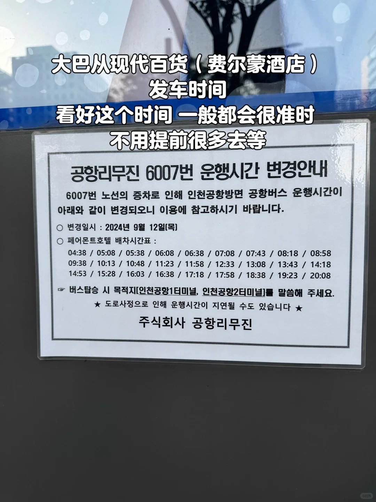

Yeouido-তে থাকুন, কিংবা বিমানবন্দরে যাওয়ার আগে ডিপার্টমেন্ট স্টোরে সকালটা কাটান — সবচেয়ে সহজ উপায় বাস 6007: এটি Fairmont Ambassador Seoul-এর দরজা থেকে ছেড়ে এক্সপ্রেসওয়ে ধরে Incheon International Airport-এ যায়, আর পথে আর মাত্র কয়েকটি হোটেলে থামে।

নিচে: স্টপ কোথায় পাবেন, ভাড়া কীভাবে দেবেন, লাগেজ কে সামলায়, সময়সূচি কোথায় দেখবেন আর বিমানবন্দরে কত সময় হাতে রাখবেন। ভাড়া ও সময় বদলায়, তাই যাত্রার আগে স্টপ ও পরিচালনকারী সংস্থা যাচাই করে নিন।

## 1. কাদের জন্য এই বাস

Yeouido-র হোটেলগুলো ডিপার্টমেন্ট স্টোর ও IFC টাওয়ারের আশপাশে জড়ো, আর Incheon পর্যন্ত মেট্রো যাত্রা মোটেও হালকা নয়: Line 5 বা Line 9 ধরে Gimpo Airport, তারপর AREX রেল, সঙ্গে দুবার গেট আর দুবার লাগেজ সামলানো।

বাস 6007-এ পুরো পথটা একবারেই হয়ে যায়।

| বিকল্প | আনুমানিক সময় | আনুমানিক ভাড়া | বদল |
| --- | --- | --- | --- |
| বাস 6007 | প্রায় 1 ঘণ্টা (ব্যস্ত সময়ে বেশি) | প্রায় 17,000 won | নেই |
| মেট্রো + সব স্টপে থামা AREX | প্রায় 1 ঘণ্টা 10 মিনিট | প্রায় 5,500 won থেকে | 1–2 |

ভাড়ার পার্থক্যটা সত্যিই আছে, তবে ভারী ব্যাগ, বয়স্ক আত্মীয় বা শিশু, কিংবা ভোরে ফ্লাইট থাকলে একটানা যাত্রাটাই লাভজনক। কম বাজেটে শুধু হ্যান্ড ব্যাগ নিয়ে গেলে মেট্রো আর সব স্টপে থামা AREX জেতে; দেখুন [Incheon Airport AREX গাইড](/blog/incheon-airport-arex-guide)।

আগে ঘড়ি দেখে নিন: শেষ 6007 বাসটি 20:08-এ হোটেল থেকে ছাড়ে, তাই রাতের দেরিতে অবতরণ করা ফ্লাইট বা ভোররাতের ফ্লাইটে এটি ব্যবহার করা যাবে না। সেসব ক্ষেত্রে দেখুন [Incheon Airport রাতের বাস গাইড](/blog/incheon-airport-late-night-bus-guide)।

## 2. স্টপ: 3 নম্বর এক্সিট দিয়ে বেরিয়ে দুবার ডানে

স্টপটি Fairmont Ambassador Seoul-এর দরজায়; হোটেলের নাম ধরেই খুঁজুন।

ডিপার্টমেন্ট স্টোর থেকে গ্রাউন্ড ফ্লোরে 3 নম্বর এক্সিট খুঁজুন: দরজা দিয়ে বেরিয়ে ডানে ঘুরুন, তারপর কোণে আবার ডানে; রাস্তা পার হতে হবে না, আর হোটেলটি সামনেই। 4 নম্বর এক্সিট আরও কাছে — সেটা দিয়ে বেরিয়ে ডানে ঘুরলেই লাল কিনারার টাওয়ারটি ঠিক সামনে, স্টপটি তার দরজায়: গাঢ় নীল রঙে 공항버스 / AIRPORT BUS লেখা, সঙ্গে হোটেলের নাম, আর নিচে 6007 রুট ও ভাড়া লেখা।

সাইনবোর্ডের পাশে রাস্তার গাছের ছায়ায় পাঁচ-দশ মিনিট আগেই গিয়ে দাঁড়ান; অন্য যাত্রীরাও ধীরে ধীরে এসে লাইনে দাঁড়াবেন। সাইনটি ফুটপাতে বসানো, তাই নীল এয়ারপোর্ট-বাস প্যানেলটাই খুঁজবেন।

IFC টাওয়ার বা Yeouido Station থেকে Yeouido-daero ধরে ডিপার্টমেন্ট স্টোর পর্যন্ত হেঁটে হোটেলের দিকে ঘুরে আসুন; ম্যাপে ঘুরপথ মনে হলেও এটি মাত্র 200–300 মিটার।

## 3. বাসে ওঠা: ট্যাপ করুন বা নগদ দিন, লাগেজ চালকই নেন

T-money কার্ড বা নগদে ভাড়া দিন। বাসে সাধারণত খুচরা পাওয়া যায়, তবে 10,000 won-এর নোট থাকলে সহজ হয়।

বাস এসে থামলে দরজায় হুড়োহুড়ি করবেন না: চালক দরজা বন্ধ রাখেন এবং প্রতিটি স্যুটকেস নিজেই হোল্ডে তুলে দেন, তারপর যাত্রীদের উঠতে দেন। লাইনে আপনার কেসটি পাশে রাখুন আর দরজার পথ খালি রাখুন।

সিটগুলো চওড়া ও পেছনে হেলান দেওয়া যায়, আর এক্সপ্রেসওয়েতে ওঠার আগে চালক সবাইকে সিটবেল্ট বাঁধার কথা মনে করিয়ে দেন; বাসটি আগে আরও কয়েকটি হোটেলেও থামে। যাত্রায় প্রায় এক ঘণ্টা লাগে, ব্যস্ত সময়ে আরও বেশি।

নির্ধারিত সিট নেই — পছন্দমতো সিট পেতে আগেই উঠুন — আর সপ্তাহান্তে ও কোরিয়ার ছুটির দিনে বাস ভরে যায়, তাই সামনের দিকে লাইনে দাঁড়ান। শিশু সঙ্গে থাকলে সহজে নামার জন্য সামনের দিকে বসুন।

## 4. ছাড়ার সময়: প্রথম 04:38, শেষ 20:08

স্টপে টাঙানো সময়সূচি, 2025 সালের এপ্রিলে ছবি তোলা, 04:38 থেকে 20:08 পর্যন্ত চলে, দিনে মোটামুটি প্রতি 30–35 মিনিটে একটি।

| সময় | ছাড়ার সময় |
| --- | --- |
| ভোর | 04:38, 05:08, 05:38, 06:08 |
| সকাল | 06:38, 07:08, 07:43, 08:18, 08:58 |
| দুপুর | 09:38, 10:13, 10:48, 11:23, 11:58, 12:33 |
| বিকেল | 13:08, 13:43, 14:18, 14:53, 15:28, 16:03, 16:38 |
| সন্ধ্যার শুরু | 17:18, 17:58, 18:38 |
| সন্ধ্যা | 19:23, 20:08 |

পরিচালনকারী সময় বদলায়, আর ছুটির দিন ও যানজটে বাস কয়েক মিনিট দেরি করতে পারে। টাঙানো সময়সূচির ছবি তুলে রাখুন — ফিরতি যাত্রায় কাজে লাগবে। ভোরে ফ্লাইট থাকলে 04:38 বাসটি T1-এ পৌঁছায় প্রায় 05:40-এ, যা চেক-ইনের জন্য সময় দেয়; এর চেয়েও আগের ফ্লাইট মানে বিমানবন্দরের কাছে রাত কাটানো বা ট্যাক্সি।

## 5. বিমানবন্দরে: আগে T1, তারপর T2

বাসটি প্রথমে T1, তারপর T2-তে থামে। ঘোষণা শুনুন বা সাইন দেখুন; হ্যান্ড ব্যাগ নিজের কাছে রাখুন, আর চালক কেসের জন্য হোল্ড খোলেন, তাই তাড়াহুড়ো করে নামার দরকার নেই।

সময়টা পিছন থেকে হিসাব করুন: বিমানবন্দরে 2.5–3 ঘণ্টা, সঙ্গে বাসে এক ঘণ্টা ও স্টপে অপেক্ষা — মানে Yeouido থেকে বেরোতে হবে ফ্লাইটের প্রায় চার ঘণ্টা আগে। সপ্তাহান্তে ও কোরিয়ার দীর্ঘ ছুটিতে এক্সপ্রেসওয়েতে বেশি সময় লাগে।

T1-এর ডিপার্চার লেভেল তৃতীয় তলা, চেক-ইন এয়ারলাইন অনুযায়ী ভাগ করা, আর ট্রলিও একই তলায়। T2 আলাদা ভবন, কেবল কিছু এয়ারলাইন এটি ব্যবহার করে, আর আপনার বুকিং-এ কোনটি লেখা আছে। ভুল টার্মিনাল মানে শাটল, যাওয়া-আসায় দশ মিনিট বা তার বেশি — কম সময়ের শিডিউলে তা মারাত্মক।

ফিরতি পথে একই বাস উল্টো দিকে: T1 বা T2-এর স্ট্যান্ডে Yeouido লেখা সাইন খুঁজুন আর আগে চালকের কাছে গন্তব্য নিশ্চিত করুন। T-money চলে, আর লাগেজ তখনও চালকই সামলান।

## সংশ্লিষ্ট লিঙ্ক

- **এই সাইটে**: [Incheon International Airport (ICN)](/airport/ICN), [South Korea (KR)](/country/KR)
- **আরও লেখা**: [Incheon Airport AREX গাইড](/blog/incheon-airport-arex-guide), [Incheon Airport রাতের বাস গাইড](/blog/incheon-airport-late-night-bus-guide)
- **Wikipedia**: [Incheon International Airport](https://en.wikipedia.org/wiki/Incheon_International_Airport)
- **Baidu Baike**: [Incheon International Airport](https://baike.baidu.com/item/%E4%BB%81%E5%B7%9D%E5%9B%BD%E9%99%85%E6%9C%BA%E5%9C%BA)

ভাড়া ও সময় স্টপে টাঙানো তথ্য এবং পরিচালনকারীর প্রকাশনা অনুসারে (2025 সালের এপ্রিলে ছবি তোলা); যে দিন যে তথ্য প্রযোজ্য, সেটিই চলে। ছবি কৃতিত্ব: পাবলিক উপাদান থেকে সংকলিত।
