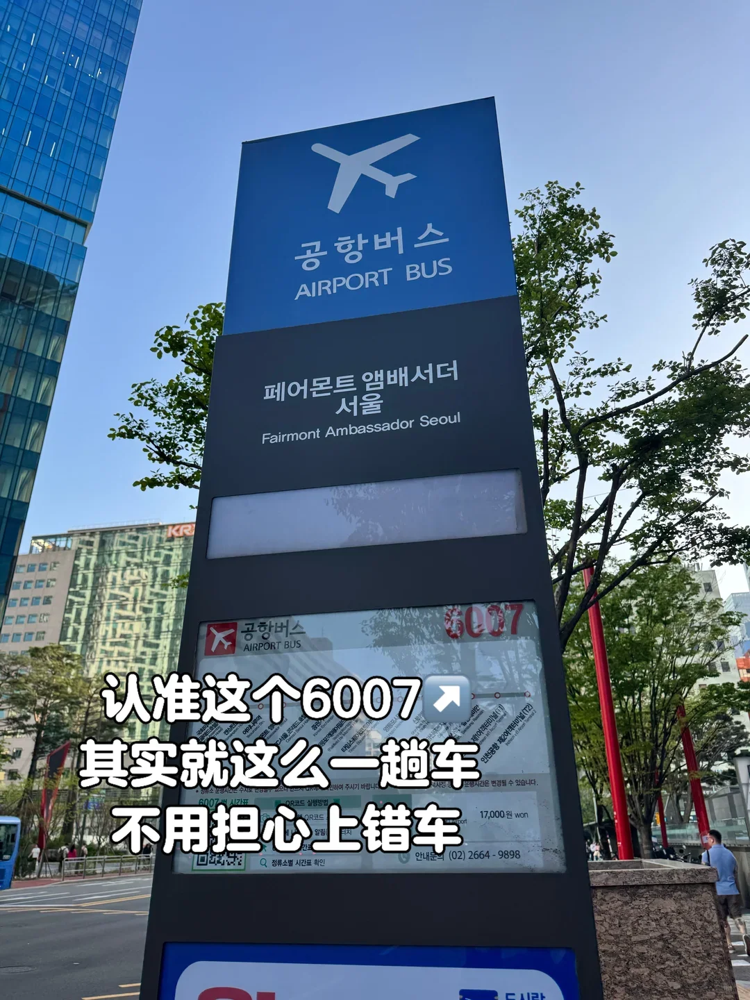

योइदो में ठहर रहे हों या एयरपोर्ट जाने से पहले डिपार्टमेंट स्टोर में सुबह बिता रहे हों, सबसे आसान विकल्प बस 6007 है: यह फेयरमोंट एंबेसडर सियोल के दरवाज़े से निकलती है, एक्सप्रेसवे से इंचियोन अंतरराष्ट्रीय एयरपोर्ट तक जाती है और रास्ते में सिर्फ़ कुछ होटलों पर रुकती है।

नीचे: स्टॉप कैसे खोजें, भुगतान कैसे करें, सामान कौन संभालता है, टाइमटेबल कहाँ देखें और एयरपोर्ट पर कितना समय बचाकर चलें। किराए और समय बदलते रहते हैं, इसलिए यात्रा से पहले स्टॉप और ऑपरेटर की जानकारी जाँच लें।

## 1. यह बस किसके लिए सही है

योइदो के होटल डिपार्टमेंट स्टोर और IFC टावरों के आसपास केंद्रित हैं, और इंचियोन तक मेट्रो का सफ़र आसान नहीं है: लाइन 5 या लाइन 9 से गिम्पो एयरपोर्ट, फिर AREX रेलवे, यानी दो बार गेट पार करने और दो बार सामान संभालने की झंझट।

बस 6007 इसे एक ही सफ़र बना देती है।

| विकल्प | अनुमानित समय | अनुमानित किराया | बदलाव |
| --- | --- | --- | --- |
| बस 6007 | लगभग 1 घंटा (व्यस्त समय में अधिक) | लगभग 17,000 वॉन | कोई नहीं |
| मेट्रो + हर स्टेशन पर रुकने वाली AREX | लगभग 1 घंटा 10 मिनट | लगभग 5,500 वॉन से | 1–2 |

यह किराए में सचमुच बड़ा अंतर है, लेकिन भारी बैग, बुज़ुर्ग रिश्तेदार या बच्चों के साथ, या सुबह की जल्दी वाली उड़ान हो तो सीधे सफ़र का यह खर्च बनता है। अगर बजट सीमित है और सिर्फ़ केबिन बैग है, तो मेट्रो और हर स्टेशन पर रुकने वाली AREX बेहतर हैं; देखें [इंचियोन एयरपोर्ट AREX गाइड](/blog/incheon-airport-arex-guide)।

पहले घड़ी देख लें: आखिरी 6007 होटल से 20:08 पर निकलती है, इसलिए देर रात उतरने वाले और तड़के की उड़ान वाले यात्री इसका इस्तेमाल नहीं कर सकते। ऐसे मामलों के लिए देखें [इंचियोन एयरपोर्ट लेट-नाइट बस गाइड](/blog/incheon-airport-late-night-bus-guide)।

## 2. स्टॉप: निकास 3 से बाहर, दो बार दाएँ

स्टॉप फेयरमोंट एंबेसडर सियोल के दरवाज़े पर है; होटल को नाम से खोजें।

डिपार्टमेंट स्टोर से ग्राउंड फ़्लोर पर निकास 3 खोजें: दरवाज़े से बाहर निकलकर दाएँ मुड़ें, फिर कोने पर दोबारा दाएँ मुड़ें, कोई सड़क पार नहीं करनी है, और होटल आपके सामने होगा। निकास 4 ज़्यादा पास है — उससे बाहर निकलकर दाएँ मुड़ें और लाल किनारी वाला टावर ठीक वहीं है, उसके दरवाज़े पर स्टॉप है: गहरे नीले रंग का बोर्ड, जिस पर 공항버스 / AIRPORT BUS और होटल का नाम लिखा है, और नीचे 6007 रूट तथा किराया दर्ज है।

साइन के पास सड़क के पेड़ों के नीचे पाँच-दस मिनट पहले से इंतज़ार करें; दूसरे यात्री भी आकर कतार में लग जाएँगे। साइन फ़ुटपाथ पर लगा है, इसलिए नीले एयरपोर्ट-बस पैनल को देखकर पहचानें।

IFC टावरों या योइदो स्टेशन से योइदो-देरो पर चलकर डिपार्टमेंट स्टोर तक और वहाँ से घूमकर होटल की तरफ़ जाएँ; नक्शे पर यह लंबा रास्ता लगता है, लेकिन दूरी सिर्फ़ 200–300 मीटर है।

## 3. बस में चढ़ना: टैप करें या भुगतान करें, और ड्राइवर सामान उठाता है

टी-मनी कार्ड या नकद से भुगतान करें। बस में आमतौर पर छुट्टे पैसे मिल जाते हैं, लेकिन 10,000 वॉन का नोट रखना आसान रहता है।

बस आने पर दरवाज़े की तरफ़ लपकें नहीं: ड्राइवर दरवाज़ा बंद रखता है और हर सूटकेस खुद ही सामान वाले हिस्से में रखता है, फिर यात्रियों को चढ़ने देता है। कतार में अपना सूटकेस अपने पास रखें और दरवाज़े का रास्ता खुला छोड़ें।

सीटें चौड़ी हैं और पीछे झुकती हैं, और एक्सप्रेसवे से पहले ड्राइवर सभी को सीट बेल्ट बाँधने की याद दिलाता है; बस पहले कुछ और होटलों पर भी रुकती है। सफ़र में लगभग एक घंटा लगता है, व्यस्त समय में इससे ज़्यादा।

सीटें आरक्षित नहीं होतीं — पसंद की सीट के लिए जल्दी चढ़ें — और सप्ताहांत तथा कोरियाई छुट्टियों में बस भर जाती है, इसलिए कतार में आगे की तरफ़ रहें। बच्चों के साथ हों तो आगे की सीट पर बैठें, उतरना आसान रहेगा।

## 4. प्रस्थान: पहली 04:38, आखिरी 20:08

स्टॉप पर लगा टाइमटेबल, जिसकी फ़ोटो अप्रैल 2025 में ली गई थी, 04:38 से 20:08 तक चलता है, दिन भर में लगभग हर 30–35 मिनट पर बस है।

| समय | प्रस्थान |
| --- | --- |
| तड़के | 04:38, 05:08, 05:38, 06:08 |
| सुबह | 06:38, 07:08, 07:43, 08:18, 08:58 |
| दोपहर | 09:38, 10:13, 10:48, 11:23, 11:58, 12:33 |
| दोपहर बाद | 13:08, 13:43, 14:18, 14:53, 15:28, 16:03, 16:38 |
| शाम की शुरुआत | 17:18, 17:58, 18:38 |
| शाम | 19:23, 20:08 |

ऑपरेटर समय में बदलाव करता रहता है, और छुट्टियों तथा ट्रैफ़िक के कारण बस कुछ मिनट देर से आ सकती है। स्टॉप पर लगे टाइमटेबल की फ़ोटो ले लें — वापसी के सफ़र में काम आएगा। सुबह की उड़ान के लिए 04:38 वाली बस T1 पर लगभग 05:40 बजे पहुँचती है, जिससे चेक-इन के लिए समय बच जाता है; इससे भी जल्दी जाना हो तो एयरपोर्ट के पास रात बितानी पड़ेगी या टैक्सी लेनी होगी।

## 5. एयरपोर्ट पर: पहले T1, फिर T2

बस पहले T1 और फिर T2 पर रुकती है। घोषणा सुनें या साइनबोर्ड देखें; अपना केबिन बैग अपने पास रखें, और ड्राइवर सूटकेस के लिए सामान वाला हिस्सा खोलता है, इसलिए उतरने की जल्दी नहीं है।

समय का हिसाब उल्टा कीजिए: एयरपोर्ट पर 2.5–3 घंटे, साथ में बस का एक घंटा और स्टॉप पर इंतज़ार, यानी योइदो से उड़ान के लगभग चार घंटे पहले निकलना होगा। सप्ताहांत और कोरियाई लंबे सप्ताहांत में एक्सप्रेसवे पर ज़्यादा समय लगता है।

T1 का प्रस्थान स्तर तीसरी मंज़िल है, जहाँ चेक-इन एयरलाइन के हिसाब से बँटा है और उसी मंज़िल पर ट्रॉली मिलती हैं। T2 अलग इमारत है, जिसका इस्तेमाल सिर्फ़ कुछ एयरलाइनें करती हैं, और आपकी बुकिंग में बताया होता है कि कौन-सा टर्मिनल है। गलत टर्मिनल पहुँचे तो शटल से जाना पड़ेगा, हर तरफ़ दस मिनट या ज़्यादा — कम समय वाले शेड्यूल के लिए यह भारी पड़ता है।

वापसी में वही बस उल्टे क्रम में चलती है: T1 या T2 के स्टैंड पर योइदो लिखा साइन खोजें और पहले ड्राइवर से गंतव्य की पुष्टि करें। टी-मनी चलता है, और ड्राइवर सामान फिर भी खुद संभालता है।

## संबंधित लिंक

- **इस साइट पर**: [इंचियोन अंतरराष्ट्रीय एयरपोर्ट (ICN)](/airport/ICN), [दक्षिण कोरिया (KR)](/country/KR)
- **और लेख**: [इंचियोन एयरपोर्ट AREX गाइड](/blog/incheon-airport-arex-guide), [इंचियोन एयरपोर्ट लेट-नाइट बस गाइड](/blog/incheon-airport-late-night-bus-guide)
- **विकिपीडिया**: [इंचियोन अंतरराष्ट्रीय एयरपोर्ट](https://en.wikipedia.org/wiki/Incheon_International_Airport)
- **बाइदू बाइके**: [इंचियोन अंतरराष्ट्रीय एयरपोर्ट](https://baike.baidu.com/item/%E4%BB%81%E5%B7%9D%E5%9B%BD%E9%99%85%E6%9C%BA%E5%9C%BA)

किराए और समय स्टॉप पर लगी जानकारी और ऑपरेटर के प्रकाशनों के अनुसार हैं (फ़ोटो अप्रैल 2025 में ली गई); जिस दिन यात्रा करें, उस दिन लागू जानकारी ही मान्य होगी। चित्र श्रेय: सार्वजनिक सामग्री से संकलित।
