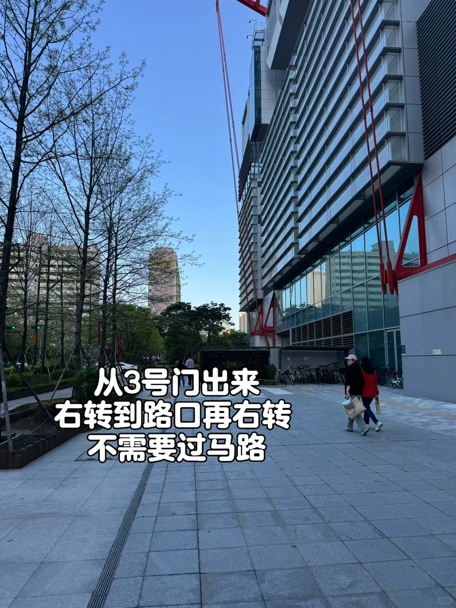

汝矣島に滞在している場合や、空港へ向かう前に百貨店で午前中を過ごす場合、最も簡単なのは6007番バスです。フェアモント・アンバサダー・ソウルの扉の前から出発し、高速道路で仁川国際空港へ向かい、途中でいくつかのホテルにしか停まりません。

以下では、停留所の見つけ方、支払い方法、荷物を誰が扱うか、時刻表の見方、空港でどれだけ時間を確保するかを説明します。運賃と時刻は変わるため、旅行前に停留所と運行会社で確認してください。

## 1. このバスが向いている人

汝矣島のホテルは百貨店とIFCタワーの周辺に集まっており、仁川までの地下鉄は気軽な移動とは言えません。5号線か9号線で金浦空港へ行き、そこからAREX鉄道に乗り換える必要があり、改札を2回通り、荷物も2回扱うことになります。

6007番バスなら、乗り換えなしの1回で済みます。

| 手段 | 所要時間の目安 | 運賃の目安 | 乗り換え |
| --- | --- | --- | --- |
| 6007番バス | 約1時間（ピーク時はより長い） | 約17,000ウォン | なし |
| 地下鉄＋各駅停車のAREX | 約1時間10分 | 約5,500ウォンから | 1〜2回 |

実際に運賃差はありますが、重い荷物がある場合、高齢の家族や子供と一緒の場合、あるいは早朝便の場合、乗り換えなしの移動には価値があります。予算が厳しく、機内持ち込み荷物だけなら、地下鉄と各駅停車のAREXが有利です。[仁川空港AREXガイド](/blog/incheon-airport-arex-guide)をご覧ください。

まず時計を確認してください。6007番の最終便はホテルを20:08に出るため、遅い時間の到着や未明の出発には使えません。その場合は[仁川空港の深夜バスガイド](/blog/incheon-airport-late-night-bus-guide)をご覧ください。

## 2. 停留所：3番出口を出て右へ2回

停留所はフェアモント・アンバサダー・ソウルの扉の前にあります。ホテル名で検索してください。

百貨店からは、1階の3番出口を探してください。扉を出て右へ曲がり、角でもう一度右へ曲がると、道路を渡らずにホテルが正面に見えます。4番出口のほうが近く、出口を出て右へ曲がると赤い縁取りのタワーがすぐそこにあります。停留所はその扉の前にあり、紺色の看板に「공항버스 / AIRPORT BUS」とホテル名、その下に6007番の路線と運賃が記されています。

看板の横、街路樹の下で5〜10分前に待ってください。他の旅客も次第に集まり、列を作ります。看板は歩道に立っているので、青い空港バスの表示を目印にしてください。

IFCタワーや汝矣島駅からは、汝矣大路を百貨店まで歩き、ホテル側へ回り込んでください。地図では遠回りに見えますが、わずか200〜300メートルです。

## 3. 乗車：タッチか現金、荷物は運転手が預かります

T-moneyカードまたは現金で支払います。車内で通常はお釣りが出ますが、10,000ウォン札を用意しておくと簡単です。

バスが到着しても、扉に殺到しないでください。運転手は扉を閉めたまま、スーツケースを1つずつ自分で荷物室に積み込み、それから旅客を乗せます。列ではスーツケースを手元に置き、出入口を空けておいてください。

座席は広く、リクライニングします。高速道路に入る前に運転手が全員にシートベルトの着用を促します。バスは最初にいくつかのホテルにも停まります。所要時間は約1時間で、ラッシュ時はさらに長くなります。

指定席はないので、選びたい場合は早めに乗車してください。週末や韓国の連休にはバスが満席になるため、列の前方に並びましょう。子供連れなら、降りやすいように前方の席に座ってください。

## 4. 出発時刻：始発04:38、最終20:08

停留所に掲示されている時刻表は2025年4月に撮影したもので、04:38から20:08まで、日中はおよそ30〜35分間隔です。

| 時間帯 | 出発時刻 |
| --- | --- |
| 早朝 | 04:38、05:08、05:38、06:08 |
| 午前 | 06:38、07:08、07:43、08:18、08:58 |
| 昼 | 09:38、10:13、10:48、11:23、11:58、12:33 |
| 午後 | 13:08、13:43、14:18、14:53、15:28、16:03、16:38 |
| 夕方 | 17:18、17:58、18:38 |
| 夜 | 19:23、20:08 |

運行会社は時刻を調整しており、休日や交通状況によって数分遅れることがあります。掲示されている時刻表を撮影しておくと、帰りの便で役立ちます。早朝便なら、04:38発はT1に5時40分ごろ到着するので、チェックインの時間を確保できます。それより早い便は、空港周辺での宿泊かタクシーが必要です。

## 5. 空港では：先にT1、次にT2

バスはT1、次にT2に停まります。車内アナウンスを聞くか、案内表示を確認してください。機内持ち込み荷物は手元に置いておき、スーツケースは運転手が荷物室を開けてくれます。急いで降りる必要はありません。

時間は逆算してください。空港で2.5〜3時間、バスで1時間、停留所での待ち時間を加えると、出発の約4時間前に汝矣島を出ることになります。週末や韓国の連休には高速道路がより混みます。

T1の出発階は3階で、チェックインは航空会社別に分かれ、カートも同じ階にあります。T2は別棟で一部の航空会社だけが使用しており、どちらかは予約確認書に記載されています。ターミナルを間違えるとシャトルバスで片道10分以上かかり、余裕のない日程では致命的です。

帰りは同じバスを逆に使います。T1またはT2の乗り場で、汝矣島と書かれた表示を探し、先に運転手へ行き先を確認してください。T-moneyが使え、荷物はやはり運転手が扱います。

## 関連リンク

- **このサイト内**：[仁川国際空港 (ICN)](/airport/ICN)、[韓国 (KR)](/country/KR)
- **関連記事**：[仁川空港AREXガイド](/blog/incheon-airport-arex-guide)、[仁川空港の深夜バスガイド](/blog/incheon-airport-late-night-bus-guide)
- **Wikipedia**：[仁川国際空港](https://en.wikipedia.org/wiki/Incheon_International_Airport)
- **百度百科**：[仁川国際空港](https://baike.baidu.com/item/%E4%BB%81%E5%B7%9D%E5%9B%BD%E9%99%85%E6%9C%BA%E5%9C%BA)

運賃と時刻は停留所の掲示情報と運行会社の公表資料（2025年4月撮影）によります。当日の案内が優先します。画像提供：公開資料から編集。
