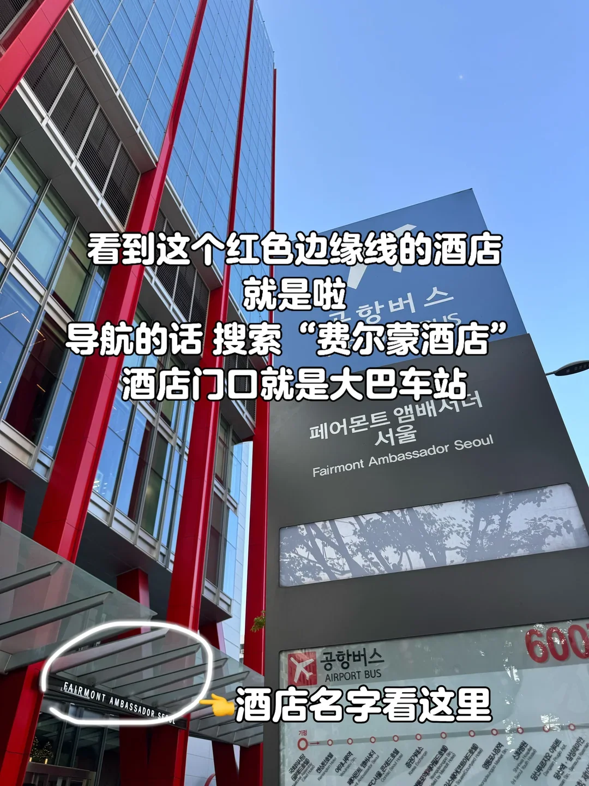

Ikiwa unakaa Yeouido, au unamaliza asubuhi kwenye duka kubwa kabla ya kwenda uwanja wa ndege, chaguo rahisi zaidi ni basi 6007: linaondoka mlangoni pa Fairmont Ambassador Seoul, linapita kwenye barabara kuu hadi Uwanja wa Ndege wa Kimataifa wa Incheon, na husimama tu kwenye hoteli chache nyingine njiani.

Hapa chini: jinsi ya kupata stendi, jinsi ya kulipa, nani anashughulikia mizigo, wapi kusoma ratiba na muda gani wa kuacha kwa ajili ya uwanja wa ndege. Nauli na nyakati hubadilika, hivyo angalia stendi na mwendeshaji kabla ya kusafiri.

## 1. Basi hili linafaa kwa nani

Hoteli za Yeouido zimejikita karibu na duka kubwa na minara ya IFC, na safari ya metro hadi Incheon si mchezo mwepesi: Mstari wa 5 au Mstari wa 9 hadi Uwanja wa Ndege wa Gimpo, kisha reli ya AREX, huku ukipitia malango mawili na kubeba mizigo mara mbili.

Basi 6007 hufanya safari yote iwe moja.

| Chaguo | Muda wa kumbukumbu | Nauli ya kumbukumbu | Mabadiliko |
| --- | --- | --- | --- |
| Basi 6007 | takriban saa 1 (ndefu zaidi wakati wa msongamano) | takriban 17,000 won | hakuna |
| Metro + AREX inayosimama kila kituo | takriban saa 1 dakika 10 | kuanzia takriban 5,500 won | 1–2 |

Huo ni tofauti halisi ya bei, lakini ukiwa na mizigo mizito, wazee wa familia au watoto, au ndege ya asubuhi na mapema, safari ya moja kwa moja inafaa. Ukiwa na bajeti ndogo na mizigo ya kubeba mkononi pekee, metro na AREX inayosimama kila kituo ndizo bora; ona [mwongozo wa AREX wa Uwanja wa Ndege wa Incheon](/blog/incheon-airport-arex-guide).

Angalia saa kwanza: basi la mwisho la 6007 linaondoka hotelini saa 20:08, hivyo ndege zinazotua usiku sana na safari zinazoondoka saa za usiku wa manane haziwezi kulitumia. Kwa hao, ona [mwongozo wa basi la usiku wa manane la Uwanja wa Ndege wa Incheon](/blog/incheon-airport-late-night-bus-guide).

## 2. Stendi: toka kwenye lango la 3, pinda kulia mara mbili

Stendi iko mlangoni pa Fairmont Ambassador Seoul; tafuta hoteli kwa jina lake.

Kutoka duka kubwa, tafuta lango la 3 kwenye ghorofa la chini: toka mlangoni, pinda kulia, kisha pinda kulia tena kwenye kona, bila kuvuka barabara yoyote, na hoteli iko mbele yako. Lango la 4 liko karibu zaidi — pinda kulia ukitoka ndani yake na mnara wenye ukingo mwekundu uko pale pale, na stendi iko mlangoni pake: rangi ya bluu iliyokolea, yenye herufi 공항버스 / AIRPORT BUS na jina la hoteli, na njia ya 6007 pamoja na nauli zimeandikwa chini.

Subiri chini ya miti ya mtaa kando ya bango, mapema kwa dakika tano au kumi; abiria wengine wataanza kufika na kujipanga kwenye foleni. Bango liko kwenye njia ya waenda kwa miguu, hivyo kibao cha bluu cha basi la uwanja wa ndege ndicho cha kutafuta.

Kutoka minara ya IFC au Kituo cha Yeouido, tembea juu ya Yeouido-daero hadi duka kubwa na kuzunguka kuelekea upande wa hoteli; kwenye ramani inaonekana kama mchepuko, lakini ni mita 200–300 tu.

## 3. Kupanda: gonga kadi au lipa, na dereva hubeba mizigo

Lipa kwa kadi ya T-money au kwa taslimu. Kawaida chenji inapatikana ndani ya basi, lakini noti ya 10,000 won hurahisisha zaidi.

Usikimbilie mlango basi linapofika: dereva huubakiza umefungwa na hupakia kila sanduku la mizigo kwenye sehemu ya mizigo mwenyewe, kisha huwaruhusu abiria kupanda. Weka sanduku lako kando yako kwenye foleni na uache mlango wazi.

Viti ni vipana na vinarejesha nyuma, na kabla ya kuingia barabara kuu dereva huwakumbusha wote kufunga mikanda; pia basi hupitia hoteli chache nyingine kwanza. Safari huchukua takriban saa moja, ndefu zaidi wakati wa msongamano wa magari.

Hakuna viti vilivyohifadhiwa — panda mapema ili upate chaguo — na mwisho wa wiki na wakati wa sikukuu za Korea basi hujaa, hivyo jipange kuelekea mbele ya foleni. Ukiwa na watoto, keti karibu na mbele ili kushuka kwa urahisi.

## 4. Kuondoka: 04:38 ya kwanza, 20:08 ya mwisho

Ratiba iliyowekwa kwenye stendi, iliyopigwa picha Aprili 2025, inaanzia 04:38 hadi 20:08, takriban kila dakika 30–35 kwa siku.

| Kipindi | Kuondoka |
| --- | --- |
| Asubuhi sana | 04:38, 05:08, 05:38, 06:08 |
| Asubuhi | 06:38, 07:08, 07:43, 08:18, 08:58 |
| Mchana | 09:38, 10:13, 10:48, 11:23, 11:58, 12:33 |
| Alasiri | 13:08, 13:43, 14:18, 14:53, 15:28, 16:03, 16:38 |
| Jioni mapema | 17:18, 17:58, 18:38 |
| Jioni | 19:23, 20:08 |

Mwendeshaji hurekebisha nyakati, na sikukuu pamoja na msongamano wa magari vinaweza kuchelewesha basi kwa dakika chache. Piga picha ratiba iliyowekwa — inafaa kwa safari ya kurudi. Kwa ndege ya asubuhi na mapema, basi la 04:38 hufika T1 karibu saa 05:40, jambo linaloacha nafasi ya kujisajili; chochote cha mapema zaidi kinamaanisha kulala karibu na uwanja wa ndege au kutumia teksi.

## 5. Uwanja wa ndege: T1 kwanza, kisha T2

Basi husimama T1, kisha T2. Sikiliza tangazo au angalia mabango; weka mizigo yako ya mkononi karibu nawe, na dereva hufungua sehemu ya mizigo kwa masanduku, hivyo hakuna haraka ya kushuka.

Hesabu muda kwa kurudi nyuma: saa 2.5–3 uwanjani, pamoja na saa moja kwenye basi na kusubiri stendi, inamaanisha kuondoka Yeouido takriban saa nne kabla ya safari. Mwisho wa wiki na wakati wa mapumziko marefu ya Korea barabara kuu huchukua muda mrefu zaidi.

Ngazi ya kuondokea ya T1 ni ghorofa la 3, huku kujisajili kukigawanywa kwa mashirika ya ndege na mikokoteni iko ghorofa hilo hilo. T2 ni jengo tofauti linalotumiwa na mashirika fulani pekee, na uhifadhi wako unaonyesha lipi. Kituo kisichofaa kinamaanisha kutumia basi la kuhamisha, dakika kumi au zaidi kila upande — janga ukiwa na muda mchache.

Safari ya kurudi ni basi hilo hilo kwa mwelekeo wa kinyume: kwenye stendi za T1 au T2, tafuta bango linalosomeka Yeouido na uthibitishe mwendo na dereva kwanza. T-money inatumika, na dereva bado anashughulikia mizigo.

## Viungo vinavyohusiana

- **Kwenye tovuti hii**: [Uwanja wa Ndege wa Kimataifa wa Incheon (ICN)](/airport/ICN), [Korea Kusini (KR)](/country/KR)
- **Makala zaidi**: [mwongozo wa AREX wa Uwanja wa Ndege wa Incheon](/blog/incheon-airport-arex-guide), [mwongozo wa basi la usiku wa manane la Uwanja wa Ndege wa Incheon](/blog/incheon-airport-late-night-bus-guide)
- **Wikipedia**: [Uwanja wa Ndege wa Kimataifa wa Incheon](https://en.wikipedia.org/wiki/Incheon_International_Airport)
- **Baidu Baike**: [Uwanja wa Ndege wa Kimataifa wa Incheon](https://baike.baidu.com/item/%E4%BB%81%E5%B7%9D%E5%9B%BD%E9%99%85%E6%9C%BA%E5%9C%BA)

Nauli na nyakati hufuata taarifa zilizowekwa stendi na machapisho ya mwendeshaji (zilipigwa picha Aprili 2025); kinachotumika siku husika ndicho chenye nguvu. Chanzo cha picha: zimekusanywa kutoka nyenzo za umma.
