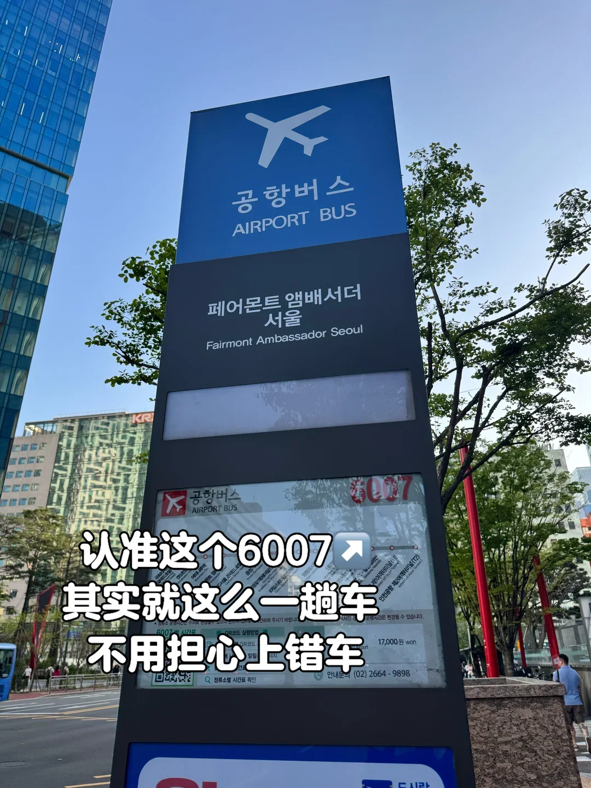
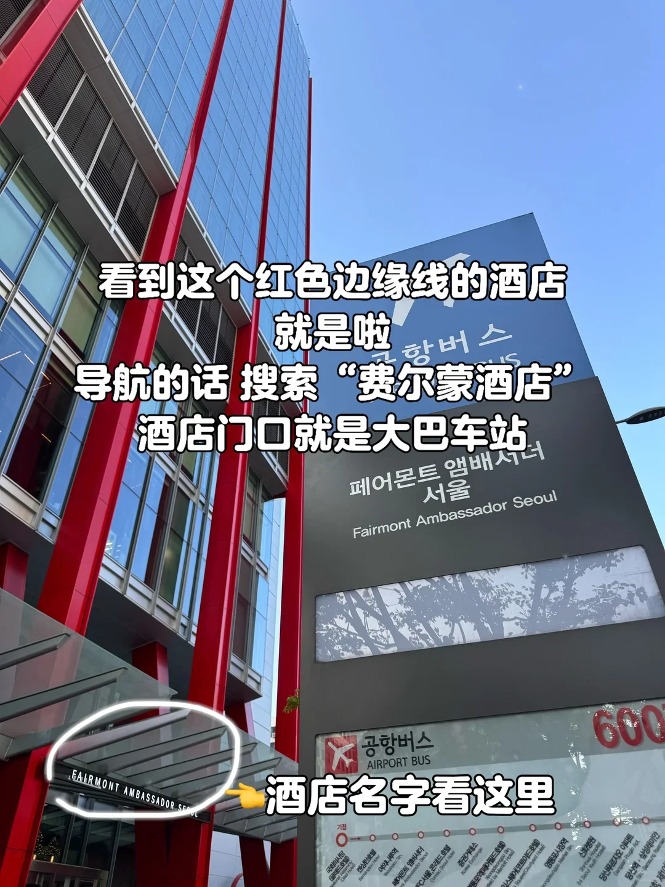
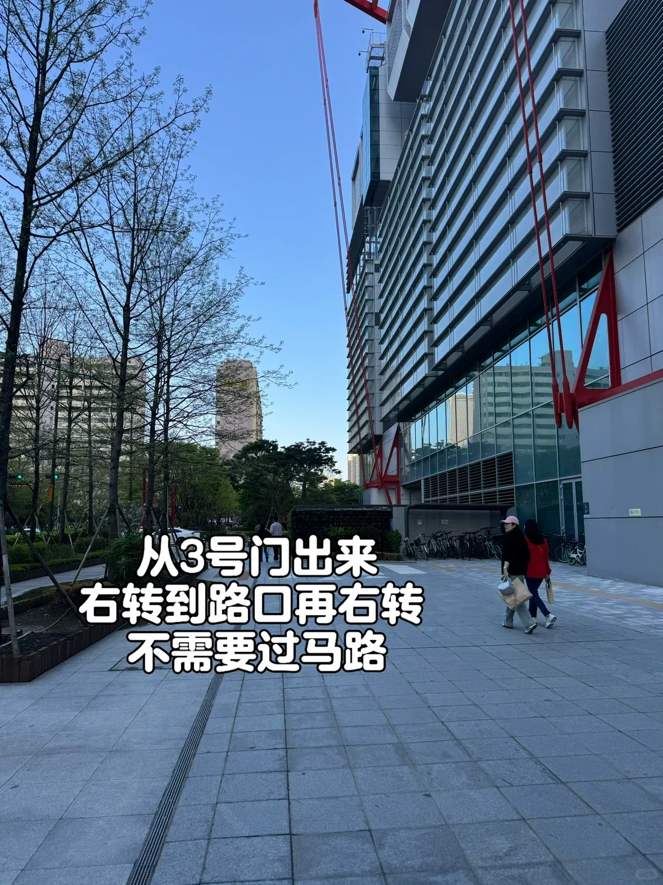
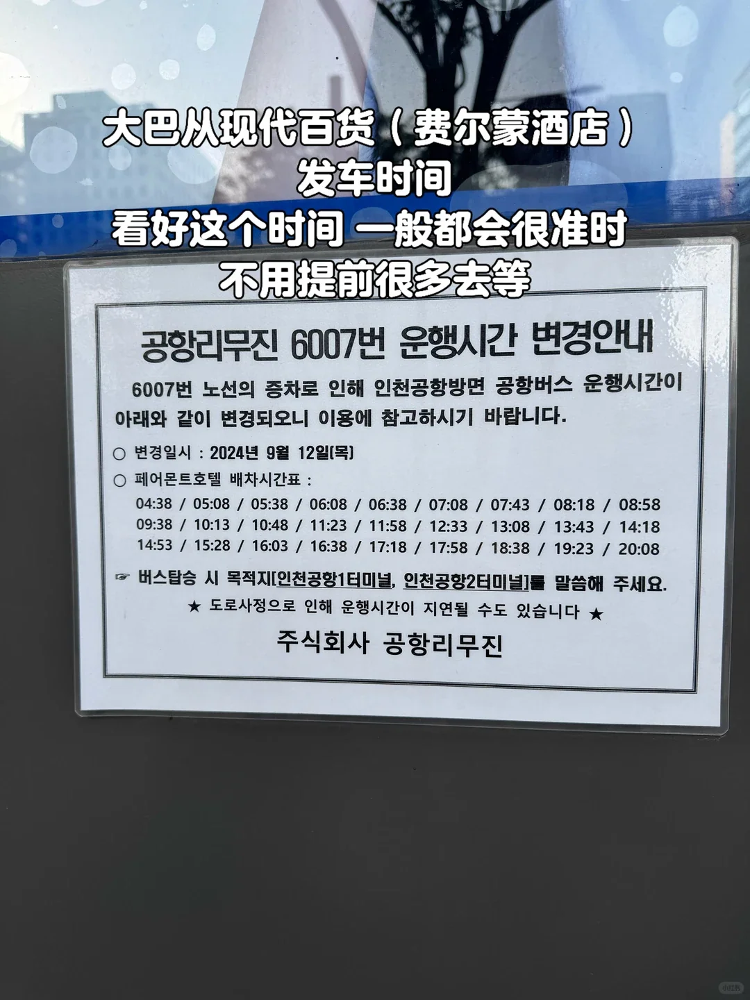

住在汝矣島（여의도），或者在現代百貨逛完直接去機場，最省力的一段路是 6007 路機場巴士：從費爾蒙大使酒店門口發車，走高速直達仁川國際機場，中途只在不同酒店接客，不用拖著箱子換地鐵。

這條線的車程約 1 小時，票價約 17,000 韓元，先到 T1 再到 T2。下面是上車點怎麼找、票怎麼付、行李誰搬、班次怎麼查，以及到機場之後的時間怎麼留。票價與時刻都可能調整，出發前以站牌和機場巴士運營方的資訊為準。

## 一、這條巴士適合誰

汝矣島的酒店集中在現代百貨、IFC 和漢江公園一帶，去仁川機場坐地鐵並不輕鬆：先坐 5 號線或 9 號線到金浦機場，再換 AREX 機場鐵路，兩次進出站、兩次搬行李。

6007 路把這段合成一程。對比一下：

| 方式 | 參考時間 | 參考費用 | 換乘 |
| --- | --- | --- | --- |
| 6007 機場巴士 | 約 1 小時（高峰期更久） | 約 17,000 韓元 | 0 次 |
| 地鐵 + AREX 普通車 | 約 1 小時 10 分鐘 | 約 5,500 韓元起 | 1–2 次 |

價格差得不小，但行李多、同行有老人小孩、或者趕早班機時，一程直達值這個錢。想省錢又只帶隨身行李，地鐵加 AREX 普通車更划算，線路細節見另一篇[《仁川機場 AREX 機場鐵路指南》](/tw/blog/incheon-airport-arex-guide)。

還要先看一眼時間：6007 的末班車 20:08 從酒店門口發車，深夜落地或凌晨起飛的航班用不上這條線，那個時段要看夜間巴士和計程車，見[《仁川機場深夜巴士指南》](/tw/blog/incheon-airport-late-night-bus-guide)。

## 二、上車點：3 號門出來，右轉兩次

巴士站在費爾蒙大使酒店（Fairmont Ambassador Seoul）門口，導航直接搜酒店名字最穩。

從現代百貨一樓走的話，找 3 號門：出門右轉，走到路口再右轉，不用過馬路，就能看到酒店。4 號門其實更近，出門右轉就能看到那棟帶紅色邊框的高樓，酒店門口就是站牌——深藍色，上面寫著「공항버스／AIRPORT BUS」和酒店名，下面貼著 6007 的路線圖、票價與時刻表。

站牌旁邊的行道樹下就能候車，提前五到十分鐘到即可，會陸續有其他旅客來排隊。站牌的位置在人行道邊，不在車道中間，看到「機場巴士」的藍色牌子就到了。

從 IFC 或汝矣島站方向過來，沿著汝矣大路走到現代百貨，再按上面的路線繞到酒店一側；地圖上看起來要繞一圈，實際只有兩三百米。

## 三、上車：刷卡或付現，行李司機來搬

車費可以刷 T-money，也可以付現金；沒有零錢也沒關係，司機一般會找零，但備好一萬韓元紙幣更省事。

車到站後不著急上車：司機會先關著車門，把每個人的行李箱逐個放進車廂下層的行李艙，全部放好之後才開門讓乘客上車。所以排隊時把箱子放在手邊，人往旁邊站一站，別堵在門口。

座位寬敞，靠背可以調，坐一路不算累。車開上高速之前，司機會提醒系安全帶；沿途還會在其他酒店停靠接客，之後才正式上高速。全程大約 1 小時，早晚高峰會更久一些。

機場巴士不對號入座，先上車先挑位置。週末、節假日和大型活動期間同一班車人多，排隊時靠前一點更穩妥；帶小孩的話儘量坐靠前的位置，下車也快。

## 四、發車時刻：首班 04:38，末班 20:08

站牌上貼著的時刻表（2025 年 4 月拍攝）顯示，從費爾蒙酒店發車的班次從清晨 04:38 開始，到晚上 20:08 結束，白天大致每 30–35 分鐘一班。下表按發車時段列出當時貼出的全部班次，實際以站牌為準。

| 時段 | 參考發車時刻 |
| --- | --- |
| 清晨 | 04:38、05:08、05:38、06:08 |
| 上午 | 06:38、07:08、07:43、08:18、08:58 |
| 午間 | 09:38、10:13、10:48、11:23、11:58、12:33 |
| 午後 | 13:08、13:43、14:18、14:53、15:28、16:03、16:38 |
| 傍晚 | 17:18、17:58、18:38 |
| 晚間 | 19:23、20:08 |

時刻表會隨運營方調整，節假日和路況也會讓車晚到幾分鐘。到站後先拍一張站牌上的時刻表，回程或改簽時能對上時間。趕早班機的人尤其要注意：首班 04:38 到 T1 大約 05:40，辦完值機還有富餘；如果航班更早，就只能前一晚住到機場附近，或者改坐計程車。

## 五、到機場：先 T1，後 T2

巴士先停 T1，再停 T2，下車前聽清廣播或看窗外的航廈指示。隨身行李自己帶下車，大箱子在行李艙裡，司機會開門讓大家取，別急著走。

時間要倒著算：國際航班建議提前 2.5–3 小時到機場，加上約 1 小時車程和等車時間，從汝矣島出發最好在起飛前 4 小時上車。旺季、週末和韓國連休，高速上的時間會更長。

到了 T1，出發層在 3 樓，值機櫃臺按航空公司分割槽，手推車和行李打包處也在這一層；T2 是另一棟樓，只有部分航司使用，訂票資訊裡會寫明。走錯航廈要坐機場內的接駁車，往返十幾分鍾，趕時間的話很致命。

回程是反過來的同一路車：在 T1 或 T2 的機場巴士站臺找寫有「汝矣島」的站牌，上車前跟司機確認終點，別坐上開往其他區的機場巴士。回程同樣可以刷 T-money，行李還是司機代放。

## 相關連結

- **本站頁面**：[仁川國際機場（ICN）](/tw/airport/ICN)、[韓國（KR）](/tw/country/KR)
- **相關文章**：[仁川機場 AREX 機場鐵路指南](/tw/blog/incheon-airport-arex-guide)、[仁川機場深夜巴士指南](/tw/blog/incheon-airport-late-night-bus-guide)
- **維基百科**：[仁川國際機場](https://zh.wikipedia.org/wiki/%E4%BB%81%E5%B7%9D%E5%9B%BD%E9%99%85%E6%9C%BA%E5%9C%BA)

票價與時刻參考站牌與機場巴士運營方公佈的資訊（拍攝於 2025 年 4 月），實際以當日為準。圖片來源：文中圖片為公開資料整理。
